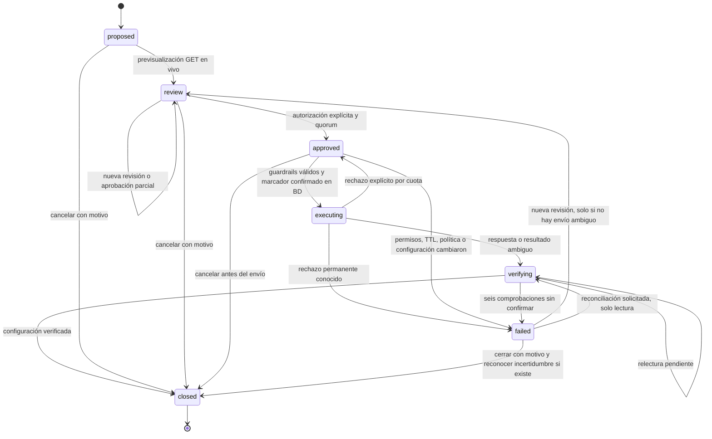

# Action Center: operaciones aprobadas sobre Meta

Implementación F5 del 2026-10-26. Interfaz `/acciones`, contratos en `src/action-contracts.ts`, servicio, gateway y ejecutor en `src/modules/optimization/`. Migraciones `0011_action_center.sql` y `0012_action_center_rls.sql`.

## 1. Alcance y activación

El Action Center convierte recomendaciones **aceptadas** en propuestas de cambio. Aceptar una recomendación, generar una con IA o registrar una regla no ejecuta operaciones. Cada envío necesita revisión en vivo, autorización explícita del diff y el quorum de personas autorizadas.

Las escrituras están desactivadas por defecto en dos niveles:

1. `META_WRITES_ENABLED=false` en API y worker. Habilitarlo exige configurar explícitamente el entorno; el despliegue de este código no lo habilita.
2. Política por cuenta con `enabled=false` por defecto, solo `pause` como operación inicialmente permitida y límites presupuestarios en cero. Un owner/admin guarda reglas, motivo y autorización de cuenta; cada cambio genera una versión nueva que invalida revisiones anteriores, incluso si los valores vuelven a ser los mismos.

Además se exigen conexión activa para la app configurada, consentimiento contractual `write_status` o `write_budget`, tenant/cliente activos y permisos vigentes en Meta. El token se descifra solo en el servidor, con AAD de su conexión, y no aparece en respuestas ni en el payload de la cola.

La implementación se ha probado con Graph simulado. No se ejecutaron escrituras en cuentas reales. La prueba de sandbox y el piloto requieren cuentas, acceso y autorización para esa prueba concreta, conforme a [TESTING](TESTING.md#9-pruebas-manuales-autorizadas).

## 2. Estados

Una acción verificada se cierra automáticamente con resultado `verified`. `already_current` indica que, antes del envío, la configuración ya coincidía exactamente con la intención: no hubo POST y no se atribuye el cambio al sistema. `cancelled`, `blocked`, `rejected`, `unknown` y `abandoned_unknown` distinguen otros resultados.

Una acción fallida mantiene el bloqueo de su objeto hasta que se revisa, reconcilia o cierra explícitamente. No se puede cerrar durante ejecución/verificación. Una reversión es **otra propuesta**, ligada por `rollbackOf`, con su propia revisión y aprobaciones.

## 3. Operaciones soportadas

| Operación | Entidades | Restricciones |
|---|---|---|
| Pausar | Campaña, conjunto, anuncio | Solo entidades configuradas ACTIVE/PAUSED; destino absoluto `status=PAUSED` |
| Activar | Campaña, conjunto, anuncio | `status=ACTIVE`, dos aprobadores; presupuesto de entrega conocido dentro del máximo. No activa a sus padres |
| Cambiar presupuesto diario | Campaña o conjunto | Presupuesto diario propio ya existente, sin convertir a total; no anuncios; no presupuesto programado; no conjunto cuyo presupuesto controla la campaña |
| Cambiar presupuesto total | Campaña o conjunto | Modo total propio ya existente y fecha de fin futura; mismas restricciones anteriores |

Se envía un único campo permitido por `POST /v26.0/{id}`; nunca rutas o parámetros arbitrarios del cliente. El SDK oficial de Meta declara `status`, `daily_budget` y `lifetime_budget` para actualización de [Campaign](https://github.com/facebook/facebook-python-business-sdk/blob/main/facebook_business/adobjects/campaign.py) y [AdSet](https://github.com/facebook/facebook-python-business-sdk/blob/main/facebook_business/adobjects/adset.py), y `status` para [Ad](https://github.com/facebook/facebook-python-business-sdk/blob/main/facebook_business/adobjects/ad.py). Son referencias de contrato, no garantías de elegibilidad de toda entidad. Las páginas de referencia de developers.facebook.com devolvieron error/429 al consultarlas; los campos se contrastaron con las fuentes oficiales del SDK y el cliente local v26.

No se soportan eliminación, archivo, creación, edición de creatividades o audiencias, pujas, cambio de modo presupuestario ni restauración de entidades eliminadas. Meta conserva la última palabra sobre mínimos, presupuesto ya consumido, restricciones del objetivo y otras reglas dinámicas: un rechazo queda registrado y no se interpreta como aplicación parcial exitosa.

## 4. Revisión, permisos y límites

La previsualización hace solo GET: verifica el token con `debug_token`, `ads_management`, app, caducidad, `user_tasks` ADVERTISE/MANAGE, cuenta activa, identidad y pertenencia real de la entidad y de sus padres. Lee estado configurado y efectivo, presupuesto diario/total, programación, padres, fecha final, moneda y zona horaria. Se compara la configuración relevante; no se conserva una copia de todos los campos publicitarios.

El diff muestra valor anterior, valor absoluto propuesto, porcentaje, advertencias, quorum, huella y caducidad de 15 minutos. Antes de aprobar se vuelve a leer Meta; antes de enviar se repiten permisos locales, consentimiento, configuración en vivo, reglas y aprobaciones. Un cambio relevante obliga a nueva revisión. El estado efectivo se guarda y muestra pero no invalida la huella de configuración porque puede cambiar asíncronamente por la revisión de Meta.

| Rol | Facultades |
|---|---|
| Viewer | Ver acciones y bitácora dentro de sus clientes |
| Analyst | Proponer y previsualizar dentro de su alcance |
| Manager | Lo anterior, aceptar recomendaciones, aprobar estados y cerrar/reconciliar acciones de sus clientes. No aprueba presupuesto |
| Owner/admin | Lo anterior, aprobar presupuestos y configurar reglas/kill switch por cuenta |

**Nadie aprueba su propia propuesta.** Las activaciones requieren dos personas distintas del proponente. Los presupuestos requieren dos cuando su cambio porcentual alcanza el umbral configurado (10 % por defecto); por debajo, una. Pausar exige una. Las aprobaciones son únicas por acción, persona y huella; repetir una no aumenta el quorum. La autorización incluye `authorize=true`, motivo, revisión y hash exacto. En el worker se comprueban de nuevo las membresías, roles y alcance de los aprobadores y del proponente.

Los límites configurables son máximo absoluto por presupuesto, cambio porcentual por acción (20 % por defecto), cambio acumulado absoluto por objeto en 24 h (30 %), aumentos presupuestarios acumulados por cuenta en 24 h y ventana horaria en la zona de la cuenta. Diario y total usan unidades menores enteras de la moneda, sin convertir divisas. Las ventanas móviles acumulan cambios configurados, **no son un límite del gasto real facturado**.

Además se aplica un intervalo de 30 segundos entre ediciones del mismo objeto y un máximo conservador de cuatro cambios presupuestarios por objeto/hora. Las reservas de envíos de resultado desconocido también consumen límites para evitar eludirlos con fallos. El gobernador compartido protege cuotas por app/cuenta; los errores tipificados por Meta pueden imponer esperas adicionales.

## 5. Cola, duplicados y concurrencia

- La creación tiene clave UUID de idempotencia y hash canónico del contenido. La misma clave/contenido devuelve la acción existente; contenido distinto da conflicto. Hay unicidad por recomendación, por reversión original y por objeto pendiente. Cerrar no permite volver a convertir la misma recomendación; los bloqueos sin envío se revisan en la misma acción.
- Cada aprobación se ata a una versión del diff. Las bitácoras y aprobaciones son de solo inserción, con RLS forzado, FK compuestas y revocación de UPDATE/DELETE/TRUNCATE a `app_rw`. Triggers impiden modificar/borrar el historial. El propietario de BD conserva DDL para mantenimiento; esto no es almacenamiento WORM frente a un DBA.
- `jobs` solo contiene `actionId`. La transición aprobada y su trabajo se confirman en una transacción. La clave de cola incluye revisión para no perder un despertar si un trabajo anterior está terminando. Los duplicados tardíos leen el estado durable y no vuelven a enviar.
- La cola existente reclama con `FOR UPDATE SKIP LOCKED` y lease. El ejecutor retiene un advisory lock de la cuenta Meta durante todo el I/O y usa bloqueos de fila/revisión para las transiciones. Así serializa ejecuciones incluso si dos tenants usan la misma cuenta Meta.
- Una transacción separada confirma estado `executing`, timestamp de envío, reserva y evento `dispatch` **antes** de hacer el POST. Tras caída de proceso, timeout, respuesta malformada o error transitorio ambiguo, ese marcador solo permite GET y reconciliación.
- No se afirma exactly-once remoto. No hay transacción distribuida ni compare-and-swap con Ads Manager. Otro editor externo aún puede actuar entre GET y POST; el cierre posterior de esa carrera requeriría soporte remoto. Las asignaciones absolutas y la abstención ante ambigüedad reducen el riesgo sin inventar una garantía.

Solo un rechazo explícito reconocido como cuota/límite (p. ej. 613/4841018 o 613/1487632) permite reprogramar el envío previamente autorizado en cola, tras su espera, siempre que siga vigente el diff. Si su TTL caduca se necesita revisión humana nueva. El worker no hace reintentos ciegos de incrementos ni de escrituras con resultado desconocido.

## 6. Verificación y reconciliación

Una respuesta `success=true` no basta: se relee Meta. Coincidir en el campo configurado cierra con evidencia anterior/posterior; se muestra además el estado efectivo. `ACTIVE` configurado no garantiza entrega: puede haber padres pausados, revisión o restricciones de Meta.

Si no coincide o no se puede leer, se reprograman lecturas cada 30 segundos, hasta seis comprobaciones. Después queda `failed/unknown`, sin nuevo POST. Un usuario autorizado puede pedir reconciliación por lectura. Esto funciona con el kill switch activo; exige consentimiento de lectura y una conexión con acceso de lectura vigente. Si se revoca todo el acceso, la acción queda sin confirmar hasta recuperarlo o cerrar explícitamente reconociendo la incertidumbre.

La bitácora guarda propuesta, revisión, aprobaciones, reserva, respuesta/ambigüedad, lecturas, bloqueo y cierre. No almacena tokens ni respuestas crudas de errores Graph. Cada evento de acción también se refleja en `audit_log`.

## 7. Rollback y efectos no reversibles

Se permite proponer la inversa solo para una acción cerrada, confirmada por Meta y verificada. Se lee la configuración actual y se exige que coincida con la instantánea posterior de la acción original. Si cambió, se bloquea; no se sobrescribe un ajuste de otra persona. Una escritura reconciliada tras timeout sin acuse confirmado no habilita rollback automático.

La inversa restaura el valor original **si sigue siendo válido**. Pasa por los mismos consentimientos, límites, ventana, cooldown, diff y aprobaciones. Un presupuesto total original que ya quedó por debajo del gasto consumido puede ser rechazado; un calendario vencido o cambio de tipo presupuestario impide la reversión. Una pausa revertida es activación y por ello exige dos aprobadores y máximo presupuestario explícito.

No se pueden revertir gasto ya realizado, facturación, subastas perdidas, leads no recibidos, efectos sobre el aprendizaje, revisión o reputación del anuncio ni resultados comerciales. Revertir configuración no restaura el pasado. No se implementan compensaciones automáticas sobre entidades distintas ni un rollback masivo.

## 8. API y operación

| Ruta | Función |
|---|---|
| GET /v1/actions | Últimas 100 acciones visibles, filtro opcional por cuenta |
| POST /v1/actions | Propuesta desde recomendación aceptada |
| GET /v1/actions/:id | Estado, diff, aprobaciones y resultado |
| GET /v1/actions/:id/events | Evidencia de solo lectura |
| POST /v1/actions/:id/preview | Revisión en vivo con control de revisión |
| POST /v1/actions/:id/approve | Aprobar diff exacto con autorización explícita |
| POST /v1/actions/:id/close | Cerrar/cancelar con motivo; reconocimiento adicional si hay incertidumbre |
| POST /v1/actions/:id/reconcile | Solicitar relectura, sin reenvío |
| POST /v1/actions/:id/rollback | Proponer la inversa; nunca ejecutarla inmediatamente |
| GET/PUT /v1/action-policies/:id | Leer/configurar reglas de la cuenta |

El tick HTTP y `pnpm dev:worker` incorporan `action_execute`; no hace falta otra cola o proceso. Para contener un incidente: deshabilitar la cuenta con el botón de bloqueo, deshabilitar `META_WRITES_ENABLED` en API/worker y revisar envíos con marcador. No se puede retirar un HTTP ya enviado; su resultado se sigue reconciliando. Nunca editar la bitácora para ocultar un fallo.

## 9. Validación y límites pendientes

Pruebas nuevas: `src/modules/optimization/model.test.ts` (5) y `test/actions.test.ts` (14), con `test/fake-actions.ts` como Graph local inyectado. Cubren recorrido completo, importes absolutos, dos aprobadores, idempotencia, huellas jsonb, caducidad, versiones de política, kill switches, consentimiento/roles/scopes revocados, drift, límites, timeout aplicado/no aplicado, 613, concurrencia, recuperación de marcador, rollback completo y aislamiento entre tenants/clientes. La suite existente prueba RLS y arquitectura, incluida la frontera que impide a la IA llegar al ejecutor.

Validación visual con respuestas sintéticas de la API: diff de presupuesto, bloqueo del botón sin autorización explícita, envío del hash/revisión correctos, primera aprobación 1/2, bitácora y políticas en escritorio y móvil. No sustituye una prueba de sesión Google ni de sandbox.

En una repetición de la suite se observó una cuenta no descubierta en el test de sincronización existente. No se reprodujo al aislarlo ni en las siguientes ejecuciones completas; se añadió diagnóstico del estado de trabajos y sincronizaciones para un eventual reingreso. No se atribuye una causa ni se declara corregido un fallo de producción sin reproducirlo.

Quedan fuera de este alcance la reautenticación reforzada para cada aprobación, webhooks de cambios externos, ejecución por reglas automáticas, ventanas que crucen medianoche, lotes atómicos y validación de impacto causal. Toda ejecución implementada es manualmente autorizada; la IA conserva herramientas de solo lectura. Los límites dinámicos del proveedor se manejan por rechazo/reconciliación y deben comprobarse en el sandbox antes de habilitar una cuenta real.
