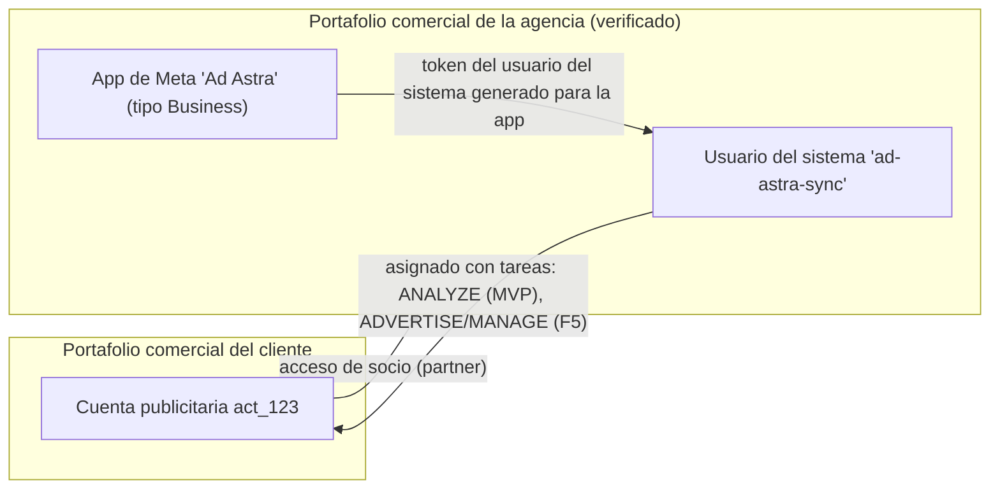

# Integraciones externas — Ad Astra

> Versión 0.1 · 2026-10-23. Los hechos marcados como **[V]** se verificaron en documentación oficial en esa fecha (fuentes en §5). Los marcados como **[S]** proceden de fuentes secundarias y deben confirmarse. Los marcados como **[F0]** se resuelven en el spike (lista en §1.20).

## 1. Meta Graph / Marketing API

### 1.1 Versión objetivo y ciclo de vida

| Versión | Publicación | Disponible hasta | Uso en Ad Astra |
|---|---|---|---|
| **v26.0** | 2026-07-29 | Por determinar | **Objetivo** desde F0 [V] |
| v25.0 | 2026-02-18 | 2027-02-23 | Respaldo si v26 bloquea algo [V] |
| v24.0 | 2025-10-08 | 2026-11-10 según el changelog de Marketing API; 2026-10-06 según la página general de versiones | No usar [V] |
| v21.0–v23.0 | 2024–2025 | Expiradas en Marketing API | No usar (los repositorios candidatos que fijan v21 están fuera de soporte) [V] |

- Las versiones de Marketing API duran unos 12 meses (menos que las de Graph API). Meta publica además **cambios fuera de ciclo** cada dos semanas y los refleja en las specs de GitHub (`facebook/facebook-business-sdk-codegen/api_specs`) [V].
- Cambios de v26 relevantes [V]: eliminados `daily_outcomes_curve`, `budget_guardrail` y `estimate_dau` de las estimaciones de entrega; los conjuntos nuevos o copiados con categorías especiales (vivienda, empleo, crédito) deben fijar `advantage_audience` explícitamente; eliminada la ubicación Instagram Explore; bloqueada la creación de anuncios de encuesta; `web_only` de `applink_treatment` no permitido en campañas de conversión; eliminados los comportamientos heredados `pretty`, `debug`, `date_format`, `GET /?ids=` y `ETag` (en todas las versiones desde el 2026-10-27).
- Advantage+ [V]: desde v25 no se pueden crear campañas ASC/AAC heredadas en ninguna versión; desde v26 las heredadas quedan bloqueadas para edición. Las campañas Advantage+ se identifican con `advantage_state_info.advantage_state` (`ADVANTAGE_PLUS_SALES`, `_APP`, `_LEADS` o `DISABLED`) y `smart_promotion_type`.

**Política:** la versión vive en una sola constante (`META_API_VERSION`). Cada versión nueva abre una tarea de actualización con: lectura del changelog, regeneración del snapshot de specs, tests de contrato y un sync en staging. Se registra la versión usada en cada `sync_run` (requisito RQ-1.7).

### 1.2 Modelo de acceso para una agencia



1. El cliente comparte su cuenta publicitaria con el portafolio comercial de la agencia como socio.
2. La agencia asigna la cuenta a su **usuario del sistema** con la tarea mínima necesaria: análisis para el MVP; anunciar o gestionar en F5.
3. Se genera un token del usuario del sistema para la app de Ad Astra con los permisos mínimos (`ads_read` en el MVP; `business_management` solo si el inventario por portafolio lo requiere [F0]).
4. Ad Astra guarda el token cifrado y registra el **consentimiento del cliente** (quién, cuándo, alcance), independiente del permiso técnico.

Tiers de usuarios del sistema [V]: con *Limited access*, 1 usuario del sistema y 1 administrador; con *Full access*, 10 y 1. El servidor MCP oficial solo admite usuarios del sistema con rol *Employee*.

**SaaS (F7):** Facebook Login for Business con *configuration ID*, que permite al cliente autorizar desde su propio portafolio y emite tokens de usuario del sistema de integración de negocio. Las acciones con tokens de usuario del sistema no quedan vinculadas a una persona real [V]; por eso Ad Astra registra siempre al aprobador humano en su propio registro de auditoría.

### 1.3 Permisos, App Review y niveles de acceso

| Necesidad | Requisito [V] | Fase |
|---|---|---|
| Leer cuentas propias de la agencia | *Standard access* a `ads_read` (aprobación automática en apps Business) | F0 |
| Leer cuentas de clientes (otros negocios) | *Advanced access* a `ads_read` mediante App Review; verificación del negocio si se accede a datos sensibles | F1 (trámite desde F0) |
| Escribir en cuentas de clientes | *Advanced access* a `ads_management` | F5 |
| Cuotas de producción | **Marketing API Access Tier: Full access.** El nivel por defecto (*Limited*) está fuertemente limitado y es solo para desarrollo | F1 |
| Pasar a Full access | ≥ 500 llamadas en 15 días y < 15 % de errores en las últimas 500; se pide con **+Upgrade** en el panel de la app tras la revisión | F0–F1 |
| Calidad de dataset (EMQ) | Usuario o usuario del sistema con acceso parcial "usar dataset de eventos"; app con `ads_read` + (`ads_management` o `business_management`); el nivel avanzado exige `ads_management` avanzado + Access Tier | F3 |

> Riesgo principal de la ruta crítica (RSK-01). Mientras tanto se desarrolla con cuentas propias, la cuenta sandbox (si existe, V-06) y datos sintéticos. V-01 resuelve si las cuentas de socio funcionan ya en *Limited*.

### 1.4 Tokens

| Tipo | Duración [V] | Uso en Ad Astra |
|---|---|---|
| Usuario, corta duración | 1–2 horas | Nunca se almacena |
| Usuario, larga duración | ~60 días | Solo como alternativa temporal; alerta 14 días antes de expirar |
| **Usuario del sistema** | No expira (puede invalidarse) | **MVP: tipo recomendado por Meta para servidor a servidor** |
| Integración de negocio (FLfB) | Según la configuración | F7 |

- **Alta:** campo de solo escritura en la UI → `debug_token` → se valida que `app_id` coincida con nuestra app, el tipo y los scopes mínimos → se cifra (ver [SECURITY.md §4.4](SECURITY.md#44-secretos-y-credenciales)) → nunca se devuelve ni se registra; solo una huella corta (8 caracteres de un SHA-256) para soporte.
- **Validación diaria** (`token_validation`): `debug_token` + una lectura mínima. Si falla con 190 o 102, la conexión pasa a `invalid`, se abre una alerta crítica y se detienen sus jobs.
- **Rotación:** alta del token nuevo como versión de la misma conexión → validación → activación → borrado del cifrado anterior.
- **Invalidaciones conocidas:** el administrador retira el usuario del sistema o sus activos, se revocan permisos o se rota el app secret (el alcance de la invalidación al rotar el secret se verifica en F0).

### 1.5 Seguridad de las llamadas

- **`appsecret_proof`** en todas las llamadas: HMAC-SHA256 del token con el app secret como clave [V]. Se activa **Require App Secret** en el panel de la app para que un token robado no sirva sin el secret [V].
- Opcional: *Server Allow List* (IPs de salida permitidas) si el hosting ofrece IP fija [V]. En Vercel las IP de salida son dinámicas y la lista exige su opción de IPs estáticas (ADR-022): no se usa en el MVP.
- **Token fuera de la URL:** el cliente lo envía siempre en `Authorization: Bearer <token>` (V-02, confirmado en el spike), nunca en la URL ni en el cuerpo de un POST; en la URL solo va el `appsecret_proof`. La redacción de URLs se mantiene como defensa en profundidad. Los errores de red de las librerías HTTP pueden incluir la URL completa: el cliente nunca registra `error.message` sin pasarlo por la redacción [S, lección documentada por arcbaslow].
- TLS 1.2+ y tiempos de espera explícitos: 30 s en lecturas síncronas, 120 s en subidas; los trabajos asíncronos se consultan por sondeo.
- **SDK oficial:** no se usa (ADR-004). Si se usara, habría que desactivar el informe automático de errores (`crash_log`), que envía trazas a Meta [S].

### 1.6 Endpoints por fase

| Endpoint | Método | Uso | Fase | Requisito |
|---|---|---|---|---|
| `/debug_token?input_token=…` | GET | Validar app, tipo, scopes y expiración | F0–F1 | Token de app |
| `/me/adaccounts` | GET | Cuentas asignadas al usuario del sistema | F0–F1 | `ads_read` |
| `/{business_id}/owned_ad_accounts`, `/{business_id}/client_ad_accounts` | GET | Inventario por portafolio [F0] | F1 | `business_management` |
| `/act_{id}` | GET | Moneda, zona horaria, estado, `user_tasks`, `spend_cap`, `amount_spent` | F1 | `ads_read` |
| `/act_{id}/campaigns`, `/adsets`, `/ads`, `/adcreatives` | GET | Catálogo de entidades | F1 | `ads_read` |
| `/act_{id}/insights` | GET (síncrono) | Ventanas cortas (hoy y ayer) | F1 | `ads_read` |
| `/act_{id}/insights` | POST (asíncrono) | Reexpresión de 28 días, backfill | F1 | `ads_read` |
| `/{report_run_id}` y `/{report_run_id}/insights` | GET | Estado y resultados del job asíncrono | F1 | `ads_read` |
| `/act_{id}/activities` | GET | Registro de cambios (1 semana por defecto [V]) | F1 | `ads_read` [F0] |
| `/` con `batch=[…]` | POST | Hasta 50 peticiones por lote | F1 | — |
| `/act_{id}/insights` con `breakdowns` | GET | Desgloses en vivo con caché | F2 | `ads_read` |
| `/{pixel_id}/stats`, `/dataset_quality?dataset_id=…` | GET | Salud de eventos, cobertura de CAPI, EMQ | F3 | Ver §1.3 |
| `/{campaign_id}`, `/{adset_id}`, `/{ad_id}` | POST | Estado y presupuesto (aprobados) | F5 | `ads_management` avanzado + tarea en la cuenta |
| Suscripción de la app a `ad_account` y conexión de cuentas | POST | Webhooks | F5 | [F0, V-13] |

### 1.7 Campos solicitados en el MVP

Verificados contra las specs oficiales el 2026-10-23. Un test de contrato falla si se pide un campo que no existe en el snapshot de la versión fijada.

| Objeto | Campos |
|---|---|
| AdAccount | `id, account_id, name, currency, timezone_name, timezone_offset_hours_utc, account_status, disable_reason, amount_spent, spend_cap, business{id,name}, user_tasks, created_time` |
| Campaign | `id, name, objective, status, effective_status, configured_status, buying_type, bid_strategy, daily_budget, lifetime_budget, budget_remaining, is_adset_budget_sharing_enabled, special_ad_categories, advantage_state_info, smart_promotion_type, start_time, stop_time, created_time, updated_time` |
| AdSet | `id, name, campaign_id, status, effective_status, configured_status, optimization_goal, billing_event, bid_strategy, bid_amount, daily_budget, lifetime_budget, budget_remaining, destination_type, promoted_object, attribution_spec, learning_stage_info, issues_info, targeting` (subcampos acotados, incluido `targeting_automation`, que no es un campo de primer nivel), `daily_min_spend_target, daily_spend_cap, start_time, end_time, created_time, updated_time` |
| Ad | `id, name, adset_id, campaign_id, status, effective_status, configured_status, creative{id}, issues_info, ad_review_feedback, failed_delivery_checks, created_time, updated_time` |
| AdCreative | `id, name, object_type, title, body, call_to_action_type, url_tags, thumbnail_url` (+ `object_story_spec` y `asset_feed_spec` acotados) |
| AdActivity | `event_time, event_type, translated_event_type, object_id, object_name, object_type, actor_id, actor_name, application_id, application_name, extra_data, date_time_in_timezone` |
| AdsInsights (account, campaign, adset y ad; `time_increment=1`) | `account_id, campaign_id, adset_id, ad_id, date_start, date_stop, account_currency, spend, impressions, reach, clicks, inline_link_clicks, outbound_clicks, actions, action_values, results, objective, optimization_goal, attribution_setting, video_thruplay_watched_actions`; solo a nivel de anuncio: `quality_ranking, engagement_rate_ranking, conversion_rate_ranking` |

Notas de tipos [V]: las métricas llegan como **strings decimales** (`spend`, `reach`…) y se insertan como `numeric` sin pasar por coma flotante. `results` y `cost_per_result` son `list<Object>` sin tipar en la spec, así que su forma se fija en el spike (V-04). `actions` y `action_values` son listas de `AdsActionStats` con `action_type`, `value` y claves por ventana (`1d_click`, `7d_click`, `28d_click`, `1d_view`, `1d_ev`…). Los presupuestos (`daily_budget`, `lifetime_budget`, `bid_amount`) están en **unidades menores** de la moneda; en monedas sin decimales (JPY, KRW, CLP, COP…) el factor es 1, no 100 [S, tabla de fortytwode; se confirmará con la página oficial de monedas en F0].

### 1.8 Insights: estrategia de consulta

- **Niveles:** se consultan por separado los niveles `account`, `campaign`, `adset` y `ad` con `time_increment=1`. Es necesario porque el alcance y la frecuencia no son aditivos.
- **Síncrono primero, asíncrono para lo grande** [V]: hoy y ayer en síncrono; 28 días o el backfill en asíncrono (`POST` → `report_run_id` → sondeo de `async_status` hasta "Job Completed" y `async_percent_completion` = 100 → resultados paginados). El `report_run_id` caduca a los 30 días y no se guarda a largo plazo. Un job puede tardar hasta una hora [V].
- **"Too much data"** (código 100, subcódigo 1487534) [V]: se divide la consulta por rango (mitades sucesivas), por menos campos o por lotes de IDs. Diseño inspirado en el *async job manager* de Airbyte (solo como idea; su licencia ELv2 impide copiar código).
- **Cuentas grandes** [V]: evitar desgloses de alta cardinalidad a nivel de cuenta y rangos `lifetime`; filtrar con `filtering` (p. ej. `ad.impressions GREATER_THAN 0`) y usar `IN` en lugar de `CONTAIN`.
- **Desgloses (F2):** edad, género, país, región, `publisher_platform`, `platform_position`, `device_platform`, bajo demanda con caché de 15 min (Meta refresca cada 15 min [V]) y límite de consultas por usuario.
- **Atribución:** se usa la configuración unificada de la cuenta y se guarda `attribution_setting` por fila. Para comparar ventanas (F3+) se pide `action_attribution_windows` con las ventanas disponibles.

### 1.9 Atribución y cambios metodológicos 2025–2026

| Fecha | Cambio [V] | Efecto en Ad Astra |
|---|---|---|
| 2025-06-10 | `use_unified_attribution_setting` y `action_report_time` se ignoran: las respuestas reflejan Ads Manager | Las cifras deben coincidir con Ads Manager; confirmar en V-08 |
| 2025-06-10 | Las consultas con desgloses y fecha de inicio de hace más de 13 meses omiten `reach`, `frequency` y `cpp`; vía asíncrona, máximo 10 por cuenta y día (cabecera `x-Fb-Ads-Insights-Reach-Throttle`) | Marcar como no disponible; no reintentar en bucle |
| 2026-01-12 | Se eliminan las ventanas `7d_view` y `28d_view`. Siguen: `1d_click`, `7d_click`, `28d_click`, `1d_view`, `1d_ev` | Las series que las usaban muestran rotura; anotación en los gráficos |
| 2026-01-12 | Métricas únicas y desgloses horarios limitados a 13 meses de historia; desglose `frequency_value` a 6 meses; `mmm` solo asíncrono | Matriz de disponibilidad (§1.10) |
| 2026-03 (despliegue gradual) | El clic de conversiones web y en tienda solo cuenta clics en enlace; compartir, guardar y otros pasan a *engage-through* (antes "engaged-view"); la vista comprometida de vídeo baja de 10 s a 5 s | Escalón en las series de conversiones por clic; anotación y regla R-ATT-012 |

### 1.10 Disponibilidad de datos

| Dato | Estado | Motivo |
|---|---|---|
| Gasto, impresiones, clics, clics en enlace | Disponible | Medido por Meta |
| Acciones y resultados | Disponible, atribuido | Según `attribution_setting`; incluye conversiones modeladas por Meta, que Ad Astra no puede separar |
| Alcance y frecuencia diarios por entidad | Estimado | Meta estima el alcance; nunca se suma |
| Alcance de un rango, entidad o cuenta arbitrarios | No disponible salvo consulta específica | No aditivo; las ventanas estándar se precalculan |
| Alcance deduplicado entre cuentas | No disponible | Meta no lo ofrece entre cuentas |
| Rankings de calidad | Estimado | Solo a nivel de anuncio y con volumen suficiente |
| Métricas únicas y desgloses horarios > 13 meses | No disponible | Restricción del 2026-01-12 |
| Desglose por frecuencia > 6 meses | No disponible | Restricción del 2026-01-12 |
| Alcance con desgloses > 13 meses | No disponible en síncrono; asíncrono limitado | Restricción del 2025-06-10 |
| Cualquier valor > 37 meses | No disponible | Retención de Meta |
| Días recientes (por defecto, los últimos 7) | En maduración | Las conversiones siguen llegando según la ventana |
| ROAS sin valor de compra | No aplica | Sin `action_values` de compra |
| Datos de usuario individual | Nunca | Fuera de la API y del alcance |

### 1.11 Frescura, madurez y reexpresión

- Los insights se refrescan cada 15 minutos, **dejan de cambiar 28 días después** y se expresan en la **zona horaria de la cuenta**; tras finalizar un anuncio pueden seguir cambiando unos días [V].
- Ad Astra reexpresa cada noche los últimos 28 días y marca `is_final = true` en las filas anteriores. El registro de actividad está en UTC: se convierte a la zona de la cuenta para correlacionar cambios con días.

### 1.12 Límites de tasa

| Límite [V] | Ámbito | Valor | Efecto en el diseño |
|---|---|---|---|
| Puntuación de la API | App + cuenta | Lectura 1 punto, escritura 3. Limited: máximo 60, decae en 300 s, bloqueo de 300 s. Full: máximo 9000, decae en 300 s, bloqueo de 60 s | En Limited, unas 60 lecturas cada 5 minutos por cuenta: solo sirve para desarrollo |
| BUC `ads_insights` | Cuenta, por hora | Full: 190 000 + 400 × anuncios activos − 0,001 × errores de usuario. Desarrollo: 600 + 400 × anuncios activos − … | Cabecera de uso BUC |
| BUC `ads_management` | Cuenta, por hora | Full: 100 000 + 40 × anuncios activos. Desarrollo: 300 + 40 × anuncios activos | Escrituras y lecturas de gestión |
| BUC `custom_audience` | Cuenta | Full: entre 190 000 y 700 000 + 40 × audiencias | No se usa en el MVP |
| Plataforma de Insights | App | Si se dispara, se limitan todas las llamadas de Insights de la app | Bloqueo global de insights en el gobernador |
| QPS de mutaciones | App + cuenta | 100 creaciones o ediciones por segundo | F5 |
| Concurrencia por objeto | App + endpoint | 1 edición cada 30 s por objeto | F5: reintento ≥ 30 s |
| Cambios de límite de gasto de la cuenta | Cuenta | 10 al día | Fuera del MVP de F5 |
| Cambios de presupuesto de un conjunto | Conjunto | 4 por hora | Guardrail en F5 |

**Cabeceras que se parsean** [V]: `X-Ad-Account-Usage` (`acc_id_util_pct`, `reset_time_duration`, `ads_api_access_tier`), `X-Business-Use-Case-Usage` (por portafolio y tipo: `call_count`, `total_cputime`, `total_time`, `estimated_time_to_regain_access`; la página de Marketing API la llama `X-Business-Use-Case`, nombre exacto en V-07), `X-FB-Ads-Insights-Throttle` (`app_id_util_pct`, `acc_id_util_pct`, `ads_api_access_tier`) y `X-App-Usage`.

Recomendaciones de Meta adoptadas [V]: repartir las peticiones en el tiempo, agrupar con lotes o IDs múltiples, usar asíncrono para Insights grandes, usar `level` y `filtering`, backoff exponencial con los tiempos de reinicio de las cabeceras y espaciar las ediciones del mismo objeto.

### 1.13 Taxonomía de errores y política de reintentos

Se clasifica por `error.code` y `error.error_subcode` del cuerpo, **no por el estado HTTP**. Se respeta `is_transient` si viene.

| Código | Subcódigo | Significado | Acción |
|---|---|---|---|
| 1, 2 | — | Error desconocido o temporal del servicio | Reintento con backoff exponencial y jitter (2 s → 64 s, máximo 5) |
| 4 | 1504022, 1504039 | Límite de la plataforma de Insights (app) [V] | Bloquear `app:insights`; reprogramar sin gastar reintentos |
| 4 | — | Límite de la app [V] | Bloquear `app:global`; reprogramar |
| 17 | 2446079 | Límite de puntuación de la cuenta [V] | Bloquear la cuenta hasta `reset_time_duration` |
| 17 | 1885172 | Más de 10 cambios de límite de gasto al día [V] | No reintentar hoy; informar |
| 32 | — | Límite de llamadas de página | Reprogramar |
| 613 | 1487742 | Demasiadas llamadas de la cuenta [V] | Bloquear la cuenta |
| 613 | 5044001 | QPS de mutaciones [V] | Backoff corto |
| 613 | 4841018 | Concurrencia sobre el mismo objeto [V] | Reintentar a los ≥ 30 s |
| 613 | 1487632 | Más de 4 cambios de presupuesto del conjunto por hora [V] | Reprogramar ≥ 1 h; avisar en la propuesta |
| 613 | 1487225 | Creación limitada por el límite de gasto diario [V] | No reintentar; informar |
| 613 | — | Reducción por prevención de abusos [V] | Detener; contactar con Meta |
| 80000, 80001, 80003, 80004, 80005, 80006, 80014 | — | Cuota BUC agotada [V] | Esperar `estimated_time_to_regain_access` |
| 100 | 1487534 | Demasiados datos [V] | Dividir la consulta (§1.8) |
| 100 | otros | Parámetro inválido | No reintentar: es un defecto. Alerta técnica con el campo afectado |
| 102, 190 | varios | Token inválido, caducado o revocado | Conexión `invalid`, alerta crítica, detener jobs |
| 10, 200–299 | — | Permiso denegado | Marcar la cuenta como sin acceso; alerta |
| 368 | — | Bloqueo temporal por políticas | Detener escrituras; alerta |
| Red o timeout | — | Fallo de transporte | Reintento con backoff (máximo 5), mensaje redactado |

Todo error se guarda redactado (código, subcódigo, `fbtrace_id` y mensaje sin secretos) en `sync_runs` o `meta_api_calls`.

### 1.14 Paginación y lotes

- Paginación por cursor (`paging.cursors.after`, `paging.next`) con `limit` explícito (500 en listados). Un error a mitad de la paginación **falla el run como `partial`**: nunca se trunca en silencio (defecto observado en dashboard-meta-ads).
- Si `paging.next` incluye el token, la URL se reconstruye desde el cursor en lugar de seguirla tal cual, para no registrar ni reenviar URLs con credenciales.
- Lotes de hasta 50 peticiones para leer por IDs (p. ej. insights de varios conjuntos). Cada subrespuesta se trata con la misma taxonomía.

### 1.15 Estrategia de sincronización y presupuesto de llamadas

| Job | Frecuencia | Alcance | Modo |
|---|---|---|---|
| `discovery` | Diaria y bajo demanda | Cuentas accesibles, estado, `user_tasks` | Síncrono |
| `entities` | Cada 2 h | Campañas, conjuntos, anuncios y creatividades (incremental por `updated_time` si V-03 lo confirma; si no, listado completo con campos mínimos) | Síncrono paginado |
| `insights_incremental` | Cada hora (configurable por plan) | Hoy y ayer en los 4 niveles | Síncrono |
| `insights_restatement` | Diaria (madrugada local de la cuenta) | Últimos 28 días en los 4 niveles | Asíncrono si la cuenta tiene > 200 anuncios activos |
| `insights_backfill` | Al dar de alta la cuenta | Hasta 37 meses (13 por defecto), por meses | Asíncrono, prioridad baja |
| `activities` | Cada 2 h | Desde el último `event_time` | Síncrono |
| `token_validation` | Diaria | Cada conexión | Síncrono |

**Estado (2026-10-24):** implementados `token_validation`, `discovery`, `entities` e `insights_*` (en síncrono, partiendo el rango ante 100/1487534, TD-16); `activities` pendiente. Detalle de los resultados de cada trabajo en [ARCHITECTURE.md §6.2](ARCHITECTURE.md#62-sincronización).

**Estimación por cuenta** (SUP-03, ≤ 300 anuncios activos): ~10–15 llamadas/hora en el incremental, ~20–60 por noche en la reexpresión y ~50 jobs asíncronos en un backfill de 13 meses. Con 50 cuentas: ~15–25 mil llamadas al día, muy por debajo de las cuotas de Full por cuenta y hora. En Limited (60 puntos cada 5 minutos por cuenta) basta para el spike y para staging con pocas cuentas.

### 1.16 Escrituras (F5)

| Operación | Llamada | Reversible | Consideraciones |
|---|---|---|---|
| Pausar o activar una campaña, conjunto o anuncio | `POST /{id}` con `status=PAUSED` o `ACTIVE` | Sí (estado previo) | 1 edición cada 30 s por objeto. Reactivar algo pausado mucho tiempo puede reiniciar el aprendizaje [F0] |
| Cambiar el presupuesto diario o total | `POST /{id}` con `daily_budget` o `lifetime_budget` en unidades menores | Sí (valor previo), dentro del límite de 4 cambios por hora por conjunto | Los cambios significativos reinician el aprendizaje; un presupuesto total no puede bajar de lo ya gastado; en Advantage+ el presupuesto está en la campaña; desde v24 un día puede gastar hasta un 75 % más dentro del tope semanal [S, V-11] |
| Ajustar bid o cost cap | `POST /{adset_id}` con `bid_amount` | Sí | Reinicia el aprendizaje |
| Límite de gasto de la cuenta | `POST /act_{id}` con `spend_cap` | Sí | 10 cambios al día; fuera del MVP de F5 |
| Duplicar o crear entidades | — | No | Fuera del alcance de F5 (v26 exige `advantage_audience` explícito con categorías especiales) |

Precondiciones de toda escritura: scope `ads_management` en el token, tarea ADVERTISE o MANAGE en `user_tasks` de la cuenta, consentimiento del cliente con alcance de escritura y propuesta aprobada. Referencia de parámetros y enums: `src/services/api-contracts.ts` y `src/tools/{budget,adsets,campaigns,ads}.ts` de mikusnuz/meta-ads-mcp (MIT), que se contrastan con las specs oficiales.

### 1.17 Webhooks (F5+)

Campos del objeto `ad_account` [V]: `effective_status` (cambios de entrega, rechazos y bloqueos), `with_issues_ad_objects`, `in_process_ad_objects`, `creative_fatigue`, `ad_recommendations` y `subscriptions` (creación o actualización de objetos y umbrales de métricas definidos por la app). Las notificaciones **solo avisan**: Ad Astra encola un sync dirigido de la entidad afectada.

Implementación: endpoint público `/v1/webhooks/meta` con verificación de suscripción (`hub.challenge`), validación de `X-Hub-Signature-256` (HMAC con el app secret), respuesta inmediata y encolado, deduplicación por hash del cuerpo y nunca procesamiento síncrono.

### 1.18 Servidor MCP y CLI oficiales de Meta

| | Ads MCP server [V] | Ads CLI [V] |
|---|---|---|
| Estado | Beta abierta desde el 2026-04-29; reglas de gobierno del portafolio desde el 2026-07-16 | Parte de los mismos conectores |
| Acceso | `https://mcp.facebook.com/ads`; OAuth con Facebook Login for Business o token de usuario del sistema (solo rol Employee) | Token de usuario del sistema; `.env` |
| Permisos | `ads_mcp_management` + `ads_read` o `ads_management` (opcionales: `catalog_management`, `business_management`, `pages_show_list`, `instagram_basic`) | Los del token |
| Capacidades | Reportes, creación y edición de campañas, conjuntos y anuncios, catálogos, señales y datasets, ayuda, tests A/B y estudios de lift, registro de actividad | `meta ads <recurso> <acción>`; list, create, get, update y delete; insights de solo lectura; salida JSON; códigos de salida 0–5 |
| Límites documentados | No publicados | No publicados |

**Decisión (ADR-015):** no forman parte del núcleo. Son conversacionales o de consola, su comportamiento puede cambiar en la beta y sus escrituras no pasarían por el flujo de aprobación ni por el registro de auditoría de Ad Astra. Se recomiendan al equipo para exploración puntual fuera de la plataforma y se reevalúan en F6/F7 como adaptador opcional de herramientas para la IA.

### 1.19 Condiciones de la plataforma de Meta aplicables [V]

| Cláusula | Obligación | Cómo se cumple |
|---|---|---|
| §3.a | No vender, licenciar ni comprar datos; no crear perfiles de usuario sin consentimiento; no vigilancia; no discriminar; solo para los fines permitidos | Datos agregados de rendimiento, solo para la gestión de las cuentas del cliente |
| §3.c | Compartir solo según las condiciones | Ni exportaciones a terceros ni datos entre tenants |
| §3.d | Eliminar los datos cuando lo pida Meta o el usuario, cuando ya no sean necesarios o cuando cese el servicio | Purga al dar de baja a un cliente o revocar el consentimiento; retenciones definidas en [DATABASE_SCHEMA.md §6](DATABASE_SCHEMA.md#6-retención-y-borrado) |
| §5.a | Los proveedores de servicios (nube, LLM, email) aceptan por escrito tratar los datos solo según nuestras instrucciones; obligaciones en cascada a sus subencargados; Ad Astra responde por ellos; lista disponible a petición | Registro de subencargados y DPA firmados antes de enviarles datos (bloquea F4) |
| §6.a–b | Seguridad acorde a los estándares del sector; notificar incidentes lo antes posible y colaborar | [SECURITY.md](SECURITY.md) §4 y §7 |
| §7 | Meta puede revisar la app, monitorizar y auditar (con 10 días hábiles de aviso, como máximo una vez al año salvo causa) | Registro de auditoría y documentación al día |

### 1.20 Puntos a verificar en el spike de F0

| ID | Pregunta | Criterio de cierre | Afecta |
|---|---|---|---|
| V-01 | ¿Las cuentas de clientes compartidas como socio y asignadas al usuario del sistema son legibles con *Limited access* o exigen *Advanced access*? | Prueba real con al menos una cuenta de cliente autorizada | RSK-01, plan de F1 |
| V-02 | ¿Acepta Graph API el token en `Authorization: Bearer`? | Llamada con cabecera y sin `access_token` en la URL | §1.5 |
| V-03 | ¿Se pueden filtrar los listados de campañas, conjuntos y anuncios por `updated_time`? | Llamada con `filtering` y comparación con el listado completo | §1.15 |
| V-04 | Forma exacta de `results` y `cost_per_result` en v26 y equivalencia con la columna "Resultados" de Ads Manager | Muestra sanitizada + comparación visual en 3 objetivos | KPI primario |
| V-05 | Unidades de `amount_spent`, `spend_cap`, `balance` y presupuestos; monedas sin decimales | Página oficial de monedas + cuenta real | Esquema |
| V-06 | ¿Existen cuentas publicitarias sandbox para probar escrituras sin gasto? | Crear una o documentar la alternativa | TESTING, F5 |
| V-07 | Nombre exacto y formato de las cabeceras de uso | Captura de cabeceras reales | Gobernador |
| V-08 | ¿Coinciden las cifras con Ads Manager sin parámetros de atribución (regla del 2025-06-10)? | Conciliación de 3 rangos | RSK-03 |
| V-09 | Antigüedad máxima y filtros (`since`, `until`) del registro de actividad | Consulta escalonada | R-CHG, alertas |
| V-10 | Plazos y requisitos reales de App Review, Full access y verificación del negocio | Solicitud enviada; plazo registrado | RSK-01 |
| V-11 | Sobregasto diario del 75 % (v24) y reparto de presupuesto del 20 % entre conjuntos | Changelog oficial | Reglas de ritmo |
| V-12 | Tareas necesarias en `user_tasks` para leer y escribir | Prueba con tareas mínimas | Permisos |
| V-13 | Permisos, forma de suscripción y payloads de los webhooks de `ad_account` | Documentación de cada campo | F5 |
| V-14 | ¿Puede el usuario del sistema de la agencia leer la calidad del dataset (EMQ) de los clientes? | Llamada real | R-TRK-013 |

Los resultados se documentan en §1.22 y los ADR afectados se actualizan.

### 1.21 Checklist de configuración en Meta (F0)

Lo hace el administrador del portafolio comercial (PQ-01: app y portafolio ya existen y están verificados). Ninguno de estos pasos requiere compartir el token con nadie.

| # | Dónde | Qué | Estado |
|---|---|---|---|
| 1 | Panel de la app (developers.facebook.com) | Confirmar que es de tipo Business y que tiene el caso de uso o producto de **Marketing API**; anotar el modo (Development o Live) | ☐ |
| 2 | App → Configuración → Avanzada → Seguridad | Activar **Require App Secret** (obliga a usar `appsecret_proof`) | ☐ |
| 3 | Configuración del negocio → Usuarios → Usuarios del sistema | Crear `ad-astra-sync` con rol **Empleado** (mínimo privilegio; el servidor MCP oficial tampoco admite el rol Administrador) | ☐ |
| 4 | Usuario del sistema → Asignar activos → App | Asignarle la app de Ad Astra | ☐ |
| 5 | Usuario del sistema → Asignar activos → Cuentas publicitarias | Asignar las cuentas propias y **al menos una de cliente compartida como socio** (necesaria para V-01), solo con el permiso de **ver rendimiento** (tarea ANALYZE) | ☐ |
| 6 | Usuario del sistema → Generar token | App de Ad Astra; caducidad "Nunca" si se ofrece; permiso **solo `ads_read`** | ☐ |
| 7 | Máquina local | Pegar el token en `.env.local` (nunca en el chat, el email ni el repositorio); rellenar `META_APP_ID` y `META_APP_SECRET` | ☐ |
| 8 | Terminal | `pnpm spike:meta` y revisión de `spike-output/report.json` | ☐ |
| 9 | App → Revisión de la app → Permisos y funciones | Solicitar **Advanced access a `ads_read`** con el caso de uso de la agencia (`ads_management` se pedirá en F5) | ☐ |
| 10 | Panel de la app → Marketing API Access Tier | Pulsar **+Upgrade** a *Full access* en cuanto haya ≥ 500 llamadas en 15 días con < 15 % de errores | ☐ |

Si el token se expone: revocarlo en el usuario del sistema y generar uno nuevo (en Ad Astra se rota como una versión nueva de la conexión, §1.4).

### 1.22 Hallazgos del spike

Dos ejecuciones manuales autorizadas el 2026-10-24 (informe local en `spike-output/report.json`; fixtures sanitizadas en `test/fixtures/meta/v26.0/`, pendientes de revisión antes de versionarlas). La primera no encontró cuentas: el usuario del sistema solo tenía páginas asignadas. En la segunda tenía 17 cuentas (4 propias y 13 de clientes) y se probó una cuenta **de cliente** compartida como socio (HNL, `America/Tegucigalpa`, ~50 anuncios).

| ID | Resultado | Decisión |
|---|---|---|
| V-01 | ✓ Las cuentas de clientes compartidas como socio y asignadas al usuario del sistema se leen (entidades, Insights síncronos y asíncronos, actividad) con el nivel actual, `development_access` | El plan de F1 no cambia. Full access sigue haciendo falta por cuota (V-10) |
| V-02 | ✓ Graph acepta el token en `Authorization: Bearer` sin `access_token` en la URL | Hecho: el cliente solo usa la cabecera (§1.5) y el Meta simulado de los tests rechaza un token en la URL |
| V-03 | Parcial: `filtering` por `updated_time` aceptado (3 de 49 campañas cambiadas en 30 días); falta compararlo con el listado completo | `entities` sigue con el listado completo |
| V-04 | Forma confirmada: `results = [{indicator: "actions:<action_type>", values: [{value, attribution_windows: ["default"]}]}]`, y su valor coincide con ese `action_type` (14 conversaciones de mensajería = 14). A nivel de cuenta con objetivos mezclados no se devuelve. Falta compararlo con la columna "Resultados" de Ads Manager en 3 objetivos | `parseResults` interpreta bien las filas reales (ninguna marcada `results_unparsed`) |
| V-05 | `amount_spent` llega como entero en unidades menores (p. ej. `123456` → 1 234,56 en la moneda de la cuenta); `spend` de Insights, en unidades mayores con decimales | Pendiente de confirmar el acumulado en Ads Manager |
| V-06 | Sin probar | Aplazado a F5 |
| V-07 | ✓ Llegan `x-business-use-case-usage` (clave: id de la cuenta **sin** `act_`; `type`, `call_count`, `total_cputime`, `total_time`, `estimated_time_to_regain_access`, `ads_api_access_tier`), `x-ad-account-usage` (`acc_id_util_pct`, `reset_time_duration`, `ads_api_access_tier`), `x-fb-ads-insights-throttle` (`app_id_util_pct`, `acc_id_util_pct`, `ads_api_access_tier`) y `x-app-usage`. No llega `x-business-use-case` | El parser del gobernador ya las cubre todas |
| V-08 | Pendiente: conciliación diaria con Ads Manager (CA-F0-02). `attribution_setting` vale `1d_view_7d_click` en campañas, conjuntos y anuncios, y `multiple` a nivel de cuenta | — |
| V-09 | `since` de 90 días aceptado; la primera página trae 100 eventos (del 2026-08-30 al 2026-10-23) | Paginar en la próxima ejecución para conocer la antigüedad máxima |
| V-10 | Nivel actual `development_access` (cabeceras); solicitudes no enviadas | Responsable: App Review de `ads_read` y paso a Full access (§1.21, pasos 9 y 10) |
| V-11 | Sin probar (es consulta del changelog) | Aplazado a F3 |
| V-12 | Las cuentas se asignaron con `DRAFT`, `ANALYZE` y `ADVERTISE`, y la lectura funciona; falta probar solo con `ANALYZE` | Reasignar con "ver rendimiento" al rotar el token |
| V-13 | Sin probar | Aplazado a F5 |
| V-14 | Sin probar | Aplazado a F3 |

Otros hallazgos:
- **Consistencia entre niveles:** el gasto y las impresiones de 30 días son idénticos en los 4 niveles, y la suma de los días coincide con el total del periodo. Incluir objetos archivados o borrados (`filtering` por todos los `effective_status`) no cambia nada: los hechos por nivel no pierden datos.
- Los días con conversiones atribuidas pero sin impresiones llegan como filas (5 de 108 a nivel de anuncio); se guardan con gasto 0, que es lo que Meta informa.
- El informe asíncrono añade las combinaciones anuncio-día **sin entrega** (210 filas frente a 108, mismo gasto). Si se adopta (TD-16), hay que aceptarlas como ceros o filtrarlas.
- El informe asíncrono de 30 días a nivel de anuncio tardó 7 s en esta cuenta.
- **Desviaciones de la checklist (§1.21):** el usuario del sistema tiene rol de **Admin** y el token **35 permisos** (entre ellos `ads_management`, `business_management`, `pages_manage_posts` y `whatsapp_business_messaging`) en lugar de rol Empleado y solo `ads_read`. El token y el app secret de estas ejecuciones se compartieron por chat: el responsable los rotará (paso 7 y párrafo final de §1.21).
- `debug_token` con el token de la app y `appsecret_proof` funciona (cierra TD-19).

## 2. Proveedores LLM (F4)

### 2.1 Interfaz desacoplada

Contrato mínimo (una sola implementación al principio; la interfaz existe porque el encargo exige el desacoplamiento):

```ts
interface LlmProvider {
  readonly id: string;                         // 'anthropic'
  readonly capabilities: {
    tools: boolean; structuredOutput: boolean; citations: boolean;
    promptCaching: boolean; batch: boolean; maxContextTokens: number;
  };
  generate(req: LlmRequest): Promise<LlmResult>;  // sin parámetros de muestreo (ver §2.2)
  stream(req: LlmRequest): AsyncIterable<LlmEvent>;
}
// LlmResult incluye: texto o JSON validado, llamadas a herramientas, uso de tokens
// (entrada, salida, caché), costo calculado, stop_reason normalizado (incluido 'refusal').
```

Reglas: el resto del sistema solo ve `LlmProvider`; los prompts y los esquemas de herramientas son independientes del proveedor; cada petición registra proveedor, modelo, versión de prompt, tokens, costo y latencia en `llm_usage`.

**Implementado (2026-10-24, `src/modules/ai/provider.ts`):** `LlmProvider { id, model, generate(req) }`; la petición lleva sistema, herramientas (nombre, descripción y esquema JSON neutral), mensajes (`user`, `assistant` con su contenido nativo y `system` intermedio), `maxTokens` y `effort`; el resultado, bloques neutrales, contenido nativo, `stop_reason` normalizado (`end_turn`, `tool_use`, `max_tokens`, `refusal`, `other`), uso (entrada, salida, lectura y escritura de caché), costo, modelo que respondió, si actuó el respaldo, latencia e id de petición. Los fallos del proveedor llegan clasificados (`LlmError`: límite, no disponible, rechazo, credencial) y sin la clave. `stream` y `capabilities` quedan aplazados (TD-26): el asistente responde en una petición síncrona.

### 2.2 Proveedor inicial: Anthropic

Datos de la referencia oficial del SDK (caché del 2026-10-06; se reverifican al implementar F4):

| Modelo | ID | Contexto | Precio por millón de tokens (entrada / salida) | Uso propuesto |
|---|---|---|---|---|
| Claude Opus 5.5 | `claude-opus-5-5` | 1M | 4 $ / 20 $ (lectura de caché 0,20 $) | **Por defecto** en copiloto y reportes |
| Claude Sonnet 5.5 | `claude-sonnet-5-5` | 1M | 2 $ / 10 $ | Alternativa por ruta, solo si los evals lo justifican y el responsable lo decide |
| Claude Haiku 5.5 | `claude-haiku-5-5` | 1M | 0,10 $ / 0,50 $ (prompts ≤ 100K) | Ídem (clasificación o resúmenes masivos) |

Implicaciones de diseño:
- **Pensamiento adaptativo** (`thinking: {type: "adaptive"}`) y control de profundidad con `output_config.effort` (por defecto `medium` en Opus 5.5). Antes de añadir otros modelos se prueba Opus 5.5 con un esfuerzo menor y se mide el costo por tarea completada.
- **Salidas estructuradas** con `output_config.format` (validadas con zod) y herramientas con `strict: true`. En Opus 5.5 el uso forzado de herramientas (`tool_choice` `any` o `tool`) devuelve 400: se usa `auto` + instrucción explícita.
- **`temperature`, `top_p` y `top_k` devuelven 400** en todos los modelos desde el 2026-10-21: la interfaz no expone parámetros de muestreo.
- **Caché de prompts:** prefijo estable (herramientas → sistema → mensajes); lo volátil (fechas, IDs) va al final. Se verifica con `cache_read_input_tokens`.
- **Mensajes de sistema intermedios** como canal del operador (resistente a inyección) sin invalidar la caché.
- **Citas** (`citations`) para respuestas sobre documentos aprobados; son incompatibles con las salidas estructuradas, así que se elige por ruta.
- **API de lotes** (50 % de descuento, asíncrona) para los reportes ejecutivos nocturnos.
- **`stop_reason: "refusal"`** se trata explícitamente; se valora activar los *fallbacks* del lado del servidor al implementar.
- **`inference_geo`** disponible si la residencia de datos lo exige (PQ-04).
- El SDK reintenta 408, 409, 429 y 5xx (2 veces por defecto) e integra OpenTelemetry.

**Decisiones de la implementación (2026-10-24, `src/modules/ai/anthropic.ts`, SDK `@anthropic-ai/sdk` 1.2):**
- `client.beta.messages.create` con `model` de `AI_MODEL` (`claude-opus-5-5` por defecto o `claude-sonnet-5-5`), `thinking: {type: "adaptive"}`, `output_config.effort` explícito (`AI_EFFORT`, `medium` por defecto), `tool_choice: auto`, herramientas con `strict: true` y `cache_control` automático en el nivel superior. Sin `temperature`, `top_p` ni `top_k`.
- **Respaldo del servidor activado:** `fallbacks: "default"` con la cabecera beta `server-side-fallback-2026-07-01`. Si el modelo rechaza la petición por política, la API la reintenta en el modelo recomendado dentro de la misma llamada; el uso indica si actuó (`usage.iterations` con `fallback_message`) y el costo se calcula con el precio del modelo que respondió. Un `refusal` final (también del respaldo) cierra el turno sin respuesta.
- Bloques de pensamiento reenviados sin cambios; con `thinking.block_binding.prefix_mismatch_behavior: "drop_block"` (cabecera `thinking-binding-controls-2026-08-01`) un bloque antiguo que deje de casar con el prefijo (p. ej. tras cambiar el prompt de sistema) se descarta en lugar de romper la conversación.
- El modo estricto no admite restricciones numéricas, de longitud ni de tamaño de array: se quitan del esquema enviado (todas las propiedades quedan obligatorias y sin adicionales) y zod las sigue validando al recibir cada llamada.
- Precios usados para el costo y los presupuestos (USD por millón de tokens, entrada / salida / lectura de caché / escritura de caché): Opus 5.5 4 / 20 / 0,20 / 5; Sonnet 5.5 2 / 10 / 0,20 / 2,5; Opus 5 y Opus 4.8 (posibles modelos de respaldo) 5 / 25 / 0,50 / 6,25. Un modelo sin precio conocido se cobra al más caro.
- Probado contra un `fetch` falso (`test/ai-provider.test.ts`): forma de la petición, reenvío del contenido nativo, normalización, detección del respaldo y clasificación de errores. Sin red ni clave real en la CI.

### 2.3 Embeddings

Diferidos (ADR-012). F4 empieza con la búsqueda de texto completo de Postgres sobre documentos aprobados, que basta para un corpus pequeño de playbooks y briefs. Si los evals de recuperación no alcanzan el umbral, se añade pgvector y se elige un proveedor de embeddings tras verificar la oferta vigente.

### 2.4 Cumplimiento con el proveedor LLM

- Antes de enviar datos: DPA o condiciones comerciales que cubran el tratamiento por instrucciones (Condiciones de Meta §5.a) y política de retención (confirmar disponibilidad de retención cero para el modelo elegido; los modelos Fable exigen 30 días de retención).
- **Minimización:** métricas agregadas e identificadores internos; sin PII; nombres de clientes sustituidos por alias si la revisión legal lo pide.
- Registro de subencargados actualizado ([SECURITY.md §5](SECURITY.md#5-cumplimiento)).

## 3. Email y notificaciones (F3)

Proveedor transaccional por API HTTP o SMTP detrás de `notifications/` (proveedor a decidir en F3). Requisitos: SPF, DKIM y DMARC del dominio, plantillas sin datos sensibles más allá del nombre de la cuenta y un enlace a la plataforma, registro de envíos y rebotes. Otros canales (Slack, Teams, WhatsApp) según PQ-06.

## 4. Tipos de cambio (F2, condicional)

Solo si hay cuentas con monedas distintas (SUP-07). Candidato: tipos de referencia diarios del BCE (gratuitos, base EUR). Toda cifra convertida se etiqueta "convertida (aprox.)" con la fecha y la fuente del tipo; nunca se mezcla con cifras sin convertir (ADR-020).

## 5. Fuentes consultadas (2026-10-23)

**Oficiales de Meta**
- Versiones de Graph API: https://developers.facebook.com/docs/graph-api/changelog/versions/
- Changelog de Marketing API: https://developers.facebook.com/docs/marketing-api/marketing-api-changelog/
- Anuncio de v26: https://developers.facebook.com/blog/post/2026/07/29/introducing-graph-api-v26-and-marketing-api-v26/
- Límites de tasa: https://developers.facebook.com/docs/marketing-api/overview/rate-limiting
- Autorización y niveles de acceso: https://developers.facebook.com/docs/marketing-api/get-started/authorization
- Autenticación y tokens: https://developers.facebook.com/documentation/ads-commerce/marketing-api/get-started/authentication.md
- Usuarios del sistema: https://developers.facebook.com/docs/business-management-apis/system-users/
- Asegurar peticiones (`appsecret_proof`): https://developers.facebook.com/docs/graph-api/securing-requests/
- Buenas prácticas de Insights: https://developers.facebook.com/docs/marketing-api/insights/best-practices/
- Disponibilidad de métricas (enero de 2026): https://developers.facebook.com/blog/post/2025/10/16/ads-insights-api-metric-availability-updates/
- Atribución por clic (marzo de 2026): https://www.facebook.com/business/news/click-attribution
- Campañas Advantage+: https://developers.facebook.com/docs/marketing-api/advantage-campaigns
- Webhooks de anuncios: https://developers.facebook.com/documentation/ads-commerce/marketing-api/ads-webhooks/ads-webhooks-overview
- API de calidad de dataset: https://developers.facebook.com/docs/marketing-api/conversions-api/dataset-quality-api/
- Registro de actividad: https://developers.facebook.com/docs/marketing-api/reference/ad-activity/
- Ads MCP server: https://developers.facebook.com/documentation/ads-commerce/ads-ai-connectors/ads-mcp-server/ads-mcp-server-overview y `.../ads-mcp-server-get-started.md`
- Ads CLI: https://developers.facebook.com/documentation/ads-commerce/ads-ai-connectors/ads-cli/ads-cli-overview.md
- Anuncio de los conectores de IA: https://www.facebook.com/business/news/meta-ads-ai-connectors
- Condiciones de la plataforma: https://developers.facebook.com/terms/
- Specs oficiales: https://github.com/facebook/facebook-business-sdk-codegen (`api_specs/specs/*.json`)

**Secundarias (a confirmar)**
- arcbaslow/meta-ads-agents, `docs/ROADMAP.md` (2026-09-30): sobregasto del 75 % desde v24, reparto del 20 %, crash reporter del SDK, filtrado de tokens en errores de red.
- fortytwode/meta-ads-account-audit, `_shared.py`: tabla de monedas sin decimales.

**Anthropic**
- Referencia del skill oficial de la API de Claude (modelos y precios en caché del 2026-10-06); se reverifica con la documentación en vivo al implementar F4.
