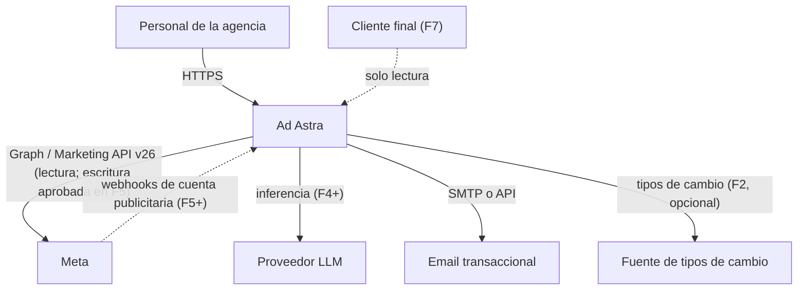
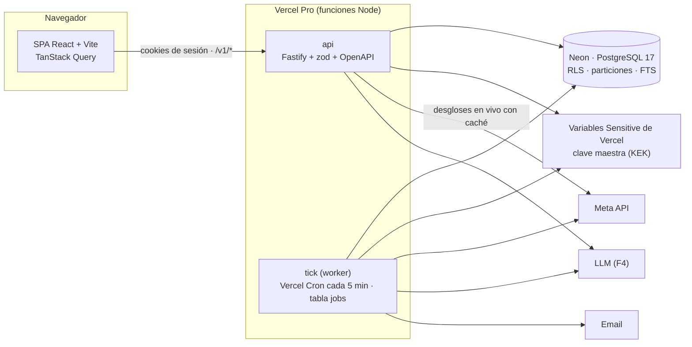
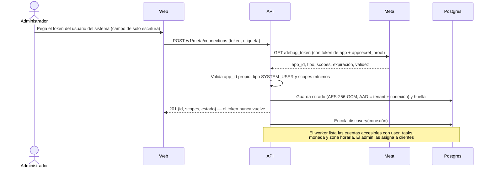
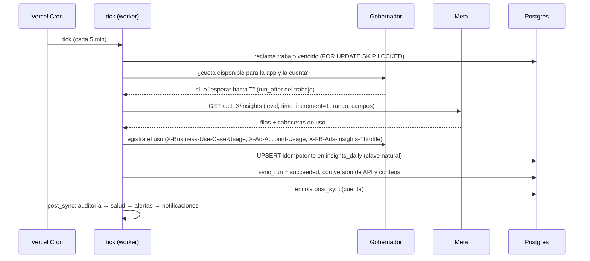
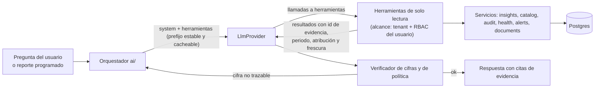

# Arquitectura — Ad Astra

> Versión 0.1 · 2026-10-23 · Estado: **propuesta** (pendiente de validar en F0). Las decisiones citadas están en [DECISIONS.md](DECISIONS.md).

## 1. Principios arquitectónicos

1. **Monolito modular, no microservicios.** Un repositorio, un lenguaje (TypeScript), una base de datos, una API y un *worker* lógico del mismo código; en Vercel, el worker es una función programada (*tick*, ADR-022). Los módulos tienen fronteras explícitas y pueden extraerse más adelante si una métrica lo justifica (ADR-001).
2. **Postgres hace de todo hasta demostrar lo contrario:** datos transaccionales, hechos analíticos, cola de trabajos, búsqueda de texto y, si hiciera falta, vectores (ADR-002).
3. **Determinismo separado de la generación.** Las métricas, reglas, índices y pronósticos son funciones puras y versionadas. La IA consume sus resultados mediante herramientas de solo lectura y nunca calcula ni escribe (ADR-010).
4. **Meta es una fuente remota, no la base de datos de la UI.** Los dashboards leen de Postgres. Solo los desgloses ad hoc consultan a Meta en vivo, con caché y límite de uso.
5. **Integraciones detrás de un módulo propio:** solo `meta` habla con Meta, solo `ai` habla con proveedores LLM y solo `notifications` envía emails.
6. **Fallar cerrado:** sin contexto de tenant no hay filas (RLS); sin aprobación no hay escritura; sin datos suficientes no hay puntuación.
7. **Todo resultado es reproducible:** guarda la versión del motor, los parámetros y la referencia a los datos de entrada.

## 2. Contexto (C4 · nivel 1)



## 3. Contenedores (C4 · nivel 2)



| Contenedor | Responsabilidad | Escala |
|---|---|---|
| `web` | UI. Se compila a estáticos servidos por la CDN de Vercel. Nunca recibe tokens de Meta ni claves | Estático |
| `api` | Autenticación, autorización, consultas, configuración, encolado de trabajos, copiloto (F4), receptor de webhooks (F5) | Función de Vercel, sin estado |
| `tick` (worker) | Sincronización, cálculo post-sync (auditoría, salud, alertas), notificaciones, reportes en lote, ejecución de acciones aprobadas. Procesa el trabajo vencido hasta su plazo interno y deja el resto al siguiente tick | Una invocación cada 5 min (máx. 800 s); la concurrencia por cuenta la limita el gobernador |
| `PostgreSQL` | Única base de datos: Neon (Launch o Scale) con PITR; Postgres 17 en local | Autoescalado de Neon; particiones en las tablas de hechos |

## 4. Módulos del monolito (C4 · nivel 3)

Un solo paquete (ADR-001, revisado en F0). Estado a 2026-10-24: ✅ implementado · ⏳ fase posterior.

```
src/
  app.ts                  ✅ ensamblado de Fastify (plugins, errores, acceso, rutas)
  server.ts               ✅ entrada local (en Vercel, función: F1 despliegue)
  contracts.ts            ✅ contrato v1 en zod: validación, serialización de respuestas y OpenAPI
  domain.ts               ✅ valores de dominio sin dependencias (los importa también la web)
  db/                     ✅ esquema Drizzle, pool y contexto de tenant por transacción (withContext)
  platform/               ✅ config, logging con redacción, errores RFC 9457, cifrado, eventos,
                             auth (Better Auth + Google), access (invitaciones y membresías),
                             http (control de acceso por ruta, CSRF), rbac, jobs (cola y tick)
  modules/
    tenancy/              ✅ miembros, invitaciones, clientes, asignaciones, consentimientos
    meta/                 ✅ conexiones (token cifrado), cliente Graph v26, taxonomía de errores,
                             gobernador de cuotas, sincronización (sync.ts), extracción de
                             Insights (insights.ts) y tick HTTP
                          ⏳ actividad, informes asíncronos (TD-16)
    catalog/              ✅ cuentas (lectura, asignación, activación de la sincronización e
                             historial de sync_runs) y campañas
                          ⏳ creatividades, cambios de configuración
    insights/             ✅ catálogo único de métricas (catalog.ts, compartido con la web),
                             servicio de consultas (report.ts) y exportación CSV auditada
    audit/                ✅ motor de auditoría determinista (stats, model, context, rules,
                             health, engine), persistencia y ciclo de vida (service.ts), API;
                             hallazgos, recomendaciones y registro de eventos (consulta y decisión)
                          ⏳ alertas y notificaciones (TD-21)
    alerts/ notifications/   ⏳ F3
    ai/                   ✅ proveedor LLM desacoplado (provider.ts) con adaptador Anthropic,
                             herramientas de solo lectura (tools.ts), respuesta estructurada,
                             prioridad y verificador (answer.ts), orquestador con límites y
                             presupuestos (assistant.ts) y API (routes.ts)
                          ⏳ documentos aprobados, reportes en lote, streaming (TD-24, TD-26)
    optimization/         ⏳ F5
    forecasting/          ✅ pronóstico con backtest y calibración (forecast.ts), curvas de respuesta
                             y Monte Carlo (simulate.ts) y API de solo lectura (routes.ts)
web/src/                  ✅ SPA: login con Google, organización activa, clientes, cuentas, conexiones,
                             analítica (dashboard.tsx, chart.tsx), auditoría (audit.tsx),
                             asistente de IA (assistant.tsx) y previsión y escenarios (forecast.tsx)
migrations/               ✅ SQL generado y revisado; 0001_rls.sql y 0003_sync_rls.sql con el aislamiento
scripts/worker.ts         ✅ tick en local (pnpm dev:worker)
test/                     ✅ integración y seguridad contra Postgres real
```

**Reglas de dependencia:**
- `platform` no depende de ningún módulo.
- Las tablas de un módulo solo las escribe ese módulo. Las lecturas cruzadas se limitan a los *joins* necesarios para aplicar el alcance (por ejemplo, hallazgo → cuenta → cliente asignado).
- `ai` solo depende de servicios de lectura (`insights`, `catalog`, `audit`, `health`, `alerts`) y de su propio proveedor. **No importa `meta` ni `optimization`** (test de arquitectura en F4).
- `optimization` es el único módulo que invoca operaciones de escritura de `meta`.
- `contracts.ts` y `domain.ts` no contienen lógica con efectos.

## 5. Stack tecnológico

Las versiones exactas se fijan en F0 con lockfile. Toda dependencia adicional exige justificación en el PR.

| Capa | Elección | Alternativas descartadas | Motivo |
|---|---|---|---|
| Lenguaje | TypeScript estricto en todo el stack | Python para el backend | Un solo lenguaje para web, API y worker; tipos compartidos; perfil pedido en el encargo |
| Runtime | Node.js LTS (24.x; mínimo 22.x) | Bun, Deno | Madurez y soporte de librerías |
| Monorepo | pnpm workspaces (3 paquetes) | Nx, Turborepo | Suficiente para 3 paquetes; sin herramientas extra |
| API | Fastify + `fastify-type-provider-zod` + `@fastify/swagger` | Express, NestJS, tRPC | Rendimiento, validación por esquema, OpenAPI generado; tRPC no da un contrato estándar para el futuro SaaS |
| Validación | zod | Ajv, Valibot | Una sola fuente de esquemas para validación, tipos y OpenAPI |
| BD | PostgreSQL 17+ | MySQL, ClickHouse, TimescaleDB | RLS, particionado, JSONB, FTS; volumen previsto muy por debajo de su límite |
| ORM / migraciones | Drizzle ORM + drizzle-kit (SQL revisado y versionado) | Prisma, Kysely | Esquema tipado en TS, SQL legible, sin motor binario |
| Cola / cron | Tabla de sistema `jobs` (recurrentes y puntuales) con `FOR UPDATE SKIP LOCKED`, drenada por Vercel Cron (ADR-022) | pg-boss (necesita un proceso permanente), Vercel Queues/Workflows, BullMQ + Redis | Sin infraestructura ni dependencias nuevas; portable fuera de Vercel |
| Autenticación del personal | Better Auth con Google Workspace como único proveedor (ADR-019) | Auth.js, Keycloak, Clerk/WorkOS | Sin contraseñas propias; 2FA impuesto por el Workspace; sesiones en Postgres |
| Logs | pino (incluido en Fastify) con redacción | winston | Rendimiento y redacción nativa |
| Web | React + Vite + React Router + TanStack Query | Next.js | Herramienta interna sin SEO; un único servidor de API (ADR-016) |
| Gráficos | Recharts | ECharts, D3 | Suficiente para series y barras; integración React |
| Estilos | Tailwind CSS + componentes copiados de shadcn/ui | MUI | Sin dependencia de un kit pesado |
| Tests | Vitest, Playwright; `fetch` inyectable en el cliente de Meta | Jest, msw, `MockAgent` de undici | Rápido, nativo para ESM; los dobles HTTP no necesitan dependencias |
| LLM (F4) | `@anthropic-ai/sdk` tras la interfaz `LlmProvider` | LangChain | Menos capas; acceso directo a herramientas, salidas estructuradas y caché (ADR-011) |
| Alojamiento | Vercel Pro (SPA estática + funciones) + Neon; Docker Compose solo para el Postgres local | VM propia, Kubernetes | Decisión del responsable (PQ-04); sin servidores que operar |

## 6. Flujos principales

### 6.1 Conexión de Meta y descubrimiento



### 6.2 Sincronización



Tipos de job: `discovery`, `entities`, `insights_incremental` (hoy y ayer, cada hora), `insights_restatement` (últimos 28 días, cada noche, asíncrono si la cuenta es grande), `insights_backfill` (alta de cuenta, por meses, prioridad baja), `activities` (registro de actividad), `token_validation` (diaria), `post_sync`. Calendario y presupuesto de llamadas en [API_INTEGRATIONS.md §1.15](API_INTEGRATIONS.md#115-estrategia-de-sincronización-y-presupuesto-de-llamadas).

**Implementación (F1, 2026-10-24).** `src/platform/jobs.ts` (cola) y `src/modules/meta/sync.ts` (un handler por tipo). Alta de conexión → `token_validation` → si es válido, `discovery` diario → las cuentas con la sincronización activa reciben `entities` (2 h), `insights_incremental` (1 h) e `insights_restatement` (24 h); al activarla también un `insights_backfill` que avanza mes a mes con el progreso en el *payload*. Cada handler de cuenta comprueba antes de llamar a Meta que la sincronización sigue activa, que la conexión está `active` y que el cliente tiene `read_insights`; si no, el trabajo termina sin llamadas. Resultado de cada trabajo:

| Situación | Resultado | `sync_runs.status` |
|---|---|---|
| Éxito | `done` (los recurrentes vuelven a la cola) | `succeeded` |
| Cuota bloqueada o throttling | `reschedule` hasta `blocked_until`, sin gastar intento | `throttled` |
| 190 / 102 | conexión `invalid`, evento, cola de la conexión vaciada y `stop` | `failed` |
| Red, 1, 2 o fallo propio | `retry` con backoff exponencial (30 s · 2ⁿ, máx. 1 h) | `failed`, o `partial` si ya escribió algo |
| Permisos u otros errores permanentes | `stop` | `failed` |

Cada bloque (un nivel de Insights, un tipo de entidad) se lee entero y se escribe en una transacción con *upsert* por clave natural: repetir un trabajo no cambia nada y un fallo a mitad no deja medio nivel escrito. `post_sync` llega con la auditoría (F3).

### 6.3 Gobernador de cuotas

- Estado por ámbito en `meta_rate_state`, con la app de Meta en la clave (Meta limita por app): `<app_id>|app`, `<app_id>|insights` y `<app_id>|account:<act_id>`, con `blocked_until` y el último uso leído (`src/modules/meta/governor.ts`).
- Antes de cada llamada: si `blocked_until > ahora`, el trabajo se reprograma (`run_after`) sin consumir reintentos.
- Tras cada respuesta se parsean las cabeceras de uso. Uso ≥ 90 % → bloquear el ámbito durante `estimated_time_to_regain_access` (o `reset_time_duration`, o 5 min por defecto). Uso ≥ 75 % → concurrencia 1 y pausa entre llamadas.
- Errores de throttling (ver [taxonomía](API_INTEGRATIONS.md#113-taxonomía-de-errores-y-política-de-reintentos)) → bloqueo del ámbito según el código.
- Concurrencia: `TICK_CONCURRENCY` trabajadores por tick (3 por defecto). La deduplicación deja un solo trabajo de cada tipo por cuenta; tipos distintos de la misma cuenta pueden coincidir y es el gobernador quien frena si sube el uso.

> ponytail: gobernador con estado en una tabla y reprogramación de jobs. Límite conocido: no reparte la cuota entre tenants que comparten la misma app. Se añade un reparto justo por tenant en F7 si hay contención.

### 6.4 Métricas (catálogo determinista)

- El catálogo vive en `src/modules/insights/catalog.ts` (sin dependencias: lo importan la API y la web) y define, por métrica: id, nombre, fórmula, unidad, dirección ("menor es mejor"), aditividad, niveles válidos y fuente (campo de Meta o derivada).
- **Ratios de sumas:** `CPM = 1000·Σgasto/Σimpresiones`, `CPC (enlace) = Σgasto/Σclics_enlace`, `CTR (enlace) = Σclics_enlace/Σimpresiones`, `CPR = Σgasto/Σresultados`, `ROAS = Σvalor_compra/Σgasto`. Nunca se promedian ratios de filas.
- **No aditivas:** `alcance` y `frecuencia` (= impresiones/alcance) solo para el grano consultado a Meta. Un rango arbitrario de días muestra "no disponible", salvo las ventanas estándar precalculadas (7, 14 y 28 días).
- **Estados de dato:** `available`, `estimated` (por ejemplo, el alcance o los rankings de calidad, que Meta estima), `unavailable` (no devuelto, o fuera de la ventana permitida), `not_applicable` (por ejemplo, ROAS sin valor de compra), `immature` (días recientes con conversiones aún por llegar).
- **KPI primario por perfil.** Se detecta por conjunto de anuncios a partir de `optimization_goal`, `destination_type` y `promoted_object.custom_event_type` (método portado de fortytwode). Se prefiere el campo `results` de Meta cuando existe (equivale a la columna "Resultados" de Ads Manager; a confirmar en V-04) y se puede sobrescribir manualmente. A nivel de campaña, el perfil del conjunto con más gasto.
- **Descomposición del CPA** (identidad exacta, útil para explicar variaciones): `CPA = CPM / (1000 · CTR · CVR)` ⇒ `Δln CPA = Δln CPM − Δln CTR − Δln CVR`. Se muestra qué parte del cambio viene del costo de la subasta, de la creatividad o de la conversión.

Perfiles KPI v1:

| Perfil | Objetivos / señales típicas | KPI primario | Secundarios |
|---|---|---|---|
| `sales` | OUTCOME_SALES; OFFSITE_CONVERSIONS con compra | CPA de compra; ROAS si hay valor | CTR enlace, CVR, CPM |
| `leads` | OUTCOME_LEADS; LEAD_GENERATION, QUALITY_LEAD | CPL | CTR, tasa de formulario |
| `messages` | CONVERSATIONS; destino WhatsApp o Messenger | Costo por conversación iniciada | CTR, CPM |
| `traffic` | OUTCOME_TRAFFIC; LINK_CLICKS, LANDING_PAGE_VIEWS | Costo por visita a la página (o CPC enlace) | CTR enlace, tasa LPV/clic |
| `awareness` | OUTCOME_AWARENESS; REACH, IMPRESSIONS, AD_RECALL_LIFT | CPM o costo por 1000 alcanzados | Frecuencia, alcance |
| `engagement` | OUTCOME_ENGAGEMENT; THRUPLAY, POST_ENGAGEMENT | Costo por ThruPlay o por interacción | Tasa de reproducción |
| `app` | OUTCOME_APP_PROMOTION; APP_INSTALLS | CPI o costo por evento de app | CTR, CVR |

### 6.5 Motor de auditoría

**Interfaz de una regla** (contrato conceptual; se implementa en F3):

```ts
interface AuditRule<P> {
  id: string;                    // 'R-EFF-001'
  version: number;               // cambia si cambia la lógica
  category: RuleCategory;        // eficiencia, rendimiento, estabilidad, fatiga, saturación, entrega, estructura, atribución, seguimiento, cambios, riesgo, datos
  appliesTo: { levels: Level[]; profiles: Profile[] | 'all' };
  paramsSchema: ZodSchema<P>;    // los parámetros por tenant/cliente se validan contra este esquema
  defaults: P;
  evaluate(ctx: EvalContext, params: P): RuleOutcome[];   // función pura
}
type RuleOutcome =
  | { status: 'triggered'; finding: FindingDraft }
  | { status: 'not_triggered' }
  | { status: 'insufficient_data'; reason: string };
```

**Cada hallazgo incluye:** evidencia (valores, periodo, referencia y su origen, umbral, tamaño de muestra), impacto estimado (método y moneda), confianza (0–1 y etiqueta), severidad, prioridad, recomendación (plantilla con parámetros), versión de la regla y huella para deduplicar.

**Estado (2026-10-24): implementado** en `src/modules/audit/`: `stats.ts` (estadística), `model.ts` (taxonomía, perfiles y configuración), `context.ts` (ventanas, sumas, referencias y benchmarks internos), `rules.ts` (catálogo), `health.ts` (salud), `engine.ts` (función pura), `service.ts` (carga, persistencia y ciclo de vida) y `engine.routes.ts` (API). Decisiones en ADR-023.

**Taxonomía.** Diez categorías: eficiencia, rendimiento, estabilidad, fatiga creativa, entrega, estructura, atribución, medición, cambios bruscos y calidad de datos. Severidad: info, baja, media, alta o crítica. Las reglas que estiman impacto la gradúan por su parte del gasto de la cuenta en la ventana (crítica ≥ 25 %, alta ≥ 10 %, media ≥ 3 %, configurable) sin bajar del mínimo propio de la regla. Confianza de 0 a 1: probabilidad a posteriori, 1 − p o 1 en las reglas deterministas; etiqueta alta ≥ 0,9, media ≥ 0,7, baja por debajo.

**Perfiles por objetivo** (orden de detección: objetivo de optimización del conjunto y su evento promocionado → tipo de resultado de Meta → objetivo de la campaña):

| Perfil | Señales | Evento clave | Costo del evento |
|---|---|---|---|
| `awareness` | REACH, IMPRESSIONS, AD_RECALL_LIFT · OUTCOME_AWARENESS | Impresiones | CPM |
| `traffic` | LINK_CLICKS, LANDING_PAGE_VIEWS · OUTCOME_TRAFFIC | Visitas a la página (clics en el enlace si no hay) | Costo por visita o CPC |
| `engagement` | THRUPLAY, POST_ENGAGEMENT · OUTCOME_ENGAGEMENT | Resultados de Meta | Costo por resultado |
| `messages` | CONVERSATIONS o resultado de mensajería | Conversaciones iniciadas | Costo por conversación |
| `leads` | LEAD_GENERATION, QUALITY_LEAD, OFFSITE_CONVERSIONS + LEAD · OUTCOME_LEADS | Clientes potenciales | Costo por cliente potencial |
| `sales` | OFFSITE_CONVERSIONS o VALUE + PURCHASE · OUTCOME_SALES | Compras (y ROAS con valor) | Costo por compra |
| `app` | APP_INSTALLS · OUTCOME_APP_PROMOTION | Instalaciones | Costo por instalación |
| `other` | el resto | Resultados de Meta | Costo por resultado |

**Ventanas** (configurables): evaluación de 7 días hasta ayer (día local de la cuenta); ventana madura = la evaluación sin sus 3 últimos días, para las pruebas de conversiones; línea base = los 28 días anteriores; estabilidad y anomalías, 14 días; entrega, 2 días; fatiga, la semana actual frente a la anterior.

**Referencias: benchmarks internos, nunca valores "del sector".** Objetivo del cliente (`targets` de la configuración, por perfil y moneda) → línea base propia (≥ 5 eventos; ≥ 1000 impresiones en reconocimiento) → mediana de la cuenta para el mismo nivel y perfil (≥ 3 entidades con muestra). Cada hallazgo guarda la fuente usada. Los umbrales de las reglas son parámetros estadísticos o metodológicos (α, probabilidad mínima, tolerancia), no niveles de mercado; el único número externo es el de 50 eventos semanales de la fase de aprendizaje, que publica Meta, y también es configurable.

**Catálogo v1 (15 reglas):**

| ID | Categoría | Niveles · perfiles | Dispara cuando (método) | Muestra mínima | Parámetros por defecto | Impacto |
|---|---|---|---|---|---|---|
| R-EFF-001 | Eficiencia | campaña, conjunto, anuncio · todos | P(costo > ref · (1 + tolerancia)) ≥ prob. mínima; Gamma-Poisson con a priori Gamma(k, k·ref) | gasto ≥ 2 × costo de referencia (≥ 1000 impresiones en reconocimiento) | tolerancia 0,2 · prob. 0,8 · k 5 | gasto − eventos × ref |
| R-EFF-002 | Eficiencia | ídem · todos salvo reconocimiento | 0 eventos y P(0 \| λ = gasto ÷ ref) = e^−λ < α | λ ≥ 1 | α 0,05 | gasto |
| R-PERF-003 | Rendimiento | ídem · salvo reconocimiento | P(X ≤ observados \| esperados = gasto × tasa de la línea base) < α y caída ≥ 20 % | línea base ≥ 10 eventos; esperados ≥ 5 | α 0,05 · caída 0,2 | (esperados − observados) × costo base |
| R-EFF-004 | Eficiencia | ídem · ventas | P(ROAS < ref · (1 − tolerancia)) ≥ prob.; Gamma-Poisson de compras con el valor medio | ≥ 3 compras (ventana o base) | tolerancia 0,2 · prob. 0,8 | gasto × ROAS ref − valor |
| R-RATE-005 | Rendimiento | conjunto, anuncio · salvo reconocimiento | CTR del enlace menor que en la línea base: dos proporciones unilateral, p < α y caída ≥ 15 % | ≥ 2000 impresiones en cada periodo | α 0,05 · caída 0,15 | — |
| R-STAB-006 | Estabilidad | campaña, conjunto · todos | CV del costo diario sin ruido de Poisson (√max(0, CV² − 1/media diaria)) > max(piso, factor × mediana de la cuenta) | ≥ 10 días con eventos y ≥ 3 comparables | piso 0,3 · factor 1,5 | — |
| R-FAT-007 | Fatiga | conjunto, anuncio · todos | CTR de la semana menor que la anterior (p < α, caída ≥ 15 %) y frecuencia diaria +10 % (o > el máximo del cliente, opcional) | ≥ 1000 impresiones por semana | α 0,05 | — |
| R-DEL-008 | Entrega | campaña, conjunto, anuncio · todos | activa (ella y sus padres) sin impresiones en 2 días habiendo entregado o con presupuesto; o rechazada, con problemas o sin facturación | determinista | — | presupuesto × días |
| R-DEL-009 | Entrega | conjunto · salvo reconocimiento | límite de costo o de puja por debajo del costo real: P(costo > límite) ≥ 0,8 | ≥ 3 eventos en 14 días | — | — |
| R-DEL-010 | Entrega | conjunto · salvo reconocimiento | `learning_stage_info` = FAIL, o presupuesto semanal ÷ costo de referencia < eventos de aprendizaje | determinista | eventos de aprendizaje 50 | — |
| R-STR-011 | Estructura | campaña · salvo reconocimiento | ≥ 3 conjuntos activos del mismo perfil y todos con < 50 eventos por semana | determinista | — | — |
| R-ATT-012 | Atribución | campaña · todos | más de un `attribution_setting` entre sus conjuntos | determinista | — | — |
| R-TRK-013 | Medición | campaña, conjunto · clientes potenciales, ventas, app | ≥ 100 clics, 0 conversiones y e^−(clics × conversión por clic de la base) < α | ≥ 100 clics; base ≥ 5 conversiones | α 0,01 | gasto |
| R-CHG-014 | Cambios bruscos | cuenta, campaña · todos | z robusta de Iglewicz-Hoaglin (mediana y MAD) del gasto, el CPM o el CTR de ayer ≥ umbral y cambio ≥ 30 %; solo entidades activas, con la historia desde su primera entrega y los días sin entrega a 0 | ≥ 14 días de historia | umbral 3,5 | — |
| R-DATA-015 | Calidad de datos | cuenta | alcance > impresiones, clics > impresiones o clics en el enlace > clics; días sin datos con historia de entrega diaria | determinista | — | — |

Aplazadas del catálogo previsto (TD-20): saturación (necesita el alcance semanal de Meta: el diario no se suma), audiencias compartidas (necesita leer `targeting`), riesgo de inversión (falta el `spend_cap`) y, en medición, píxel, CAPI y EMQ (V-14).

**Control de falsos descubrimientos.** Cada prueba estadística de la ejecución entra con su valor p, también las que no disparan. Se aplica Benjamini-Hochberg con q = 0,10 (configurable): un hallazgo de severidad alta o crítica que no lo supera se abre como medio y lo indica en su evidencia.

**Prioridad:** `peso_severidad × confianza × min(1, impacto ÷ gasto de la cuenta en la ventana)`, con pesos crítica 1,0 · alta 0,7 · media 0,4 · baja 0,2 · info 0,1. Sin impacto estimado se asume 0,25 (configurable).

**Ciclo de vida.** Huella `regla:nivel:entidad`. Un hallazgo se abre, se actualiza en cada evaluación (cambio de severidad → evento) y se resuelve solo tras 2 evaluaciones limpias seguidas (configurable; "datos insuficientes" no cuenta como limpia). Si la condición vuelve, se abre uno nuevo como reapertura. Lo descartado por una persona no se reabre mientras no cambie la versión de la regla. Cada transición y cada decisión queda en `finding_events`, de solo inserción.

**Evidencia de cada hallazgo** (CA-F3-02): métricas, ventana, referencia con su fuente y tamaño, umbral y parámetros usados, muestra, valor p, resultado del control de falsos descubrimientos, método, impacto con su método, explicación en lenguaje natural, confianza, regla y su versión, y `engine_version`.

**Determinismo.** `runAudit(input, config)` es una función pura (no lee el reloj ni la BD). La ejecución guarda la huella SHA-256 de las entradas canónicas, la configuración y `engine_version` (`audit-1.0.0+<huella del catálogo>`): mismas entradas, mismo resultado (test).

**Configuración** (`audit_configs`, validada con zod): por defecto ← organización ← cliente. Ventanas, q, resolución, severidad por impacto, pesos y escala de la salud, objetivos por perfil y moneda y, por regla, `enabled` y `params` (cada regla valida los suyos). Owner y admin cambian la organización; owner, admin y manager, sus clientes. `GET /v1/audit/catalog` publica el catálogo con el esquema JSON de los parámetros.

**Ejecución.** Tras cada sincronización de Insights (incremental o reexpresión) se encola un trabajo `audit` por cuenta (deduplicado). También se lanza a mano con `POST /v1/ad-accounts/:id/audit`, con un `asOf` opcional para backtests.

Notas de dominio que las reglas deben respetar: con Advantage+ audience la segmentación son sugerencias (no se audita como límite); las campañas Advantage+ tienen el presupuesto a nivel de campaña; desde v24 un presupuesto diario puede gastarse hasta un 75 % más en un día dentro del tope semanal (fuente secundaria, V-11), así que no es una alerta por sí mismo; la fase de aprendizaje necesita unos 50 eventos de optimización en 7 días.

### 6.6 Índice de salud (fórmula `health-v1`)

**Objetivo:** una puntuación de 0 a 100 por entidad, explicable componente a componente, adaptada al perfil y que **no castiga la falta de datos**.

**Estado (2026-10-24): implementado** (`src/modules/audit/health.ts`) con cinco subíndices: eficiencia, estabilidad, entrega, medición y fatiga. El volumen y la estructura del diseño inicial quedan como reglas (R-PERF-003, R-STR-011), no como subíndices (ADR-023).

**1. Referencia de cada componente:** la misma cadena que las reglas (objetivo del cliente → línea base propia → mediana de la cuenta), con la fuente guardada.

**2. Estimación con contracción bayesiana** (evita conclusiones con muestras pequeñas):
- Costo del evento clave: `λ ~ Gamma(k, k · costo_ref)`, a posteriori `Gamma(k + eventos, k · costo_ref + gasto)`; estimación `(k · costo_ref + gasto) / (k + eventos)` e intervalo del 80 % invirtiendo los cuantiles de λ. k = 5. En ventas con valor de compra, ROAS con la misma Gamma sobre las compras y el valor medio.
- Tasas: Beta con k ensayos "virtuales" a la tasa de referencia: k = 200 clics para la conversión por clic y k = 2000 impresiones para el CTR.
- **Evaluable** con un evento esperado al costo de referencia (1000 impresiones en reconocimiento), 7 días con eventos (estabilidad), 100 clics (medición) o 1000 impresiones por semana (fatiga). Si no, el componente queda "insuficiente" y **se excluye**: no puntúa 0.

**3. Normalización a 0–100:**
```
s = clamp(80 + 40 · log2(q), 0, 100)          q > 1 es mejor que la referencia
```
En la referencia → 80; un 41 % mejor → 100; la mitad de bueno (el doble de costo) → 40; la cuarta parte → 0. Centro y pendiente son configurables y versionados. La entrega usa una escala lineal porque su referencia es un tope: `s = 100 · min(1, ratio)`.

| Subíndice | Medida | q | awareness | traffic | engagement | messages | leads | sales | app | other |
|---|---|---|---|---|---|---|---|---|---|---|
| Eficiencia | Costo del evento clave estimado (ROAS en ventas con valor) | ref ÷ estimación (ROAS: estimación ÷ ref) | 0,40 | 0,45 | 0,45 | 0,40 | 0,40 | 0,40 | 0,40 | 0,45 |
| Estabilidad | CV del costo diario sin ruido de Poisson (14 días) | max(mediana de la cuenta, piso de R-STAB-006) ÷ CV | 0,15 | 0,15 | 0,15 | 0,15 | 0,15 | 0,15 | 0,15 | 0,15 |
| Entrega | Gasto ÷ presupuesto de la ventana, o días con entrega ÷ días; × 0,7 con aprendizaje limitado y × 0,5 con problemas de entrega; no aplica si está en pausa | lineal | 0,25 | 0,20 | 0,20 | 0,20 | 0,20 | 0,20 | 0,20 | 0,25 |
| Medición | Conversiones registradas por clic frente a la referencia (cae si se rompe el seguimiento) | estimación ÷ ref | 0 | 0 | 0 | 0,15 | 0,15 | 0,15 | 0,15 | 0 |
| Fatiga | Tendencia del CTR del enlace y de la frecuencia diaria, semana actual frente a la anterior | √(CTR_act ÷ CTR_ant × frec_ant ÷ frec_act) | 0,20 | 0,20 | 0,20 | 0,10 | 0,10 | 0,10 | 0,10 | 0,15 |

El piso del CV de referencia (0,3, el parámetro `floor` de R-STAB-006) evita que una variación pequeña hunda la nota cuando la cuenta es casi perfectamente estable.

**4. Agregación:**
```
H = Σ w_c · s_c / Σ w_c                  (solo componentes evaluables)
cobertura = Σ w_c (evaluables) / Σ w_c (con peso y aplicables)
si cobertura < 0,6 o no hubo gasto  →  H = null   ("Datos insuficientes", nunca "malo")
confianza(H) = cobertura × media ponderada de la confianza de los componentes
```
Confianza de un componente según la anchura relativa de su intervalo del 80 %: < 30 % alta (0,9), 30–60 % media (0,6), > 60 % baja (0,3); en estabilidad y fatiga, según los días o las impresiones.

**5. Calificación:** 85–100 excelente · 70–84 buena · 50–69 atención · 0–49 crítica · `null` datos insuficientes.

**Cuenta:** media de las puntuaciones de sus campañas ponderada por su gasto en la ventana, con la misma regla de cobertura (sobre el gasto). Sus componentes son la misma media, informativa.

**Persistencia:** una fila diaria por entidad en `health_scores` con `formula_version`, perfil, ventana, puntuación, calificación, cobertura, confianza y componentes (valor, referencia y su fuente, q, s, peso, estado, confianza, n, nota). La web muestra el desglose y la fórmula; un test recalcula cada puntuación desde los componentes guardados.

### 6.7 Alertas

- Son hallazgos de tipo `alert`, producidos por reglas de monitorización tras cada sincronización incremental.
- Tipos MVP: CPR disparado (3 d frente a la base de 28 d, prueba Gamma-Poisson, ≥ 5 resultados esperados), caída de resultados (24 h y 72 h frente a los esperados), sin entrega, gasto alto sin resultados, posible fatiga, conexión o sincronización (token inválido, fallos repetidos, datos con más de X h de antigüedad, throttling persistente) y cambios relevantes (presupuesto ±30 %, cambios de estado hechos fuera de la plataforma, según el registro de actividad y los cambios detectados).
- **Datos en maduración:** las comparaciones excluyen el día en curso y corrigen los días recientes por madurez de conversiones (F3: exclusión simple; F6: curva de madurez por cuenta).
- **Deduplicación:** una sola alerta abierta por huella (regla + entidad). Se resuelve automáticamente tras N evaluaciones sin condición.
- **Ciclo de vida:** abierta → reconocida → pospuesta → resuelta / descartada (con motivo). Cada transición queda en `finding_events`: es el historial de alertas y decisiones del requisito 8.
- **Notificación:** políticas por severidad, cliente y horario silencioso; agrupación en un resumen para evitar ráfagas.

### 6.8 Capa de IA (F4)



- **Herramientas (todas de solo lectura):** `get_portfolio_summary`, `get_entity_metrics(level, ids, rango, métricas)`, `compare_periods`, `decompose_cpa_change`, `get_findings`, `get_health(entity)`, `get_alert_history`, `get_entity_config`, `get_change_log`, `search_approved_documents`. Cada resultado lleva un `evidence_id`, el periodo, la configuración de atribución, la moneda y la frescura.
- **Sin escritura:** la IA no tiene herramientas que modifiquen datos ni que llamen a Meta. En F5 puede **redactar** una propuesta estructurada (esquema validado) que entra en la cola de aprobación como cualquier otra.
- **Verificador de cifras:** extrae cada número de la respuesta y comprueba que aparece en los resultados de las herramientas de esa conversación (normalizando formato y redondeo). Si hay cifras no trazables, se regenera una vez; si persisten, se muestra la respuesta marcada como "contiene cifras no verificadas". Las herramientas devuelven ya calculados los deltas y porcentajes habituales, de modo que el modelo no tenga que calcular.
- **Lenguaje:** el prompt de sistema exige vocabulario probabilístico ("probable", "coincide con") y prohíbe afirmar causalidad o garantizar resultados; los evals lo comprueban.
- **Contexto documental aprobado:** solo documentos en estado `approved` (playbooks, briefs, benchmarks) son recuperables; la memoria institucional (decisiones sobre hallazgos, resultados de acciones) se consulta con herramientas y no se supone memorizada.
- **Defensas contra prompt injection:** nombres de entidades, textos de creatividades y documentos se devuelven envueltos y etiquetados como datos no confiables; las instrucciones del operador van en el prompt de sistema (o en mensajes de sistema intermedios); ninguna herramienta tiene red ni escritura; las salidas se renderizan como texto y markdown saneado sin HTML activo; suite de inyección en la CI.
- **Costos:** presupuesto mensual por tenant y diario por usuario, registro de tokens y costo por petición (`llm_usage`), caché de prompts, API de lotes para reportes nocturnos, `max_tokens` y número de llamadas a herramientas acotados.

**Implementado (2026-10-24):**

- **Proveedor:** interfaz `LlmProvider` (`src/modules/ai/provider.ts`): `generate(petición) → resultado` con bloques neutrales (texto, llamada y resultado de herramienta), contenido nativo que se reenvía sin cambios, uso de tokens, costo y `stop_reason` normalizado (incluido `refusal`). Se elige por configuración (`AI_PROVIDER`, `AI_MODEL`, `AI_EFFORT`); sin clave, las rutas de IA responden 503 y nunca se simula una respuesta. Adaptador Anthropic en `anthropic.ts` ([API_INTEGRATIONS §2.2](API_INTEGRATIONS.md#22-proveedor-inicial-anthropic)).
- **Herramientas (solo lectura, `tools.ts`):** `get_scope`, `get_metrics` (comparación anterior, interanual o a medida; filas de los hijos o serie diaria; variaciones ya calculadas), `decompose_change`, `get_findings` y `get_health`. Cada una declara su permiso RBAC, valida entrada y salida con zod, corre con el contexto del usuario (RLS y alcance por cliente) y solo sobre clientes con consentimiento `ai_processing` (la cartera excluye y cuenta las cuentas sin él). Todas devuelven una **suficiencia de datos** determinista (`sufficient`, `limited` o `insufficient`, con motivos: sin entrega, sin sincronizar, menos de 1.000 impresiones o 10 resultados, varios tipos de resultado, días aún por madurar, comparación vacía, sincronización de más de 36 h, otras monedas o cuentas excluidas). Los textos de terceros se limpian (sin caracteres de control ni bidi, acotados) y se retiran si parecen instrucciones. Aplazadas: `get_alert_history`, `get_entity_config`, `get_change_log` y `search_approved_documents` (TD-24).
- **Respuesta estructurada:** la herramienta `submit_answer` (esquema en `answer.ts`) es la única forma de responder: resumen, suficiencia, afirmaciones con evidencia y cifras, hipótesis con confianza y cómo comprobarlas, recomendaciones y preguntas de seguimiento. Cada recomendación incluye evidencia, impacto esperado como hipótesis (métrica, dirección y magnitud), confianza con su motivo, dependencias, riesgo y una acción sugerida (`pause`, `activate`, `set_daily_budget`, `set_lifetime_budget` o `review`) sobre una entidad que aparezca en la evidencia.
- **Prioridad (determinista):** `prioridad = confianza (baja 0,4 · media 0,7 · alta 0,9) × magnitud del impacto (1 · 2 · 3) × factor de riesgo (bajo 1 · medio 0,75 · alto 0,5) ÷ 2,7`, entre 0 y 1; las recomendaciones se devuelven ordenadas por ella.
- **Verificador (`verifyAnswer`):** evidencia citada obligatoria y existente; cada cifra de `figures` aparece en su evidencia (con la tolerancia del redondeo escrito, también como porcentaje de una fracción); toda cifra del texto aparece en la evidencia citada (formatos español e inglés, sufijos mil, k y M, % y puntos porcentuales; los enteros de 0 a 10 sin unidad se tratan como conteos); las fechas ISO, uuids e ids de Meta del texto existen en la evidencia; la entidad de la acción y los hallazgos relacionados existen; la suficiencia declarada no es mejor que la peor de la evidencia citada; con datos insuficientes solo caben acciones `review` (o confianza baja); sin lenguaje de certeza ni causas afirmadas como hecho, y el impacto redactado como hipótesis. Si falla, el modelo tiene **un** turno para corregir; si persiste, la respuesta se muestra marcada "sin verificar" y las recomendaciones con problemas no se pueden proponer.
- **Orquestador (`assistant.ts`):** bucle manual con límites (8 llamadas al modelo, 16 consultas a herramientas, 16.000 tokens por llamada, 1 corrección, 1 recordatorio de usar `submit_answer`, 20 turnos por conversación). Prompt de sistema y herramientas fijos (`assistant-v1`), con lo que el prefijo se cachea; el contexto de cada pregunta (fecha, vista, primer id de evidencia) entra como mensaje de sistema intermedio. El historial es solo de anexar: se reenvía el contenido nativo con sus bloques de pensamiento, y solo los turnos con respuesta pasan al contexto siguiente. Proveedor y modelo quedan fijos por conversación.
- **Costos:** `llm_usage` por llamada (también las fallidas); presupuestos `AI_MONTHLY_BUDGET_USD` (organización y mes), `AI_USER_DAILY_BUDGET_USD` (usuario y día) y `AI_QUESTION_BUDGET_USD` (pregunta). Antes de cada llamada se reserva una cota (entrada estimada más un cuarto de `max_tokens`): sin saldo al empezar, 429 y evento `ai.budget_blocked`; sin saldo a mitad de turno, estado `budget_exhausted`. Límite de `AI_ASK_PER_MINUTE` preguntas por usuario y minuto.
- **Sin escritura y con aprobación:** el inventario solo tiene herramientas de lectura (test) y el cierre de importaciones de `ai` no alcanza `meta` ni `optimization` (test); una llamada a una herramienta desconocida se rechaza y queda en la traza. El usuario puede **proponer** una recomendación verificada a la cola (`recommendations`, origen `ai`, estado `open`), donde owner, admin o manager la aceptan o descartan; aceptarla no ejecuta nada hasta F5.
- **Trazabilidad:** cada turno guarda en `ai_messages` la respuesta, la verificación, la traza de herramientas (entrada, evidencia, suficiencia, duración y error), los textos retirados, el uso y el costo, y registra `ai.asked` en `audit_log`.

### 6.9 Centro de optimización (F5)

```mermaid
stateDiagram-v2
  [*] --> borrador
  borrador --> pendiente: enviar
  pendiente --> aprobada: aprobar (rol aprobador; doble aprobación si supera el umbral)
  pendiente --> rechazada: rechazar
  pendiente --> expirada: TTL vencido o el estado en Meta cambió
  aprobada --> ejecutando: el worker la toma (clave de idempotencia)
  ejecutando --> ejecutada: Meta confirma
  ejecutando --> fallida: error no recuperable
  ejecutada --> verificada: la relectura coincide
  ejecutada --> fallida: la relectura no coincide
  verificada --> revertida: revertir (solo acciones reversibles)
  rechazada --> [*]
  expirada --> [*]
  fallida --> [*]
  revertida --> [*]
  verificada --> [*]
```



- **Tipos de acción iniciales:** pausar o activar campaña, conjunto o anuncio; cambiar el presupuesto diario o total de una campaña o conjunto. Puja y cost cap después.
- **Previsualización:** se lee el estado actual en vivo y se muestra el diff, el impacto esperado con intervalo y las advertencias (reinicio del aprendizaje, límites de Meta, Advantage+).
- **Guardrails:** porcentaje máximo de cambio por acción y por día, respeto de los límites de Meta (4 cambios de presupuesto por hora por conjunto, 1 edición cada 30 s por objeto), ventana horaria permitida, comprobación de permisos (`ads_management` en el token y `user_tasks` con ADVERTISE o MANAGE en la cuenta), consentimiento del cliente con alcance de escritura y kill switch global y por tenant.
- **Ejecución:** idempotente (clave única por intento), relectura posterior y registro antes/después en el registro de auditoría.
- **Reversión:** inversa del cambio con el valor previo guardado, sujeta a los mismos guardrails.

### 6.10 Predicción y simulación (F6)

| Técnica | Uso | Condición para mostrarla |
|---|---|---|
| Baseline ingenuo estacional (semanal) | Referencia obligatoria de todo pronóstico | Siempre se calcula |
| ETS / Holt-Winters con estacionalidad semanal | Pronóstico de gasto, resultados y CPR con intervalos | MASE < 1 frente al baseline en backtesting de origen móvil |
| Detección robusta (mediana/MAD por día de la semana) y CUSUM | Anomalías y cambios de tendencia | Validada con inyección sintética de anomalías |
| Gamma-Poisson / Beta-Binomial | Estimaciones probabilísticas de CPA, CPL y tasas | Ya en F3 |
| Regresión log-log `resultados = a · gasto^b` (b < 1) | Curvas de respuesta con rendimientos decrecientes | Solo dentro del rango de gasto observado ±50 %; fuera se marca como extrapolación |
| Monte Carlo (10 000 extracciones de parámetros + ruido de Poisson) | Escenarios de redistribución de presupuesto: P10/P50/P90 | Con supuestos y la advertencia "no garantizado" visibles |
| Cadenas de Markov | Estados de entidad por semana (aprendizaje → estable → fatigada → pausada) para estimar la vida útil creativa | Solo si supera a un análisis de supervivencia simple (Kaplan-Meier) y hay ≥ 6 meses y ≥ 100 entidades de historia propia |

Toda predicción se publica con su ficha (datos, supuestos, métricas de backtest, limitaciones) y nunca como resultado garantizado. Las correlaciones no se presentan como causas.

**Implementado (2026-10-26)** en `src/modules/forecasting/` (`forecast.ts`, `simulate.ts`, `routes.ts`); matemáticas, criterios y experimentos en [FORECASTING.md](FORECASTING.md); decisión en ADR-025. Cambios respecto a la tabla anterior, por la evidencia de los experimentos:

- **Publicación de un pronóstico:** MAE relativo al ingenuo estacional < 1 en los mismos puntos del backtest (el MASE se informa: a 28 días puede pasar de 1 aunque el modelo supere al ingenuo) y cobertura diaria del intervalo del 80 % en [70 %, 90 %]. Candidatos: perfil semanal y ETS(A,Ad,A) en TypeScript (sin worker de Python).
- **Intervalos:** empíricos y conformes en el tiempo (errores de orígenes ya observados, corrección de muestra finita), no analíticos.
- **Curva de respuesta:** Poisson sobredispersa log-lineal con a priori débil sobre la elasticidad (aproximación de Laplace), validada con una predicción de un paso. Extrapolación = fuera del rango semanal observado (el margen de ±50 % resultó demasiado permisivo) y marca de cambio grande por encima de ±30 %.
- **Monte Carlo:** extracciones del a posteriori + ruido Gamma-Poisson (binomial negativa), con semilla.
- **Pendiente:** CUSUM y anomalías por día de la semana (la z robusta solo acota picos aislados para ajustar); Markov y Kaplan-Meier no aplican mientras no se cumplan sus criterios de datos.

## 7. Contrato de la API propia (v1)

- REST bajo `/v1`, JSON, OpenAPI 3.1 generado desde los esquemas zod y publicado en `/v1/openapi.json`. Un test de la CI compara el contrato con el del commit anterior y avisa de cambios incompatibles.
- **Errores:** `application/problem+json` (RFC 9457) con `type`, `title`, `status`, `detail` y `request_id`; nunca trazas ni secretos.
- **Paginación** por cursor (`?cursor=&limit=`). **Idempotencia** con la cabecera `Idempotency-Key` en los POST con efectos.
- **Autenticación** por cookie de sesión de Better Auth (httpOnly, SameSite=Lax; Secure en producción). **CSRF:** toda petición que modifica debe llevar `Origin` = `APP_ORIGIN` (se descarta el token de doble envío: con cookie SameSite y mismo origen, la verificación de origen es suficiente y no añade estado).
- **Tenant activo:** cabecera `x-tenant-id`. El servidor solo la acepta tras verificar la membresía; sin cabecera, se usa la única membresía si hay una.
- **Control de acceso por ruta:** cada ruta declara `access` (`public`, `authenticated` o `permission`); la app no arranca si alguna no lo hace.
- **Recursos** (✅ = implementado el 2026-10-23; contrato vivo en `GET /v1/openapi.json`):

| Recurso | Métodos | Fase |
|---|---|---|
| ✅ `/v1/health`, `/v1/ready`, `/v1/openapi.json` (públicos) | GET | F1 |
| ✅ `/v1/auth/*` (Better Auth: Google, sesión, salida) | GET, POST | F1 |
| ✅ `/v1/me` | GET | F1 |
| ✅ `/v1/members`, `/v1/members/{userId}` | GET, PATCH, DELETE | F1 |
| ✅ `/v1/invitations`, `/v1/invitations/{id}/revoke` | GET, POST | F1 |
| ✅ `/v1/clients`, `/v1/clients/{id}`, `/{id}/assignments`, `/{id}/consents`, `/{id}/consents/{consentId}/revoke` | GET, POST, PATCH, PUT | F1 |
| ✅ `/v1/meta/connections`, `/v1/meta/connections/{id}/revoke` (el token es de solo escritura) | GET, POST | F1 |
| ✅ `/v1/ad-accounts`, `/v1/ad-accounts/{id}`, `/v1/ad-accounts/{id}/campaigns` | GET, PATCH | F1 |
| ✅ `/v1/recommendations`, `/v1/recommendations/{id}/decision` | GET, POST | F1 (las genera F3) |
| `/v1/ad-accounts/{id}/sync`, `/v1/sync-runs`, `/v1/system/status` | GET, POST | F1 (ingesta) |
| `/v1/entities/{level}` (campañas, conjuntos, anuncios, creatividades) | GET | F2 |
| `/v1/insights/query` (métricas, nivel, rango, comparación, agrupación) | POST | F2 |
| `/v1/insights/breakdowns` (consulta en vivo con caché) | POST | F2 |
| `/v1/kpi-targets`, `/v1/kpi-profiles/overrides` | GET, POST, PATCH | F2 |
| `/v1/rules`, `/v1/rules/{id}/config` | GET, PUT | F3 |
| ✅ `/v1/findings`, `/v1/findings/{id}/decision` | GET, POST | F1 (los genera F3) |
| `/v1/health/{level}/{id}` | GET | F3 |
| `/v1/notification-policies` | GET, PUT | F3 |
| `/v1/ai/conversations`, `/v1/reports`, `/v1/documents` | GET, POST | F4 |
| `/v1/actions`, `/v1/actions/{id}/approve`, `/reject`, `/revert` | GET, POST | F5 |
| ✅ `/v1/forecasts`, `/v1/simulations` (de solo lectura; POST porque llevan cuerpo) | POST | F6 |
| ✅ `/v1/audit-log` (paginado por cursor `before`) | GET | F1 |
| `/v1/webhooks/meta` (público, con firma) | GET, POST | F5 |

## 8. Requisitos no funcionales

| Atributo | Objetivo MVP | Cómo se mide |
|---|---|---|
| Frescura | Datos de hoy con ≤ 90 min de retraso; últimos 28 días reexpresados cada noche | `sync_runs` y página de estado |
| Rendimiento | p95 < 1,5 s en el dashboard de cartera (50 cuentas × 13 meses); p95 < 500 ms en las tablas de entidad | Prueba de carga con dataset sintético |
| Disponibilidad | 99,5 % mensual en horario laboral (herramienta interna) | Monitor externo |
| Exactitud | Gasto, impresiones, clics y resultados iguales a Ads Manager con la misma atribución, zona horaria y rango (las diferencias se documentan) | Pruebas de conciliación |
| Cuota de Meta | Uso sostenido < 75 % por cuenta y app | Cabeceras registradas |
| Seguridad | Ver [SECURITY.md](SECURITY.md); ASVS nivel 2 como referencia | Checklist por fase |
| Recuperación | RPO ≤ 15 min y RTO ≤ 4 h (BD gestionada con PITR) | Simulacro por fase |
| Escala de diseño | 500 cuentas y 10 tenants sin rediseño (mismo esquema, más workers) | Prueba de volumen en F7 |
| Accesibilidad | Navegación por teclado, contraste AA y gráficos con tabla alternativa | Revisión con axe en e2e |
| Costo | Infraestructura MVP en una sola instancia + BD gestionada; LLM bajo presupuesto por tenant | Informe mensual |

## 9. Despliegue y entornos

| Entorno | Propósito | Datos | Meta |
|---|---|---|---|
| Local | Desarrollo | Sintéticos y fixtures sanitizadas | Mock HTTP; cuenta sandbox opcional |
| CI | Pruebas automáticas | Sintéticos | Nunca credenciales reales |
| Staging | Validación y piloto técnico | Cuentas propias o sandbox autorizadas | App en Limited o Full, según el avance |
| Producción | Uso real | Cuentas de clientes con consentimiento | App en Full access |

- **Vercel Pro** (ADR-022): SPA en la CDN de Vercel, API como función Node y `tick` invocado por Vercel Cron cada 5 min. Los *preview deployments* de los PR usan una rama de Neon o la BD de staging, nunca la de producción.
- **Neon** (Launch como mínimo, por el PITR): endpoint con *pooling* para las funciones y endpoint directo para las migraciones. Funciones y BD en la misma región (PQ-04b).
- **Migraciones** como paso previo al despliegue, con el rol propietario.
- **CI (GitHub Actions):** instalación con lockfile, typecheck, lint, tests unitarios y de integración con un contenedor de Postgres, build, e2e con Playwright en los PR a `main`, auditoría de dependencias y escaneo de secretos.
- **CD:** promoción manual de staging a producción durante el MVP.
- **Logs:** la retención de logs de Vercel es corta; los datos operativos que importan ya viven en la BD (`sync_runs`, `meta_api_calls`, `audit_log`) y se añade un *log drain* si hace falta más.

## 10. Observabilidad

- **Logs** JSON (pino) con `request_id` y `job_id`, `tenant_id` y módulo; redacción de `access_token`, `appsecret_proof`, `client_secret`, `fb_exchange_token`, `authorization` y `cookie`; toda URL pasa por `redactUrl()` antes de registrarse.
- **Métricas operativas** en la propia BD y en una página interna de estado: retraso de sincronización por cuenta, último éxito, errores por código, uso de cuota, profundidad de las colas, duración de los jobs, costo de LLM por tenant.
- **Salud del servicio:** `/healthz` (proceso vivo) y `/readyz` (BD accesible y migraciones aplicadas).
- **Errores:** agregador de errores opcional (con depuración de secretos) a partir de F1. OpenTelemetry cuando haya un backend de observabilidad.

## 11. Evolución a SaaS multiempresa (F7)

Lo que ya queda preparado desde F1: `tenant_id` y RLS en todo, RBAC por tenant, conexiones Meta por tenant, contrato de API versionado, costos medidos por tenant.

Lo que falta: alta autoservicio con Facebook Login for Business (configuration ID y tokens de usuario del sistema de integración de negocio por cliente), App Review para un caso de uso público, facturación y planes con cuotas, SSO (SAML/OIDC), KMS para la clave maestra con claves por tenant, reparto justo de cuota de Meta entre tenants, residencia de datos, página de estado y SLA.

## 12. Decisiones diferidas

| Tema | Se decide en | Criterio |
|---|---|---|
| Fuente de tipos de cambio | F2 | Solo si hay cuentas con monedas distintas (PQ-02) |
| Proveedor de email | F3 | API sencilla, entregabilidad, costo |
| Canales de alerta adicionales | F3 | PQ-06 |
| Embeddings y pgvector | F4 | Si el recall con FTS no alcanza el umbral en los evals |
| Servicio de Python para estadística | F6 | Si ETS o los modelos de estado no son mantenibles en TS |
| Webhooks de Meta | F5 | Necesarios para reaccionar rápido a `effective_status` y `with_issues_ad_objects` |
| CDN, réplicas de lectura, particiones adicionales | Cuando una métrica de RNF lo pida | p95 o volumen fuera de objetivo |
