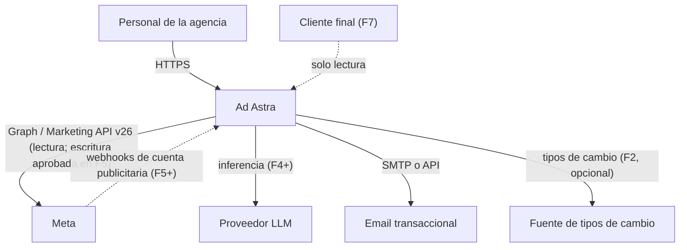
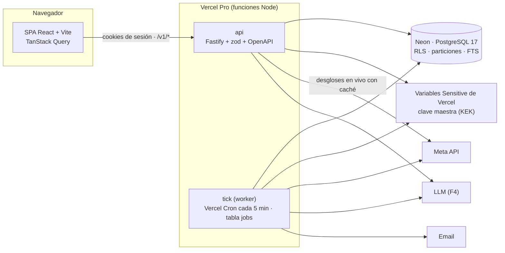
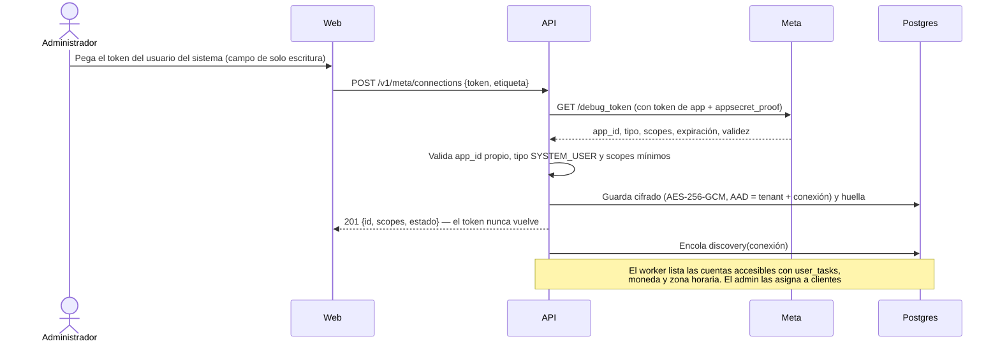
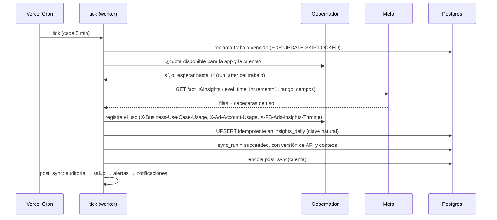
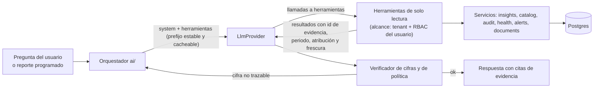

# Arquitectura — Ad Astra

> Versión 0.1 · 2026-10-23 · Estado: **propuesta** (pendiente de validar en F0). Las decisiones citadas están en [DECISIONS.md](DECISIONS.md).

## 1. Principios arquitectónicos

1. **Monolito modular, no microservicios.** Un repositorio, un lenguaje (TypeScript), una base de datos, una API y un *worker* lógico del mismo código; en Vercel, el worker es una función programada (*tick*, ADR-022). Los módulos tienen fronteras explícitas y pueden extraerse más adelante si una métrica lo justifica (ADR-001).
2. **Postgres hace de todo hasta demostrar lo contrario:** datos transaccionales, hechos analíticos, cola de trabajos, búsqueda de texto y, si hiciera falta, vectores (ADR-002).
3. **Determinismo separado de la generación.** Las métricas, reglas, índices y pronósticos son funciones puras y versionadas. La IA consume sus resultados mediante herramientas de solo lectura y nunca calcula ni escribe (ADR-010).
4. **Meta es una fuente remota, no la base de datos de la UI.** Los dashboards leen de Postgres. Solo los desgloses ad hoc consultan a Meta en vivo, con caché y límite de uso.
5. **Integraciones detrás de un módulo propio:** solo `meta` habla con Meta, solo `ai` habla con proveedores LLM y solo `notifications` envía emails.
6. **Fallar cerrado:** sin contexto de tenant no hay filas (RLS); sin aprobación no hay escritura; sin datos suficientes no hay puntuación.
7. **Todo resultado es reproducible:** guarda la versión del motor, los parámetros y la referencia a los datos de entrada.

## 2. Contexto (C4 · nivel 1)



## 3. Contenedores (C4 · nivel 2)



| Contenedor | Responsabilidad | Escala |
|---|---|---|
| `web` | UI. Se compila a estáticos servidos por la CDN de Vercel. Nunca recibe tokens de Meta ni claves | Estático |
| `api` | Autenticación, autorización, consultas, configuración, encolado de trabajos, copiloto (F4), receptor de webhooks (F5) | Función de Vercel, sin estado |
| `tick` (worker) | Sincronización, cálculo post-sync (auditoría, salud, alertas), notificaciones, reportes en lote, ejecución de acciones aprobadas. Procesa el trabajo vencido hasta su plazo interno y deja el resto al siguiente tick | Una invocación cada 5 min (máx. 800 s); la concurrencia por cuenta la limita el gobernador |
| `PostgreSQL` | Única base de datos: Neon (Launch o Scale) con PITR; Postgres 17 en local | Autoescalado de Neon; particiones en las tablas de hechos |

## 4. Módulos del monolito (C4 · nivel 3)

Un solo paquete (ADR-001, revisado en F0). Estado a 2026-10-24: ✅ implementado · ⏳ fase posterior.

```
src/
  app.ts                  ✅ ensamblado de Fastify (plugins, errores, acceso, rutas)
  server.ts               ✅ entrada local (en Vercel, función: F1 despliegue)
  contracts.ts            ✅ contrato v1 en zod: validación, serialización de respuestas y OpenAPI
  domain.ts               ✅ valores de dominio sin dependencias (los importa también la web)
  db/                     ✅ esquema Drizzle, pool y contexto de tenant por transacción (withContext)
  platform/               ✅ config, logging con redacción, errores RFC 9457, cifrado, eventos,
                             auth (Better Auth + Google), access (invitaciones y membresías),
                             http (control de acceso por ruta, CSRF), rbac, jobs (cola y tick)
  modules/
    tenancy/              ✅ miembros, invitaciones, clientes, asignaciones, consentimientos
    meta/                 ✅ conexiones (token cifrado), cliente Graph v26, taxonomía de errores,
                             gobernador de cuotas, sincronización (sync.ts), extracción de
                             Insights (insights.ts) y tick HTTP
                          ⏳ actividad, informes asíncronos (TD-16)
    catalog/              ✅ cuentas (lectura, asignación, activación de la sincronización e
                             historial de sync_runs) y campañas
                          ⏳ creatividades, cambios de configuración
    audit/                ✅ hallazgos, recomendaciones y registro de eventos (consulta y decisión)
                          ⏳ motor de reglas (F3)
    insights/ health/ alerts/ notifications/   ⏳ F2–F3
    ai/                   ⏳ F4
    optimization/         ⏳ F5
    forecasting/          ⏳ F6
web/src/                  ✅ SPA: login con Google, organización activa, clientes, cuentas, conexiones
migrations/               ✅ SQL generado y revisado; 0001_rls.sql y 0003_sync_rls.sql con el aislamiento
scripts/worker.ts         ✅ tick en local (pnpm dev:worker)
test/                     ✅ integración y seguridad contra Postgres real
```

**Reglas de dependencia:**
- `platform` no depende de ningún módulo.
- Las tablas de un módulo solo las escribe ese módulo. Las lecturas cruzadas se limitan a los *joins* necesarios para aplicar el alcance (por ejemplo, hallazgo → cuenta → cliente asignado).
- `ai` solo depende de servicios de lectura (`insights`, `catalog`, `audit`, `health`, `alerts`) y de su propio proveedor. **No importa `meta` ni `optimization`** (test de arquitectura en F4).
- `optimization` es el único módulo que invoca operaciones de escritura de `meta`.
- `contracts.ts` y `domain.ts` no contienen lógica con efectos.

## 5. Stack tecnológico

Las versiones exactas se fijan en F0 con lockfile. Toda dependencia adicional exige justificación en el PR.

| Capa | Elección | Alternativas descartadas | Motivo |
|---|---|---|---|
| Lenguaje | TypeScript estricto en todo el stack | Python para el backend | Un solo lenguaje para web, API y worker; tipos compartidos; perfil pedido en el encargo |
| Runtime | Node.js LTS (24.x; mínimo 22.x) | Bun, Deno | Madurez y soporte de librerías |
| Monorepo | pnpm workspaces (3 paquetes) | Nx, Turborepo | Suficiente para 3 paquetes; sin herramientas extra |
| API | Fastify + `fastify-type-provider-zod` + `@fastify/swagger` | Express, NestJS, tRPC | Rendimiento, validación por esquema, OpenAPI generado; tRPC no da un contrato estándar para el futuro SaaS |
| Validación | zod | Ajv, Valibot | Una sola fuente de esquemas para validación, tipos y OpenAPI |
| BD | PostgreSQL 17+ | MySQL, ClickHouse, TimescaleDB | RLS, particionado, JSONB, FTS; volumen previsto muy por debajo de su límite |
| ORM / migraciones | Drizzle ORM + drizzle-kit (SQL revisado y versionado) | Prisma, Kysely | Esquema tipado en TS, SQL legible, sin motor binario |
| Cola / cron | Tabla de sistema `jobs` (recurrentes y puntuales) con `FOR UPDATE SKIP LOCKED`, drenada por Vercel Cron (ADR-022) | pg-boss (necesita un proceso permanente), Vercel Queues/Workflows, BullMQ + Redis | Sin infraestructura ni dependencias nuevas; portable fuera de Vercel |
| Autenticación del personal | Better Auth con Google Workspace como único proveedor (ADR-019) | Auth.js, Keycloak, Clerk/WorkOS | Sin contraseñas propias; 2FA impuesto por el Workspace; sesiones en Postgres |
| Logs | pino (incluido en Fastify) con redacción | winston | Rendimiento y redacción nativa |
| Web | React + Vite + React Router + TanStack Query | Next.js | Herramienta interna sin SEO; un único servidor de API (ADR-016) |
| Gráficos | Recharts | ECharts, D3 | Suficiente para series y barras; integración React |
| Estilos | Tailwind CSS + componentes copiados de shadcn/ui | MUI | Sin dependencia de un kit pesado |
| Tests | Vitest, Playwright; `fetch` inyectable en el cliente de Meta | Jest, msw, `MockAgent` de undici | Rápido, nativo para ESM; los dobles HTTP no necesitan dependencias |
| LLM (F4) | `@anthropic-ai/sdk` tras la interfaz `LlmProvider` | LangChain | Menos capas; acceso directo a herramientas, salidas estructuradas y caché (ADR-011) |
| Alojamiento | Vercel Pro (SPA estática + funciones) + Neon; Docker Compose solo para el Postgres local | VM propia, Kubernetes | Decisión del responsable (PQ-04); sin servidores que operar |

## 6. Flujos principales

### 6.1 Conexión de Meta y descubrimiento



### 6.2 Sincronización



Tipos de job: `discovery`, `entities`, `insights_incremental` (hoy y ayer, cada hora), `insights_restatement` (últimos 28 días, cada noche, asíncrono si la cuenta es grande), `insights_backfill` (alta de cuenta, por meses, prioridad baja), `activities` (registro de actividad), `token_validation` (diaria), `post_sync`. Calendario y presupuesto de llamadas en [API_INTEGRATIONS.md §1.15](API_INTEGRATIONS.md#115-estrategia-de-sincronización-y-presupuesto-de-llamadas).

**Implementación (F1, 2026-10-24).** `src/platform/jobs.ts` (cola) y `src/modules/meta/sync.ts` (un handler por tipo). Alta de conexión → `token_validation` → si es válido, `discovery` diario → las cuentas con la sincronización activa reciben `entities` (2 h), `insights_incremental` (1 h) e `insights_restatement` (24 h); al activarla también un `insights_backfill` que avanza mes a mes con el progreso en el *payload*. Cada handler de cuenta comprueba antes de llamar a Meta que la sincronización sigue activa, que la conexión está `active` y que el cliente tiene `read_insights`; si no, el trabajo termina sin llamadas. Resultado de cada trabajo:

| Situación | Resultado | `sync_runs.status` |
|---|---|---|
| Éxito | `done` (los recurrentes vuelven a la cola) | `succeeded` |
| Cuota bloqueada o throttling | `reschedule` hasta `blocked_until`, sin gastar intento | `throttled` |
| 190 / 102 | conexión `invalid`, evento, cola de la conexión vaciada y `stop` | `failed` |
| Red, 1, 2 o fallo propio | `retry` con backoff exponencial (30 s · 2ⁿ, máx. 1 h) | `failed`, o `partial` si ya escribió algo |
| Permisos u otros errores permanentes | `stop` | `failed` |

Cada bloque (un nivel de Insights, un tipo de entidad) se lee entero y se escribe en una transacción con *upsert* por clave natural: repetir un trabajo no cambia nada y un fallo a mitad no deja medio nivel escrito. `post_sync` llega con la auditoría (F3).

### 6.3 Gobernador de cuotas

- Estado por ámbito en `meta_rate_state`, con la app de Meta en la clave (Meta limita por app): `<app_id>|app`, `<app_id>|insights` y `<app_id>|account:<act_id>`, con `blocked_until` y el último uso leído (`src/modules/meta/governor.ts`).
- Antes de cada llamada: si `blocked_until > ahora`, el trabajo se reprograma (`run_after`) sin consumir reintentos.
- Tras cada respuesta se parsean las cabeceras de uso. Uso ≥ 90 % → bloquear el ámbito durante `estimated_time_to_regain_access` (o `reset_time_duration`, o 5 min por defecto). Uso ≥ 75 % → concurrencia 1 y pausa entre llamadas.
- Errores de throttling (ver [taxonomía](API_INTEGRATIONS.md#113-taxonomía-de-errores-y-política-de-reintentos)) → bloqueo del ámbito según el código.
- Concurrencia: `TICK_CONCURRENCY` trabajadores por tick (3 por defecto). La deduplicación deja un solo trabajo de cada tipo por cuenta; tipos distintos de la misma cuenta pueden coincidir y es el gobernador quien frena si sube el uso.

> ponytail: gobernador con estado en una tabla y reprogramación de jobs. Límite conocido: no reparte la cuota entre tenants que comparten la misma app. Se añade un reparto justo por tenant en F7 si hay contención.

### 6.4 Métricas (catálogo determinista)

- El catálogo vive en `packages/shared/metrics` y define, por métrica: id, nombre, fórmula, unidad, dirección ("menor es mejor"), aditividad, niveles válidos y fuente (campo de Meta o derivada).
- **Ratios de sumas:** `CPM = 1000·Σgasto/Σimpresiones`, `CPC (enlace) = Σgasto/Σclics_enlace`, `CTR (enlace) = Σclics_enlace/Σimpresiones`, `CPR = Σgasto/Σresultados`, `ROAS = Σvalor_compra/Σgasto`. Nunca se promedian ratios de filas.
- **No aditivas:** `alcance` y `frecuencia` (= impresiones/alcance) solo para el grano consultado a Meta. Un rango arbitrario de días muestra "no disponible", salvo las ventanas estándar precalculadas (7, 14 y 28 días).
- **Estados de dato:** `available`, `estimated` (por ejemplo, el alcance o los rankings de calidad, que Meta estima), `unavailable` (no devuelto, o fuera de la ventana permitida), `not_applicable` (por ejemplo, ROAS sin valor de compra), `immature` (días recientes con conversiones aún por llegar).
- **KPI primario por perfil.** Se detecta por conjunto de anuncios a partir de `optimization_goal`, `destination_type` y `promoted_object.custom_event_type` (método portado de fortytwode). Se prefiere el campo `results` de Meta cuando existe (equivale a la columna "Resultados" de Ads Manager; a confirmar en V-04) y se puede sobrescribir manualmente. A nivel de campaña, el perfil del conjunto con más gasto.
- **Descomposición del CPA** (identidad exacta, útil para explicar variaciones): `CPA = CPM / (1000 · CTR · CVR)` ⇒ `Δln CPA = Δln CPM − Δln CTR − Δln CVR`. Se muestra qué parte del cambio viene del costo de la subasta, de la creatividad o de la conversión.

Perfiles KPI v1:

| Perfil | Objetivos / señales típicas | KPI primario | Secundarios |
|---|---|---|---|
| `sales` | OUTCOME_SALES; OFFSITE_CONVERSIONS con compra | CPA de compra; ROAS si hay valor | CTR enlace, CVR, CPM |
| `leads` | OUTCOME_LEADS; LEAD_GENERATION, QUALITY_LEAD | CPL | CTR, tasa de formulario |
| `messages` | CONVERSATIONS; destino WhatsApp o Messenger | Costo por conversación iniciada | CTR, CPM |
| `traffic` | OUTCOME_TRAFFIC; LINK_CLICKS, LANDING_PAGE_VIEWS | Costo por visita a la página (o CPC enlace) | CTR enlace, tasa LPV/clic |
| `awareness` | OUTCOME_AWARENESS; REACH, IMPRESSIONS, AD_RECALL_LIFT | CPM o costo por 1000 alcanzados | Frecuencia, alcance |
| `engagement` | OUTCOME_ENGAGEMENT; THRUPLAY, POST_ENGAGEMENT | Costo por ThruPlay o por interacción | Tasa de reproducción |
| `app` | OUTCOME_APP_PROMOTION; APP_INSTALLS | CPI o costo por evento de app | CTR, CVR |

### 6.5 Motor de auditoría

**Interfaz de una regla** (contrato conceptual; se implementa en F3):

```ts
interface AuditRule<P> {
  id: string;                    // 'R-EFF-001'
  version: number;               // cambia si cambia la lógica
  category: RuleCategory;        // eficiencia, rendimiento, estabilidad, fatiga, saturación, entrega, estructura, atribución, seguimiento, cambios, riesgo, datos
  appliesTo: { levels: Level[]; profiles: Profile[] | 'all' };
  paramsSchema: ZodSchema<P>;    // los parámetros por tenant/cliente se validan contra este esquema
  defaults: P;
  evaluate(ctx: EvalContext, params: P): RuleOutcome[];   // función pura
}
type RuleOutcome =
  | { status: 'triggered'; finding: FindingDraft }
  | { status: 'not_triggered' }
  | { status: 'insufficient_data'; reason: string };
```

**Cada hallazgo incluye:** evidencia (valores, periodo, referencia y su origen, umbral, tamaño de muestra), impacto estimado (método y moneda), confianza (0–1 y etiqueta), severidad, prioridad, recomendación (plantilla con parámetros), versión de la regla y huella para deduplicar.

**Confianza estadística.** Las reglas sobre conteos usan pruebas de Poisson o Gamma-Poisson; las de tasas, Beta-Binomial o Wilson; las de configuración son deterministas (confianza 1). Cuando una misma regla se evalúa sobre cientos de entidades en una ejecución se controla la tasa de falsos descubrimientos (Benjamini-Hochberg, q = 0,10) antes de abrir hallazgos de alta severidad.

**Prioridad v1:** `prioridad = peso_severidad × confianza × min(1, impacto / gasto_ventana_cuenta)`, con pesos crítica 1,0 · alta 0,7 · media 0,4 · baja 0,2. Ajustable tras el piloto.

**Catálogo inicial (v1, F3):**

| ID | Categoría | Dispara cuando | Muestra mínima | Impacto estimado | Recomendación tipo |
|---|---|---|---|---|---|
| R-EFF-001 | Eficiencia | CPR posterior > objetivo × (1 + tolerancia) con P > 0,8 | Gasto ≥ 2 × CPR objetivo | Gasto en exceso = gasto − resultados × CPR objetivo | Revisar puja, audiencia y creatividad; redistribuir |
| R-EFF-002 | Eficiencia | Gasto sin resultados: P(0 resultados \| gasto/CPR_ref) < 0,05 | Gasto ≥ 1 × CPR de referencia | Gasto de la ventana | Verificar seguimiento y destino; pausar si persiste |
| R-PERF-003 | Rendimiento | Resultados 7 d < esperados (gasto × tasa base de 28 d), prueba de Poisson | Esperados ≥ 5 | Resultados perdidos × CPR | Diagnóstico con la descomposición del CPA |
| R-STAB-004 | Estabilidad | Coeficiente de variación diario del CPR (14 d) > umbral | ≥ 10 días con ≥ 1 resultado | — (riesgo) | Consolidar o estabilizar presupuesto |
| R-FAT-005 | Fatiga creativa | Frecuencia > f_max del perfil y CTR de enlace de la 2.ª mitad del periodo < 1.ª mitad − x %; o señal `creative_fatigue` de Meta | ≥ 1000 impresiones por mitad | Aumento proyectado del CPR × gasto | Rotar creatividades |
| R-SAT-006 | Saturación | Frecuencia ↑, alcance incremental ↓ y CPM ↑ (7 d contra 7 d) | ≥ 5000 impresiones/semana | — | Ampliar audiencia o renovar |
| R-DEL-007 | Entrega | Entidad `ACTIVE` con 0 impresiones en 24–48 h; incluye `issues_info` | — (determinista) | Gasto diario planificado no ejecutado | Revisar rechazos, pujas y presupuesto |
| R-DEL-008 | Entrega | Bid o cost cap < CPR real posterior (portado de arcbaslow) | ≥ 3 resultados en 14 d | — | Subir el límite o cambiar de estrategia |
| R-DEL-009 | Entrega / aprendizaje | `learning_stage_info` = FAIL, o presupuesto semanal / CPR < 50 eventos | — | — | Consolidar o subir presupuesto |
| R-STR-010 | Estructura | ≥ k conjuntos activos del mismo objetivo con < 50 eventos/semana cada uno | — | — | Consolidar (Advantage+ cuando aplique) |
| R-STR-011 | Estructura | Conjuntos que comparten audiencias personalizadas en la configuración (no es un solapamiento real de usuarios) | — | — | Excluir audiencias o consolidar |
| R-ATT-012 | Atribución | `attribution_setting` heterogéneo entre conjuntos comparables; series que cruzan los cambios de 2026-01-12 o marzo de 2026 | — | — | Homogeneizar; interpretar con cautela |
| R-TRK-013 | Seguimiento | Evento optimizado con 0 eventos en 7 d y clics > umbral; dataset sin eventos en 24 h; cobertura de CAPI < objetivo; EMQ < 6 | Clics ≥ 100 | Gasto de las campañas afectadas | Revisar píxel, CAPI y deduplicación |
| R-CHG-014 | Cambios bruscos | Variación diaria > max(piso, k × mediana \|Δ\|) (umbral adaptativo portado de fortytwode) | ≥ 14 días de historia | — | Revisar el registro de actividad correlacionado |
| R-RISK-015 | Riesgo de inversión | Gasto proyectado > límite de gasto de la cuenta o del presupuesto total; concentración HHI > umbral en entidades con mala salud | — | Gasto proyectado excedente | Ajustar presupuestos |
| R-DATA-016 | Calidad de datos | Relaciones imposibles (alcance > impresiones, clics > impresiones), días sin sincronizar | — | — | Interno: revisar la ingesta |

Notas de dominio que las reglas deben respetar: con Advantage+ audience la segmentación son sugerencias (no se audita como límite); las campañas Advantage+ tienen el presupuesto a nivel de campaña; desde v24 un presupuesto diario puede gastarse hasta un 75 % más en un día dentro del tope semanal (fuente secundaria, V-11), así que no es una alerta por sí mismo; la fase de aprendizaje necesita unos 50 eventos de optimización en 7 días.

### 6.6 Índice de salud (fórmula `health-v1`)

**Objetivo:** una puntuación de 0 a 100 por entidad, explicable componente a componente, adaptada al perfil y que **no castiga la falta de datos**.

**1. Valor de referencia de cada componente** (en este orden): objetivo del cliente (`kpi_targets`) → línea base propia de la entidad (28 días previos) → mediana de la cuenta para el mismo perfil. La fuente usada se guarda.

**2. Estimación con contracción bayesiana** (evita conclusiones con muestras pequeñas):
- Componentes de costo por resultado: tasa de resultados por unidad de gasto `λ ~ Gamma(α0 = k, β0 = k · CPR_ref)`; a posteriori `Gamma(α0 + resultados, β0 + gasto)`; `CPR_est = (β0 + gasto) / (α0 + resultados)`; intervalo del 80 % invirtiendo los cuantiles de λ. Por defecto k = 5.
- Componentes de tasa (CTR, CVR): `Beta(k·p_ref, k·(1 − p_ref))` con k = 2000 impresiones equivalentes.
- **Evaluable** si los resultados esperados `gasto / CPR_ref ≥ 1` (o ≥ 1000 impresiones para las tasas). Si no, el componente queda "insuficiente" y **se excluye**: no puntúa 0.

**3. Normalización a 0–100** con escala logarítmica alrededor del objetivo:
```
q = referencia / estimación        (menor es mejor: CPR, CPM, CPC)
q = estimación / referencia        (mayor es mejor: CTR, ROAS, CVR)
s = clamp(80 + 40 · log2(q), 0, 100)
```
En objetivo → 80; un 41 % mejor → 100; el doble de costo → 40; cuatro veces el costo → 0. Los parámetros A = 80 y B = 40 son configurables y versionados.

**4. Agregación:**
```
H = Σ w_c · s_c / Σ w_c          (solo componentes evaluables)
cobertura = Σ w_c (evaluables) / Σ w_c (todos)
si cobertura < 0,6  →  H = null   ("Datos insuficientes", nunca "malo")
confianza(H) = cobertura × media ponderada de la confianza de los componentes
```
Confianza de un componente según la anchura relativa del intervalo del 80 %: < 30 % alta, 30–60 % media, > 60 % baja.

**5. Calificación:** 85–100 excelente · 70–84 buena · 50–69 atención · 0–49 crítica · `null` datos insuficientes.

**Componentes y pesos por defecto (configurables por tenant y cliente):**

| Componente | Métrica base | sales | leads | messages | traffic | awareness | engagement | app |
|---|---|---|---|---|---|---|---|---|
| Eficiencia | CPR del perfil (ROAS en ventas con valor) | 0,30 | 0,35 | 0,35 | 0,35 | 0,35 | 0,35 | 0,35 |
| Volumen | Resultados frente a los esperados por gasto | 0,15 | 0,15 | 0,15 | 0,10 | 0 | 0,10 | 0,15 |
| Estabilidad | Coeficiente de variación diario del CPR | 0,10 | 0,10 | 0,10 | 0,10 | 0,10 | 0,10 | 0,10 |
| Entrega | Ritmo de gasto frente al presupuesto, aprendizaje, ausencia de entrega | 0,15 | 0,15 | 0,15 | 0,15 | 0,20 | 0,15 | 0,15 |
| Creatividad | Frecuencia frente al umbral, tendencia del CTR, rankings de calidad | 0,10 | 0,10 | 0,10 | 0,15 | 0,20 | 0,15 | 0,10 |
| Medición | Eventos del objetivo recibidos, cobertura de CAPI, EMQ | 0,10 | 0,05 | 0,05 | 0,05 | 0 | 0 | 0,05 |
| Estructura | Fragmentación frente a los eventos necesarios para el aprendizaje | 0,10 | 0,10 | 0,10 | 0,10 | 0,15 | 0,15 | 0,10 |

**Cuenta:** `H_cuenta = 0,8 × media ponderada por gasto (7 d) de H_campaña + 0,2 × s_medición_cuenta`, con la misma regla de cobertura.

**Persistencia:** una fila diaria por entidad en `health_scores` con `formula_version`, perfil, ventana, componentes (valor, referencia y su fuente, q, s, peso, estado, confianza, n). La UI muestra el desglose y la fórmula; un test recalcula la puntuación desde los componentes guardados.

### 6.7 Alertas

- Son hallazgos de tipo `alert`, producidos por reglas de monitorización tras cada sincronización incremental.
- Tipos MVP: CPR disparado (3 d frente a la base de 28 d, prueba Gamma-Poisson, ≥ 5 resultados esperados), caída de resultados (24 h y 72 h frente a los esperados), sin entrega, gasto alto sin resultados, posible fatiga, conexión o sincronización (token inválido, fallos repetidos, datos con más de X h de antigüedad, throttling persistente) y cambios relevantes (presupuesto ±30 %, cambios de estado hechos fuera de la plataforma, según el registro de actividad y los cambios detectados).
- **Datos en maduración:** las comparaciones excluyen el día en curso y corrigen los días recientes por madurez de conversiones (F3: exclusión simple; F6: curva de madurez por cuenta).
- **Deduplicación:** una sola alerta abierta por huella (regla + entidad). Se resuelve automáticamente tras N evaluaciones sin condición.
- **Ciclo de vida:** abierta → reconocida → pospuesta → resuelta / descartada (con motivo). Cada transición queda en `finding_events`: es el historial de alertas y decisiones del requisito 8.
- **Notificación:** políticas por severidad, cliente y horario silencioso; agrupación en un resumen para evitar ráfagas.

### 6.8 Capa de IA (F4)



- **Herramientas (todas de solo lectura):** `get_portfolio_summary`, `get_entity_metrics(level, ids, rango, métricas)`, `compare_periods`, `decompose_cpa_change`, `get_findings`, `get_health(entity)`, `get_alert_history`, `get_entity_config`, `get_change_log`, `search_approved_documents`. Cada resultado lleva un `evidence_id`, el periodo, la configuración de atribución, la moneda y la frescura.
- **Sin escritura:** la IA no tiene herramientas que modifiquen datos ni que llamen a Meta. En F5 puede **redactar** una propuesta estructurada (esquema validado) que entra en la cola de aprobación como cualquier otra.
- **Verificador de cifras:** extrae cada número de la respuesta y comprueba que aparece en los resultados de las herramientas de esa conversación (normalizando formato y redondeo). Si hay cifras no trazables, se regenera una vez; si persisten, se muestra la respuesta marcada como "contiene cifras no verificadas". Las herramientas devuelven ya calculados los deltas y porcentajes habituales, de modo que el modelo no tenga que calcular.
- **Lenguaje:** el prompt de sistema exige vocabulario probabilístico ("probable", "coincide con") y prohíbe afirmar causalidad o garantizar resultados; los evals lo comprueban.
- **Contexto documental aprobado:** solo documentos en estado `approved` (playbooks, briefs, benchmarks) son recuperables; la memoria institucional (decisiones sobre hallazgos, resultados de acciones) se consulta con herramientas y no se supone memorizada.
- **Defensas contra prompt injection:** nombres de entidades, textos de creatividades y documentos se devuelven envueltos y etiquetados como datos no confiables; las instrucciones del operador van en el prompt de sistema (o en mensajes de sistema intermedios); ninguna herramienta tiene red ni escritura; las salidas se renderizan como texto y markdown saneado sin HTML activo; suite de inyección en la CI.
- **Costos:** presupuesto mensual por tenant y diario por usuario, registro de tokens y costo por petición (`llm_usage`), caché de prompts, API de lotes para reportes nocturnos, `max_tokens` y número de llamadas a herramientas acotados.

### 6.9 Centro de optimización (F5)

```mermaid
stateDiagram-v2
  [*] --> borrador
  borrador --> pendiente: enviar
  pendiente --> aprobada: aprobar (rol aprobador; doble aprobación si supera el umbral)
  pendiente --> rechazada: rechazar
  pendiente --> expirada: TTL vencido o el estado en Meta cambió
  aprobada --> ejecutando: el worker la toma (clave de idempotencia)
  ejecutando --> ejecutada: Meta confirma
  ejecutando --> fallida: error no recuperable
  ejecutada --> verificada: la relectura coincide
  ejecutada --> fallida: la relectura no coincide
  verificada --> revertida: revertir (solo acciones reversibles)
  rechazada --> [*]
  expirada --> [*]
  fallida --> [*]
  revertida --> [*]
  verificada --> [*]
```



- **Tipos de acción iniciales:** pausar o activar campaña, conjunto o anuncio; cambiar el presupuesto diario o total de una campaña o conjunto. Puja y cost cap después.
- **Previsualización:** se lee el estado actual en vivo y se muestra el diff, el impacto esperado con intervalo y las advertencias (reinicio del aprendizaje, límites de Meta, Advantage+).
- **Guardrails:** porcentaje máximo de cambio por acción y por día, respeto de los límites de Meta (4 cambios de presupuesto por hora por conjunto, 1 edición cada 30 s por objeto), ventana horaria permitida, comprobación de permisos (`ads_management` en el token y `user_tasks` con ADVERTISE o MANAGE en la cuenta), consentimiento del cliente con alcance de escritura y kill switch global y por tenant.
- **Ejecución:** idempotente (clave única por intento), relectura posterior y registro antes/después en el registro de auditoría.
- **Reversión:** inversa del cambio con el valor previo guardado, sujeta a los mismos guardrails.

### 6.10 Predicción y simulación (F6)

| Técnica | Uso | Condición para mostrarla |
|---|---|---|
| Baseline ingenuo estacional (semanal) | Referencia obligatoria de todo pronóstico | Siempre se calcula |
| ETS / Holt-Winters con estacionalidad semanal | Pronóstico de gasto, resultados y CPR con intervalos | MASE < 1 frente al baseline en backtesting de origen móvil |
| Detección robusta (mediana/MAD por día de la semana) y CUSUM | Anomalías y cambios de tendencia | Validada con inyección sintética de anomalías |
| Gamma-Poisson / Beta-Binomial | Estimaciones probabilísticas de CPA, CPL y tasas | Ya en F3 |
| Regresión log-log `resultados = a · gasto^b` (b < 1) | Curvas de respuesta con rendimientos decrecientes | Solo dentro del rango de gasto observado ±50 %; fuera se marca como extrapolación |
| Monte Carlo (10 000 extracciones de parámetros + ruido de Poisson) | Escenarios de redistribución de presupuesto: P10/P50/P90 | Con supuestos y la advertencia "no garantizado" visibles |
| Cadenas de Markov | Estados de entidad por semana (aprendizaje → estable → fatigada → pausada) para estimar la vida útil creativa | Solo si supera a un análisis de supervivencia simple (Kaplan-Meier) y hay ≥ 6 meses y ≥ 100 entidades de historia propia |

Toda predicción se publica con su ficha (datos, supuestos, métricas de backtest, limitaciones) y nunca como resultado garantizado. Las correlaciones no se presentan como causas.

## 7. Contrato de la API propia (v1)

- REST bajo `/v1`, JSON, OpenAPI 3.1 generado desde los esquemas zod y publicado en `/v1/openapi.json`. Un test de la CI compara el contrato con el del commit anterior y avisa de cambios incompatibles.
- **Errores:** `application/problem+json` (RFC 9457) con `type`, `title`, `status`, `detail` y `request_id`; nunca trazas ni secretos.
- **Paginación** por cursor (`?cursor=&limit=`). **Idempotencia** con la cabecera `Idempotency-Key` en los POST con efectos.
- **Autenticación** por cookie de sesión de Better Auth (httpOnly, SameSite=Lax; Secure en producción). **CSRF:** toda petición que modifica debe llevar `Origin` = `APP_ORIGIN` (se descarta el token de doble envío: con cookie SameSite y mismo origen, la verificación de origen es suficiente y no añade estado).
- **Tenant activo:** cabecera `x-tenant-id`. El servidor solo la acepta tras verificar la membresía; sin cabecera, se usa la única membresía si hay una.
- **Control de acceso por ruta:** cada ruta declara `access` (`public`, `authenticated` o `permission`); la app no arranca si alguna no lo hace.
- **Recursos** (✅ = implementado el 2026-10-23; contrato vivo en `GET /v1/openapi.json`):

| Recurso | Métodos | Fase |
|---|---|---|
| ✅ `/v1/health`, `/v1/ready`, `/v1/openapi.json` (públicos) | GET | F1 |
| ✅ `/v1/auth/*` (Better Auth: Google, sesión, salida) | GET, POST | F1 |
| ✅ `/v1/me` | GET | F1 |
| ✅ `/v1/members`, `/v1/members/{userId}` | GET, PATCH, DELETE | F1 |
| ✅ `/v1/invitations`, `/v1/invitations/{id}/revoke` | GET, POST | F1 |
| ✅ `/v1/clients`, `/v1/clients/{id}`, `/{id}/assignments`, `/{id}/consents`, `/{id}/consents/{consentId}/revoke` | GET, POST, PATCH, PUT | F1 |
| ✅ `/v1/meta/connections`, `/v1/meta/connections/{id}/revoke` (el token es de solo escritura) | GET, POST | F1 |
| ✅ `/v1/ad-accounts`, `/v1/ad-accounts/{id}`, `/v1/ad-accounts/{id}/campaigns` | GET, PATCH | F1 |
| ✅ `/v1/recommendations`, `/v1/recommendations/{id}/decision` | GET, POST | F1 (las genera F3) |
| `/v1/ad-accounts/{id}/sync`, `/v1/sync-runs`, `/v1/system/status` | GET, POST | F1 (ingesta) |
| `/v1/entities/{level}` (campañas, conjuntos, anuncios, creatividades) | GET | F2 |
| `/v1/insights/query` (métricas, nivel, rango, comparación, agrupación) | POST | F2 |
| `/v1/insights/breakdowns` (consulta en vivo con caché) | POST | F2 |
| `/v1/kpi-targets`, `/v1/kpi-profiles/overrides` | GET, POST, PATCH | F2 |
| `/v1/rules`, `/v1/rules/{id}/config` | GET, PUT | F3 |
| ✅ `/v1/findings`, `/v1/findings/{id}/decision` | GET, POST | F1 (los genera F3) |
| `/v1/health/{level}/{id}` | GET | F3 |
| `/v1/notification-policies` | GET, PUT | F3 |
| `/v1/ai/conversations`, `/v1/reports`, `/v1/documents` | GET, POST | F4 |
| `/v1/actions`, `/v1/actions/{id}/approve`, `/reject`, `/revert` | GET, POST | F5 |
| `/v1/forecasts`, `/v1/simulations` | GET, POST | F6 |
| ✅ `/v1/audit-log` (paginado por cursor `before`) | GET | F1 |
| `/v1/webhooks/meta` (público, con firma) | GET, POST | F5 |

## 8. Requisitos no funcionales

| Atributo | Objetivo MVP | Cómo se mide |
|---|---|---|
| Frescura | Datos de hoy con ≤ 90 min de retraso; últimos 28 días reexpresados cada noche | `sync_runs` y página de estado |
| Rendimiento | p95 < 1,5 s en el dashboard de cartera (50 cuentas × 13 meses); p95 < 500 ms en las tablas de entidad | Prueba de carga con dataset sintético |
| Disponibilidad | 99,5 % mensual en horario laboral (herramienta interna) | Monitor externo |
| Exactitud | Gasto, impresiones, clics y resultados iguales a Ads Manager con la misma atribución, zona horaria y rango (las diferencias se documentan) | Pruebas de conciliación |
| Cuota de Meta | Uso sostenido < 75 % por cuenta y app | Cabeceras registradas |
| Seguridad | Ver [SECURITY.md](SECURITY.md); ASVS nivel 2 como referencia | Checklist por fase |
| Recuperación | RPO ≤ 15 min y RTO ≤ 4 h (BD gestionada con PITR) | Simulacro por fase |
| Escala de diseño | 500 cuentas y 10 tenants sin rediseño (mismo esquema, más workers) | Prueba de volumen en F7 |
| Accesibilidad | Navegación por teclado, contraste AA y gráficos con tabla alternativa | Revisión con axe en e2e |
| Costo | Infraestructura MVP en una sola instancia + BD gestionada; LLM bajo presupuesto por tenant | Informe mensual |

## 9. Despliegue y entornos

| Entorno | Propósito | Datos | Meta |
|---|---|---|---|
| Local | Desarrollo | Sintéticos y fixtures sanitizadas | Mock HTTP; cuenta sandbox opcional |
| CI | Pruebas automáticas | Sintéticos | Nunca credenciales reales |
| Staging | Validación y piloto técnico | Cuentas propias o sandbox autorizadas | App en Limited o Full, según el avance |
| Producción | Uso real | Cuentas de clientes con consentimiento | App en Full access |

- **Vercel Pro** (ADR-022): SPA en la CDN de Vercel, API como función Node y `tick` invocado por Vercel Cron cada 5 min. Los *preview deployments* de los PR usan una rama de Neon o la BD de staging, nunca la de producción.
- **Neon** (Launch como mínimo, por el PITR): endpoint con *pooling* para las funciones y endpoint directo para las migraciones. Funciones y BD en la misma región (PQ-04b).
- **Migraciones** como paso previo al despliegue, con el rol propietario.
- **CI (GitHub Actions):** instalación con lockfile, typecheck, lint, tests unitarios y de integración con un contenedor de Postgres, build, e2e con Playwright en los PR a `main`, auditoría de dependencias y escaneo de secretos.
- **CD:** promoción manual de staging a producción durante el MVP.
- **Logs:** la retención de logs de Vercel es corta; los datos operativos que importan ya viven en la BD (`sync_runs`, `meta_api_calls`, `audit_log`) y se añade un *log drain* si hace falta más.

## 10. Observabilidad

- **Logs** JSON (pino) con `request_id` y `job_id`, `tenant_id` y módulo; redacción de `access_token`, `appsecret_proof`, `client_secret`, `fb_exchange_token`, `authorization` y `cookie`; toda URL pasa por `redactUrl()` antes de registrarse.
- **Métricas operativas** en la propia BD y en una página interna de estado: retraso de sincronización por cuenta, último éxito, errores por código, uso de cuota, profundidad de las colas, duración de los jobs, costo de LLM por tenant.
- **Salud del servicio:** `/healthz` (proceso vivo) y `/readyz` (BD accesible y migraciones aplicadas).
- **Errores:** agregador de errores opcional (con depuración de secretos) a partir de F1. OpenTelemetry cuando haya un backend de observabilidad.

## 11. Evolución a SaaS multiempresa (F7)

Lo que ya queda preparado desde F1: `tenant_id` y RLS en todo, RBAC por tenant, conexiones Meta por tenant, contrato de API versionado, costos medidos por tenant.

Lo que falta: alta autoservicio con Facebook Login for Business (configuration ID y tokens de usuario del sistema de integración de negocio por cliente), App Review para un caso de uso público, facturación y planes con cuotas, SSO (SAML/OIDC), KMS para la clave maestra con claves por tenant, reparto justo de cuota de Meta entre tenants, residencia de datos, página de estado y SLA.

## 12. Decisiones diferidas

| Tema | Se decide en | Criterio |
|---|---|---|
| Fuente de tipos de cambio | F2 | Solo si hay cuentas con monedas distintas (PQ-02) |
| Proveedor de email | F3 | API sencilla, entregabilidad, costo |
| Canales de alerta adicionales | F3 | PQ-06 |
| Embeddings y pgvector | F4 | Si el recall con FTS no alcanza el umbral en los evals |
| Servicio de Python para estadística | F6 | Si ETS o los modelos de estado no son mantenibles en TS |
| Webhooks de Meta | F5 | Necesarios para reaccionar rápido a `effective_status` y `with_issues_ad_objects` |
| CDN, réplicas de lectura, particiones adicionales | Cuando una métrica de RNF lo pida | p95 o volumen fuera de objetivo |
