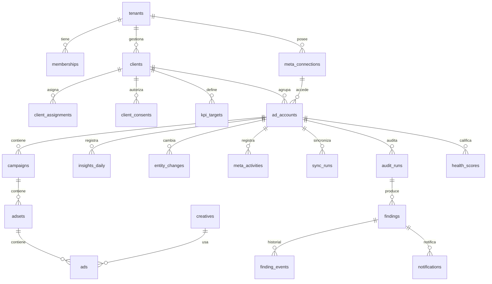

# Esquema de base de datos — Ad Astra

> Versión 0.1 · 2026-10-23 · Estado: **diseño**. El SQL de este documento es un boceto de referencia, no una migración: las migraciones reales se generan y revisan en F1 (ver §7). PostgreSQL 17+.

## 1. Convenciones

| Tema | Regla |
|---|---|
| Identificadores | `uuid` (`gen_random_uuid()`) en entidades propias; identidad `bigint` en tablas de eventos de mucho volumen; los IDs de Meta se guardan como `text` (`meta_id`), nunca como número |
| Tenancy | Toda tabla con datos de un tenant lleva `tenant_id uuid not null` y una política RLS (§4). Excepciones explícitas: las tablas de sistema `jobs`, `meta_rate_state` y `meta_api_calls`, y las de la librería de autenticación |
| Tiempo | `timestamptz` en UTC para instantes; `date` para el día **local de la cuenta publicitaria** en los hechos de insights |
| Dinero | Presupuestos y límites de Meta en **unidades menores** (`bigint`, `*_minor`) junto a la moneda; gasto e importes de insights en unidades mayores (`numeric(20,4)`), insertados desde el string de Meta sin pasar por coma flotante |
| Enumeraciones | `text` + `check` (más fáciles de migrar que los tipos `enum` de Postgres) |
| Datos crudos | `jsonb` con la respuesta de Meta en las entidades (`raw`) para trazabilidad y para campos futuros sin migración |
| Ausencia | `null` significa "no disponible"; `0` significa "Meta informó cero". Nunca se usa `coalesce(x, 0)` en métricas |
| Nombres | `snake_case`, tablas en plural, claves foráneas `<entidad>_id` |
| Borrado | Físico en la purga de clientes (cumplimiento); `deleted_at` solo en entidades que Meta archiva o borra (se conservan para el histórico) |

## 2. Diagrama entidad-relación (núcleo del MVP)



## 3. Tablas

### 3.1 Tenancy, acceso y consentimientos (F1)

```sql
create table tenants (
  id          uuid primary key default gen_random_uuid(),
  slug        text not null unique,
  name        text not null,
  status      text not null default 'active' check (status in ('active','suspended')),
  settings    jsonb not null default '{}',            -- límites de presupuesto LLM, frecuencia de sync…
  created_at  timestamptz not null default now()
);

-- Usuarios y sesiones: tablas gestionadas por Better Auth (ADR-019, Google Workspace).
create table memberships (
  tenant_id   uuid not null references tenants(id),
  user_id     uuid not null,                          -- usuario de la librería de autenticación
  role        text not null check (role in ('owner','admin','manager','analyst','viewer')),
  created_at  timestamptz not null default now(),
  primary key (tenant_id, user_id)
);

create table clients (
  id            uuid primary key default gen_random_uuid(),
  tenant_id     uuid not null references tenants(id),
  name          text not null,
  status        text not null default 'active' check (status in ('active','paused','offboarded')),
  created_at    timestamptz not null default now(),
  offboarded_at timestamptz,
  unique (tenant_id, name)
);

create table client_assignments (                     -- alcance por cliente para manager, analyst y viewer
  tenant_id uuid not null,
  client_id uuid not null references clients(id) on delete cascade,
  user_id   uuid not null,
  primary key (tenant_id, client_id, user_id)
);

create table client_consents (                        -- autorización del cliente, independiente del permiso técnico
  id               uuid primary key default gen_random_uuid(),
  tenant_id        uuid not null,
  client_id        uuid not null references clients(id),
  scope            text[] not null,                   -- {'read_insights','ai_processing','write_status','write_budget'}
  granted_by_name  text not null,
  granted_by_email text not null,
  evidence_ref     text,                              -- referencia al contrato u orden firmada (no el documento)
  granted_at       timestamptz not null,
  revoked_at       timestamptz,
  recorded_by      uuid not null,
  created_at       timestamptz not null default now()
);
```

### 3.2 Conexiones y cuentas de Meta (F1)

```sql
create table meta_connections (
  id                 uuid primary key default gen_random_uuid(),
  tenant_id          uuid not null references tenants(id),
  kind               text not null check (kind in ('system_user','user','business_integration')),
  label              text not null,
  meta_app_id        text not null,
  meta_business_id   text,
  token_ciphertext   bytea not null,                  -- AES-256-GCM: cifrado + etiqueta de autenticación
  token_nonce        bytea not null,                  -- 12 bytes aleatorios por cifrado
  token_key_version  int not null,                    -- versión de la clave maestra (rotación)
  token_fingerprint  text not null,                   -- 8 hex de SHA-256 del token, solo para soporte
  scopes             text[] not null default '{}',
  expires_at         timestamptz,                     -- null = no expira (usuario del sistema)
  status             text not null check (status in ('active','invalid','revoked')),
  last_validated_at  timestamptz,
  last_error_code    int,
  created_by         uuid not null,
  created_at         timestamptz not null default now()
);
-- AAD del cifrado = tenant_id || id: un cifrado copiado a otra fila no se puede descifrar.

create table ad_accounts (
  id                    uuid primary key default gen_random_uuid(),
  tenant_id             uuid not null,
  connection_id         uuid not null references meta_connections(id),
  client_id             uuid references clients(id),
  meta_account_id       text not null,                -- 'act_123…'
  name                  text not null,
  currency              char(3) not null,
  timezone_name         text not null,
  account_status        int not null,
  disable_reason        int,
  user_tasks            text[] not null default '{}', -- ANALYZE, ADVERTISE, MANAGE: habilita o bloquea acciones
  spend_cap_minor       bigint,
  amount_spent_minor    bigint,                       -- unidades a confirmar en V-05
  sync_enabled          boolean not null default false,
  backfill_months       int not null default 13 check (backfill_months between 0 and 37),
  last_entities_sync_at timestamptz,
  last_insights_sync_at timestamptz,
  created_at            timestamptz not null default now(),
  unique (tenant_id, meta_account_id)
);
```

### 3.3 Catálogo de entidades (F1)

```sql
create table campaigns (
  tenant_id              uuid not null,
  meta_id                text not null,
  ad_account_id          uuid not null references ad_accounts(id),
  name                   text not null,
  objective              text,
  status                 text, effective_status text, configured_status text,
  buying_type            text,
  bid_strategy           text,
  daily_budget_minor     bigint, lifetime_budget_minor bigint, budget_remaining_minor bigint,
  budget_sharing_enabled boolean,                      -- is_adset_budget_sharing_enabled
  special_ad_categories  text[],
  advantage_state        text,                         -- advantage_state_info.advantage_state
  smart_promotion_type   text,
  start_time timestamptz, stop_time timestamptz,
  meta_created_time timestamptz, meta_updated_time timestamptz,
  raw                    jsonb not null,
  first_seen_at          timestamptz not null default now(),
  last_synced_at         timestamptz not null,
  deleted_at             timestamptz,                  -- archivada o borrada en Meta
  primary key (tenant_id, meta_id)
);

create table adsets (
  tenant_id            uuid not null,
  meta_id              text not null,
  ad_account_id        uuid not null references ad_accounts(id),
  campaign_meta_id     text not null,
  name                 text not null,
  status               text, effective_status text, configured_status text,
  optimization_goal    text, billing_event text, bid_strategy text,
  bid_amount_minor     bigint,
  daily_budget_minor   bigint, lifetime_budget_minor bigint, budget_remaining_minor bigint,
  destination_type     text,
  promoted_object      jsonb,
  attribution_spec     jsonb,
  learning_stage_info  jsonb,
  issues_info          jsonb,
  targeting_summary    jsonb,                          -- subconjunto acotado de targeting (sin listas enormes)
  kpi_profile          text,                           -- derivado (catálogo de métricas) o sobrescrito
  primary_action_type  text,
  start_time timestamptz, end_time timestamptz,
  meta_created_time timestamptz, meta_updated_time timestamptz,
  raw                  jsonb not null,
  first_seen_at        timestamptz not null default now(),
  last_synced_at       timestamptz not null,
  deleted_at           timestamptz,
  primary key (tenant_id, meta_id)
);

create table ads (
  tenant_id          uuid not null,
  meta_id            text not null,
  ad_account_id      uuid not null references ad_accounts(id),
  adset_meta_id      text not null,
  campaign_meta_id   text not null,
  creative_meta_id   text,
  name               text not null,
  status text, effective_status text, configured_status text,
  issues_info        jsonb,
  ad_review_feedback jsonb,
  meta_created_time timestamptz, meta_updated_time timestamptz,
  raw                jsonb not null,
  first_seen_at      timestamptz not null default now(),
  last_synced_at     timestamptz not null,
  deleted_at         timestamptz,
  primary key (tenant_id, meta_id)
);

create table creatives (
  tenant_id           uuid not null,
  meta_id             text not null,
  ad_account_id       uuid not null references ad_accounts(id),
  name                text,
  object_type         text,
  title               text,                            -- texto NO CONFIABLE (posible prompt injection)
  body                text,                            -- texto NO CONFIABLE
  call_to_action_type text,
  url_tags            text,
  thumbnail_url       text,                            -- nunca se descarga desde el servidor (SSRF)
  raw                 jsonb not null,
  last_synced_at      timestamptz not null,
  primary key (tenant_id, meta_id)
);

create table entity_changes (                          -- cambios de configuración detectados (requisito 8)
  id             bigint generated always as identity primary key,
  tenant_id      uuid not null,
  ad_account_id  uuid not null,
  entity_level   text not null check (entity_level in ('campaign','adset','ad','creative')),
  entity_meta_id text not null,
  field          text not null,                        -- status, daily_budget_minor, bid_amount_minor, optimization_goal…
  old_value      jsonb, new_value jsonb,
  source         text not null check (source in ('sync_diff','activity_log','platform_action')),
  actor          text,                                 -- si el registro de actividad lo indica
  detected_at    timestamptz not null default now()
);

create table meta_activities (                         -- registro de actividad de Meta
  tenant_id            uuid not null,
  ad_account_id        uuid not null,
  hash                 text not null,                  -- deduplicación (no hay id estable documentado)
  event_time           timestamptz not null,
  event_type           text not null,
  translated_event_type text,
  object_id text, object_type text, object_name text,
  actor_id text, actor_name text,                      -- dato personal mínimo: retención de 13 meses
  application_id text, application_name text,
  extra_data           jsonb,
  primary key (tenant_id, ad_account_id, hash)
);
```

### 3.4 Hechos de rendimiento (F1)

```sql
create table insights_daily (
  tenant_id               uuid not null,
  ad_account_id           uuid not null,
  level                   text not null check (level in ('account','campaign','adset','ad')),
  entity_meta_id          text not null,               -- act_…, id de campaña, de conjunto o de anuncio
  date                    date not null,               -- día local de la cuenta
  currency                char(3) not null,
  attribution_setting     text,                        -- el último devuelto por Meta (no forma parte de la clave)
  spend                   numeric(20,4),
  impressions             bigint,
  reach                   bigint,                      -- estimado y diario: NO es sumable
  clicks                  bigint,
  inline_link_clicks      bigint,
  outbound_clicks         bigint,
  results                 numeric(20,4),               -- 'results' de Meta (forma en V-04)
  result_indicator        text,
  primary_results         numeric(20,4),               -- según el perfil KPI; recalculable desde 'actions'
  primary_value           numeric(20,4),
  leads                   numeric(20,4),
  purchases               numeric(20,4),
  purchase_value          numeric(20,4),
  messaging_conversations numeric(20,4),
  app_installs            numeric(20,4),
  landing_page_views      numeric(20,4),
  thruplays               numeric(20,4),
  actions                 jsonb,                       -- crudo, todos los tipos de acción
  action_values           jsonb,
  results_raw             jsonb,
  quality_ranking         text,                        -- solo nivel anuncio; estimado
  engagement_rate_ranking text,
  conversion_rate_ranking text,
  extraction_version      int not null,                -- versión de la lógica que extrae las columnas canónicas
  is_final                boolean not null default false,   -- date < hoy_local − 28 días
  data_flags              text[] not null default '{}',     -- {'immature','estimated_reach',…}
  sync_run_id             bigint not null,
  fetched_at              timestamptz not null,
  primary key (tenant_id, level, entity_meta_id, date)
) partition by range (date);

create index on insights_daily (tenant_id, ad_account_id, level, date);
-- Particiones mensuales creadas por adelantado (3 meses) por un job de mantenimiento:
-- create table insights_daily_2026_10 partition of insights_daily
--   for values from ('2026-10-01') to ('2026-11-01');
```

- **Columnas canónicas:** cada KPI se extrae de **un único** `action_type` canónico por perfil (p. ej. compras desde `omni_purchase` si existe; si no, desde `offsite_conversion.fb_pixel_purchase`), para no contar dos veces. La lógica está versionada (`extraction_version`); si cambia, un job recalcula desde `actions` sin volver a llamar a Meta.
- **Ventanas de atribución alternativas (F3+):** tabla aparte `insights_daily_windows (tenant_id, level, entity_meta_id, date, action_type, window, value)`, solo para los tipos de acción del KPI.
- **Alcance de periodos estándar:** tabla `insights_period_reach (tenant_id, level, entity_meta_id, period ('7d','14d','28d'), end_date, reach, frequency)` calculada en la reexpresión nocturna.

### 3.5 Operación de la sincronización (F1)

```sql
create table sync_runs (
  id             bigint generated always as identity primary key,
  tenant_id      uuid not null,
  ad_account_id  uuid,
  connection_id  uuid,
  kind           text not null check (kind in ('discovery','entities','insights_incremental',
                   'insights_restatement','insights_backfill','activities','token_validation')),
  api_version    text not null,                        -- requisito RQ-1.7
  window_start   date, window_end date,
  status         text not null check (status in ('queued','running','succeeded','partial','failed','throttled')),
  started_at     timestamptz, finished_at timestamptz,
  api_calls      int not null default 0,
  rows_upserted  int not null default 0,
  error_code     int, error_subcode int,
  error_message  text,                                 -- redactado
  job_id         uuid
);

create table jobs (                                   -- trabajo drenado por el tick (ADR-022). Tabla de SISTEMA:
  id           bigint generated always as identity primary key,  -- sin RLS, para que el tick vea el trabajo
  tenant_id    uuid not null,                         -- de todos los tenants; el tick fija app.tenant_id
  kind         text not null,                         -- antes de procesar cada trabajo
  payload      jsonb not null default '{}',           -- SOLO identificadores internos, nunca datos de clientes
  recurring_every interval,                           -- trabajos periódicos por cuenta (incremental, reexpresión…)
  run_after    timestamptz not null default now(),    -- también lo usa el gobernador para esperar cuota
  locked_until timestamptz,                           -- lease del tick que lo procesa
  attempts     int not null default 0,
  max_attempts int not null default 5,
  status       text not null default 'queued' check (status in ('queued','running','succeeded','failed')),
  dedupe_key   text,                                  -- p. ej. 'insights_incremental:<ad_account_id>'
  last_error   text,                                  -- redactado
  created_at   timestamptz not null default now()
);
create unique index jobs_one_active on jobs (dedupe_key) where status in ('queued','running');
create index jobs_due on jobs (run_after) where status = 'queued';
-- Reclamar: select … where status = 'queued' and run_after <= now() order by run_after
--           for update skip locked limit N; al terminar, los recurrentes se re-encolan con
--           run_after = now() + recurring_every.

create table meta_rate_state (                         -- global, sin tenant: Meta limita por app y cuenta
  scope         text primary key,                      -- 'app:insights' | 'app:global' | 'account:act_123'
  blocked_until timestamptz,
  last_usage    jsonb,
  updated_at    timestamptz not null default now()
);

create table meta_api_calls (                          -- control de costos y diagnóstico (retención 30 días)
  id            bigint generated always as identity primary key,
  at            timestamptz not null default now(),
  tenant_id     uuid,
  ad_account_id uuid,
  sync_run_id   bigint,
  method        text not null,
  path_template text not null,                         -- '/act_{id}/insights': sin query ni token
  http_status   int, error_code int, error_subcode int,
  duration_ms   int,
  usage         jsonb                                  -- cabeceras de uso parseadas
);
```

### 3.6 Objetivos y perfiles KPI (F2)

```sql
create table kpi_targets (
  id            uuid primary key default gen_random_uuid(),
  tenant_id     uuid not null,
  client_id     uuid not null references clients(id),
  scope_level   text not null check (scope_level in ('client','account','campaign')),
  scope_meta_id text,                                  -- null en el nivel de cliente
  metric        text not null,                         -- id del catálogo: 'cpl','cpa','roas','cpm'…
  target        numeric not null check (target > 0),
  tolerance_pct numeric not null default 20,
  valid_from    date not null,
  valid_to      date,
  created_by    uuid not null,
  created_at    timestamptz not null default now()
);

create table kpi_profile_overrides (
  tenant_id           uuid not null,
  entity_level        text not null check (entity_level in ('campaign','adset')),
  entity_meta_id      text not null,
  profile             text not null,
  primary_action_type text,
  reason              text not null,
  set_by              uuid not null,
  set_at              timestamptz not null default now(),
  primary key (tenant_id, entity_level, entity_meta_id)
);
```

### 3.7 Auditoría, salud y alertas (F3)

```sql
create table rule_configs (
  tenant_id  uuid not null,
  client_id  uuid,                                     -- null = todo el tenant
  rule_id    text not null,                            -- 'R-EFF-001'
  enabled    boolean not null default true,
  params     jsonb not null default '{}',              -- se valida contra el esquema zod de la regla
  updated_by uuid not null,
  updated_at timestamptz not null default now(),
  unique nulls not distinct (tenant_id, client_id, rule_id)
);

create table audit_runs (
  id             bigint generated always as identity primary key,
  tenant_id      uuid not null,
  ad_account_id  uuid not null,
  trigger        text not null check (trigger in ('post_sync','manual','scheduled')),
  data_as_of     timestamptz not null,
  engine_version text not null,                        -- semver del motor + hash del catálogo de reglas
  started_at     timestamptz not null,
  finished_at    timestamptz,
  status         text not null check (status in ('running','succeeded','failed'))
);

create table findings (                                -- hallazgos de auditoría y alertas en una sola tabla
  id                    uuid primary key default gen_random_uuid(),
  tenant_id             uuid not null,
  ad_account_id         uuid not null,
  kind                  text not null check (kind in ('audit','alert')),
  rule_id               text not null,
  rule_version          int not null,
  entity_level          text not null,
  entity_meta_id        text not null,
  fingerprint           text not null,                 -- regla + entidad (+ parámetro clave)
  severity              text not null check (severity in ('info','low','medium','high','critical')),
  confidence            numeric(4,3) not null check (confidence between 0 and 1),
  priority              numeric not null,
  impact                jsonb not null,                -- {metric, value, currency, method}
  evidence              jsonb not null,                -- valores, periodo, referencia y su fuente, umbral, n
  recommendation_key    text not null,
  recommendation_params jsonb not null default '{}',
  status                text not null check (status in ('open','acknowledged','snoozed','dismissed','resolved')),
  first_seen_run_id     bigint not null,
  last_seen_run_id      bigint not null,
  first_seen_at         timestamptz not null,
  last_seen_at          timestamptz not null,
  snoozed_until         timestamptz,
  resolved_at           timestamptz,
  decided_by            uuid,
  decision_reason       text
);
create unique index findings_one_open on findings (tenant_id, fingerprint)
  where status in ('open','acknowledged','snoozed');
create index on findings (tenant_id, ad_account_id, status, priority desc);

create table finding_events (                          -- historial de alertas y decisiones (requisito 8)
  id         bigint generated always as identity primary key,
  tenant_id  uuid not null,
  finding_id uuid not null references findings(id),
  event      text not null check (event in ('opened','updated','notified','acknowledged',
               'snoozed','dismissed','resolved','reopened','marked_useful','marked_not_useful')),
  actor_type text not null check (actor_type in ('system','user','ai')),
  actor_id   uuid,
  note       text,
  at         timestamptz not null default now()
);

create table health_scores (
  tenant_id       uuid not null,
  entity_level    text not null check (entity_level in ('account','campaign','adset','ad')),
  entity_meta_id  text not null,
  date            date not null,
  formula_version text not null,                       -- 'health-v1'
  profile         text not null,
  window_days     int not null,
  score           numeric(5,2),                        -- null = datos insuficientes
  grade           text not null check (grade in ('excellent','good','attention','critical','insufficient')),
  confidence      numeric(4,3),
  coverage        numeric(4,3) not null,
  components      jsonb not null,                      -- [{id, value, reference, reference_source, q, s, weight, status, confidence, n}]
  computed_at     timestamptz not null,
  primary key (tenant_id, entity_level, entity_meta_id, date, formula_version)
);

create table notification_policies (
  id           uuid primary key default gen_random_uuid(),
  tenant_id    uuid not null,
  client_id    uuid,
  min_severity text not null,
  channel      text not null check (channel in ('email')),
  recipients   jsonb not null,                         -- ids de usuario o roles
  quiet_hours  jsonb,
  digest       boolean not null default true
);

create table notifications (
  id         bigint generated always as identity primary key,
  tenant_id  uuid not null,
  finding_id uuid references findings(id),
  channel    text not null,
  recipient  uuid not null,
  status     text not null check (status in ('queued','sent','failed','suppressed')),
  sent_at    timestamptz,
  error      text
);
```

### 3.8 Registro de auditoría (F1)

```sql
create table audit_log (
  id          bigint generated always as identity primary key,
  tenant_id   uuid,                                    -- null en eventos de plataforma
  at          timestamptz not null default now(),
  actor_type  text not null check (actor_type in ('user','system','ai')),
  actor_id    text,
  action      text not null,                           -- 'meta_connection.created', 'finding.dismissed', 'action.approved'…
  target_type text,
  target_id   text,
  before      jsonb,                                   -- nunca secretos
  after       jsonb,
  request_id  text,
  ip          inet,
  user_agent  text
);
-- Solo inserción: REVOKE UPDATE, DELETE, TRUNCATE ON audit_log FROM app_rw;
-- F7: encadenado de hashes (prev_hash, hash) para evidencia de manipulación.
```

### 3.9 Tablas de fases posteriores (esbozo)

| Fase | Tabla | Propósito |
|---|---|---|
| F4 | `llm_usage` | Proveedor, modelo, versión de prompt, propósito, tokens (entrada, salida, caché), costo, latencia, estado; sin contenido |
| F4 | `ai_conversations`, `ai_messages` | Conversaciones con referencias de evidencia y llamadas a herramientas; contenido con retención de 90 días |
| F4 | `documents`, `document_chunks` | Documentos con estado (`draft`, `approved`, `archived`), aprobador y fecha; fragmentos con `tsvector` (FTS); `embedding vector` solo si se adopta pgvector |
| F4 | `reports` | Reportes ejecutivos generados: periodo, versión de plantilla, evidencias, estado de verificación |
| F5 | `action_proposals` | Tipo, parámetros, snapshot actual, justificación, origen (`rule`, `ai`, `user`), impacto esperado, estado (máquina de estados de ARCHITECTURE §6.9), proponente, aprobadores, expiración |
| F5 | `action_executions` | Intento, clave de idempotencia (única), petición y respuesta redactadas, verificación, `rollback_of` |
| F5 | `kill_switches` | Interruptores global y por tenant, con autor y motivo |
| F6 | `forecasts`, `forecast_backtests`, `simulations` | Modelo y versión, horizonte, puntos con intervalos, métricas de backtest, supuestos |

## 4. Aislamiento multi-tenant (RLS)

**Roles de base de datos:**

| Rol | Uso | Privilegios |
|---|---|---|
| `app_owner` | Migraciones | Propietario de las tablas; no lo usa la aplicación en ejecución |
| `app_rw` | API y worker | `NOBYPASSRLS`; DML sin DDL; sin `UPDATE` ni `DELETE` en `audit_log` |
| `app_ro` | Consultas de solo lectura e informes | `SELECT`, con RLS |
| `app_maint` | Scripts de mantenimiento puntuales (purga, particiones) | `BYPASSRLS`; credencial separada, nunca en la aplicación |

**Política tipo**, aplicada a toda tabla con `tenant_id`:

```sql
alter table campaigns enable row level security;
alter table campaigns force row level security;
create policy tenant_isolation on campaigns
  using      (tenant_id = nullif(current_setting('app.tenant_id', true), '')::uuid)
  with check (tenant_id = nullif(current_setting('app.tenant_id', true), '')::uuid);
```

- Cada petición de la API y cada job abre una transacción y ejecuta `set local app.tenant_id = '<uuid>'` (y `app.user_id`). Sin contexto, `current_setting(..., true)` devuelve `null` y la política no deja ver ni escribir nada: **falla cerrado**.
- El alcance por cliente (manager, analyst, viewer) se aplica en la capa de servicio. Una segunda política opcional con `app.client_ids` se evalúa en F7.
- **Verificación automática (CI):** un test recorre `information_schema` y falla si alguna tabla con `tenant_id` no tiene RLS forzado, salvo las de la lista explícita de tablas de sistema (`jobs`, `meta_api_calls`); otro inserta datos de dos tenants e intenta leerlos, actualizarlos y borrarlos de forma cruzada con `app_rw`.
- `jobs`, `meta_rate_state` y `meta_api_calls` son tablas de sistema sin RLS, usadas por el `tick`; no contienen datos de clientes más allá de IDs internos (un test comprueba que `jobs.payload` solo lleva claves de identificadores).

## 5. Índices y particionado

- `insights_daily` (y `insights_daily_windows` cuando exista) se particionan **por mes**. La clave primaria incluye `date`, como exige el particionado. Un job mensual crea con antelación las particiones de los próximos 3 meses y la purga por retención elimina particiones enteras.
- Índices iniciales: los de las claves primarias más los declarados en §3. Cualquier índice nuevo se justifica con un `EXPLAIN` en el PR.
- No se crean vistas materializadas en el MVP. Si el p95 de los dashboards supera el objetivo, se añaden agregados diarios por cuenta y cliente.

## 6. Retención y borrado

| Datos | Retención por defecto | Motivo |
|---|---|---|
| `insights_daily` y entidades | Igual al backfill configurado (máximo 37 meses, como Meta) | Análisis histórico |
| `meta_activities` | 13 meses | Contiene nombres de personas (dato personal mínimo) |
| `meta_api_calls` | 30 días | Diagnóstico y costos |
| `sync_runs` | 90 días de detalle; resumen mensual agregado | Operación |
| `findings`, `finding_events` | 24 meses | Historial de decisiones |
| `health_scores` | 24 meses | Evolución histórica |
| `audit_log` | 24 meses como mínimo (ampliable por requisitos legales) | Trazabilidad |
| `llm_usage` | 13 meses | Costos |
| `ai_messages` (contenido) | 90 días | Minimización |

**Purga de un cliente** (baja o revocación del consentimiento; Condiciones de Meta §3.d): job con `app_maint` que borra los insights, entidades, actividades, hallazgos, puntuaciones y documentos del cliente, desactiva sus cuentas, conserva en `audit_log` solo el evento de purga (sin datos de rendimiento) y genera un acta. Se ejecuta en ≤ 30 días desde la solicitud (plazo a confirmar con asesoría legal).

## 7. Migraciones

- Esquema en TypeScript con Drizzle y SQL generado con drizzle-kit, **revisado a mano y versionado** en `migrations/`. Las políticas RLS, los permisos y las particiones van en migraciones SQL explícitas.
- **Solo hacia delante.** Los cambios incompatibles siguen el patrón *expand → migrate → contract* en despliegues separados.
- Se ejecutan con `app_owner` como paso previo al despliegue; la aplicación no arranca si hay migraciones pendientes (`/readyz`).
- La CI levanta un Postgres vacío, aplica todas las migraciones y ejecuta los tests de RLS e integración.

## 8. Estimación de volumen (SUP-03)

| Tabla | Supuesto | Filas/año | Tamaño aprox./año |
|---|---|---|---|
| `insights_daily` (nivel anuncio) | 50 cuentas × 200 anuncios con entrega/día × 365 | ~3,7 M | ~5 GB (JSONB comprimido por TOAST) |
| `insights_daily` (otros niveles) | +~30 % | ~1,1 M | ~1,5 GB |
| Entidades | ~20 000 anuncios/año | ~30 000 | < 0,5 GB |
| `findings` y `finding_events` | ~200 evaluaciones abiertas/día | ~100 000 | < 0,5 GB |
| `meta_api_calls` | 25 000/día, 30 días | ~750 000 en ventana | < 0,5 GB |

Total del primer año: < 10 GB. Postgres con particionado mensual tiene margen de sobra; el diseño escala a 500 cuentas (~60 GB/año) sin cambiar de tecnología.

## 9. Pendiente

- Confirmar unidades de `amount_spent` y `spend_cap` (V-05) y la forma de `results` (V-04) antes de cerrar la migración de `insights_daily`.
- Elegir la librería de autenticación (ADR-019), que determina las tablas de usuarios y sesiones.
- Decidir con asesoría legal los plazos de retención y de purga.
