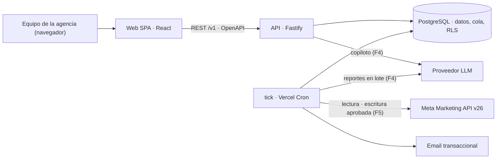
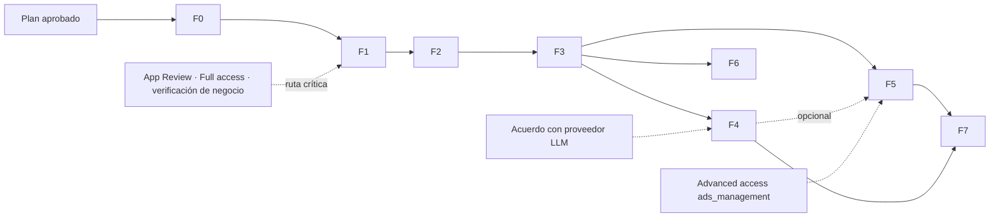

# Plan maestro — Ad Astra · Meta Ads Intelligence Platform

> **Documento rector.** Gobierna la ejecución de todas las fases. Si otro documento lo contradice, prevalece este hasta que se registre una decisión nueva en [DECISIONS.md](DECISIONS.md).

| Campo | Valor |
|---|---|
| Versión | 0.2 — **aprobado** por el responsable el 2026-10-23 |
| Fecha | 2026-10-23 |
| Fase actual | **F0 en curso** (fundaciones y spikes de viabilidad) |
| Estado del código | Esqueleto de F0: cliente mínimo de Meta, tests, CI y spike (ver [ROADMAP §4.1](ROADMAP.md#41-f0--fundaciones-y-spikes-de-viabilidad)) |
| Próximo hito | Ejecución del spike de Meta por el responsable → cierre de F0 (H1) |

## 0. Mapa de documentos

| Documento | Contenido | Cuándo se actualiza |
|---|---|---|
| **MASTER_PLAN.md** (este) | Visión, alcance, clasificación de requisitos, MVP, riesgos, reglas de ejecución | Cada cierre de fase y cada cambio de alcance |
| [ROADMAP.md](ROADMAP.md) | Fases F0–F7 en detalle (9 apartados por fase), dependencias, trazabilidad, deuda técnica | Cada cierre de fase |
| [ARCHITECTURE.md](ARCHITECTURE.md) | Módulos, flujos, fórmulas (salud, reglas), contrato de API, RNF, despliegue | Cuando cambia un componente |
| [API_INTEGRATIONS.md](API_INTEGRATIONS.md) | Meta Marketing API (versión, permisos, límites, errores, datos), proveedores LLM, email | Cada spike y cada versión nueva de Meta |
| [DATABASE_SCHEMA.md](DATABASE_SCHEMA.md) | Modelo de datos, RLS, particionado, retención, migraciones | Con cada migración |
| [SECURITY.md](SECURITY.md) | Modelo de amenazas, controles, RBAC, IA segura, cumplimiento, backups | Cada fase |
| [DECISIONS.md](DECISIONS.md) | Registro de decisiones (ADR), incluida la evaluación open source | Cada decisión |
| [TESTING.md](TESTING.md) | Estrategia de pruebas, política de credenciales, criterios de aceptación | Cada fase |
| [CHANGELOG.md](CHANGELOG.md) | Cambios por versión | Cada entrega |

## 1. Resumen ejecutivo

**Qué se construye.** Una plataforma web interna para una agencia que gestiona múltiples clientes en Meta (Facebook/Instagram). Conecta las cuentas publicitarias autorizadas, sincroniza su configuración y rendimiento en una base de datos propia, calcula métricas de forma determinista, audita automáticamente, asigna índices de salud explicables, alerta de problemas y —en fases posteriores— explica con IA, predice con incertidumbre y ejecuta optimizaciones **solo con aprobación humana**. La arquitectura queda preparada para evolucionar a SaaS multiempresa.

**Veredicto de viabilidad: viable, con tres condiciones.**
1. **Aprobaciones de Meta en la ruta crítica.** Producción requiere el nivel *Full access* del Marketing API Access Tier (el nivel por defecto, *Limited*, es "solo para desarrollo"), *Advanced access* a `ads_read` (y a `ads_management` para escribir) para cuentas de otros negocios, y verificación del negocio. Se inicia el trámite en F0, en paralelo al desarrollo.
2. **Autorizaciones y contratos.** Autorización documentada de cada cliente y acuerdo escrito con el proveedor LLM como "proveedor de servicios" (Condiciones de la Plataforma de Meta, §5.a).
3. **Disciplina de alcance.** El encargo describe un producto muy amplio. El MVP se limita a lectura + inteligencia determinista (F0–F3). IA, escritura y predicción llegan después, sobre datos ya confiables.

**MVP (F0–F3):** conexión multi-cliente, sincronización incremental y programada, dashboards de cartera/cuenta/campaña/conjunto/anuncio coherentes con Ads Manager, motor de auditoría con evidencia, índice de salud explicable y alertas por email. Sin IA generativa y sin escrituras en Meta.

**Hallazgos de la investigación que cambian el diseño** (detalle en §4.4 y [API_INTEGRATIONS.md](API_INTEGRATIONS.md)):
- La versión vigente es **v26.0** (publicada el 2026-07-29). La v24.0 deja de estar disponible en noviembre de 2026 y la v25.0 el 2027-02-23. Los repositorios que fijan v21.0 ya están fuera de soporte.
- Meta lanzó en 2026 sus propios **conectores de IA** (servidor MCP de Ads y Ads CLI, beta abierta desde el 2026-04-29). Hay que diferenciarse en lo que no cubren: vista multi-cuenta, auditorías deterministas y reproducibles, gobierno de cambios con aprobación y trazabilidad, e historial.
- **Atribución en movimiento:** desde el 2026-01-12 desaparecen las ventanas `7d_view` y `28d_view`; desde marzo de 2026 el clic solo cuenta clics en enlace (el resto pasa a *engage-through*). Las series históricas tienen roturas metodológicas que la plataforma debe señalar.
- Ninguno de los 6 repositorios candidatos sirve como base; dos aportan metodología valiosa para portar (ver §5).

## 2. Estado actual del repositorio (evaluado el 2026-10-23)

- Directorio `C:\Users\Mayco\Documents\Ad Astra` **vacío**. No es un repositorio git. No hay código, configuración ni datos.
- Herramientas en la máquina de desarrollo: Node.js 22.20.0, Python 3.13.7, git 2.47.1, GitHub CLI 2.95 autenticado.
- Consecuencia: no hay deuda heredada. F0 crea el repositorio, el esqueleto y la CI.

## 3. Visión, usuarios y alcance

**Visión.** Pasar de "mirar dashboards" a "operar con inteligencia": que cada gestor sepa cada mañana qué cuentas requieren atención, por qué (con evidencia verificable) y qué hacer, y que todo cambio quede gobernado y auditado.

**Usuarios (MVP interno):**

| Persona | Necesidad principal |
|---|---|
| Dirección de la agencia | Salud de la cartera, riesgos de inversión, concentración, tendencias |
| Gestor de cuentas / media buyer | Qué cuentas y entidades requieren acción hoy; comparaciones; alertas |
| Analista | Diagnóstico detallado, desgloses, reglas y umbrales |
| Administrador técnico | Conexiones Meta, permisos, estado de sincronización, cuotas, costos |
| *Futuro (F7):* cliente final | Vista de solo lectura de su cuenta y reportes |

**Dentro del alcance general:** los 10 bloques de capacidades del encargo (ver §4.1).

**Fuera del alcance (no-objetivos), salvo decisión explícita:**
- Crear campañas desde cero, subir creatividades o editar textos de anuncios (el centro de optimización empieza con estados y presupuestos).
- Otras plataformas publicitarias (Google, TikTok). La arquitectura no lo impide, pero no se diseña para ello.
- Datos personales de leads (formularios instantáneos). Se excluyen del alcance por riesgo y por no ser necesarios para optimizar.
- Atribución multi-touch propia o integración con CRM/GA4 (candidato posterior a F6).
- Facturación, planes y autoservicio (F7).

## 4. Requisitos, decisiones y suposiciones

### 4.1 Requisitos confirmados (del encargo)

| ID | Requisito | Fases |
|---|---|---|
| RQ-0.1 | Uso interno de agencia multi-cliente, con arquitectura evolutiva a SaaS multiempresa | Todas, F7 |
| RQ-0.2 | Investigar y justificar la reutilización de open source antes de construir | Planificación, cada fase |
| RQ-0.3 | Mantener los 9 documentos transversales; trabajar por fases con revisión de deuda | Todas |
| RQ-1.1 | Autenticación y autorización oficial con Meta | F0, F1 |
| RQ-1.2 | Gestión de cuentas publicitarias vinculadas | F1 |
| RQ-1.3 | Múltiples clientes y negocios | F1 |
| RQ-1.4 | Campañas, conjuntos, anuncios, creatividades, métricas y resultados | F1, F2 |
| RQ-1.5 | Sincronización incremental y programada | F1 |
| RQ-1.6 | Paginación, rate limits, errores, reintentos, expiración de credenciales | F1 |
| RQ-1.7 | Registro de versiones de API y permisos | F1 |
| RQ-1.8 | Diferenciar datos disponibles, estimados y no disponibles | F1, F2 |
| RQ-1.9 | Escrituras solo con permisos adecuados | F5 |
| RQ-2.1 | Dashboards: inversión, impresiones, alcance, frecuencia, CPM, CPC, CTR, resultados, CPR, leads, CPL, CPA, ROAS, conversiones, atribución, calidad de eventos | F2 (calidad de eventos: F3) |
| RQ-2.2 | Tendencias y variaciones históricas | F2 |
| RQ-2.3 | Comparación entre cuentas, campañas y periodos | F2 |
| RQ-2.4 | Segmentación por las dimensiones que permita la API | F2 |
| RQ-2.5 | Métricas y criterios de éxito según el objetivo publicitario | F2, F3 |
| RQ-3.1 | Reglas configurables: eficiencia, rendimiento, estabilidad, fatiga, saturación, entrega, estructura, atribución, seguimiento, cambios bruscos, riesgos de inversión | F3 |
| RQ-3.2 | Cada problema con evidencia, impacto estimado, confianza, prioridad y recomendación | F3 |
| RQ-4.1 | Índices de salud para cuentas, campañas, conjuntos y anuncios | F3 |
| RQ-4.2 | Adaptados al objetivo, métricas normalizadas, ponderaciones configurables | F3 |
| RQ-4.3 | Considerar volumen y calidad de datos; no concluir con muestras insuficientes; ausencia de datos ≠ mal rendimiento | F3 |
| RQ-4.4 | Fórmulas expuestas e histórico | F3 |
| RQ-5.1 | Uno o más proveedores LLM tras una interfaz desacoplada | F4 |
| RQ-5.2 | IA que consulta, explica, interpreta, prioriza, recomienda, justifica, compara, responde y redacta reportes | F4 |
| RQ-5.3 | Contexto documental aprobado, sin suponer memoria automática | F4 |
| RQ-5.4 | Separar cálculo determinista de interpretación generativa; nunca inventar datos ni capacidades | F4 (base desde F2) |
| RQ-6.1 | Evaluar e implementar, si se justifican: regresión, series temporales, anomalías, cambio de tendencia, Monte Carlo, Markov, escenarios presupuestarios, estimaciones probabilísticas | F3 (básico), F6 |
| RQ-6.2 | Intervalos de incertidumbre, validación retrospectiva, limitaciones; sin causalidad ni garantías | F6 |
| RQ-7.1 | Recomendaciones accionables y propuestas de presupuesto, anuncios y conjuntos | F3 (recomendaciones), F5 |
| RQ-7.2 | Aprobación humana, previsualización, permisos, registro, verificación y reversión | F5 |
| RQ-7.3 | La IA no modifica campañas sin autorización explícita | F4, F5 |
| RQ-8.1 | Supervisión periódica: CPR inusual, caída de conversiones, sin entrega, gasto sin resultados, fatiga, fallos de conexión/sync, cambios relevantes | F1 (sync), F3 |
| RQ-8.2 | Historial de alertas, decisiones y acciones | F3, F5 |
| RQ-9.x | Multi-tenancy verificable, RBAC, cifrado, auditoría, consentimientos, protección de endpoints, validación E/S, prompt injection, control de costos API/LLM, asíncrono, observabilidad, backups; tokens nunca en frontend, logs, prompts ni repositorios | F0–F1 (base), todas |
| RQ-10.x | Código tipado y modular, tests, contratos de API, migraciones, validación, errores explícitos, documentación reproducible, ejemplos, entornos, criterios de aceptación | Todas |

### 4.2 Decisiones propuestas (requieren aprobación)

| Decisión | Resumen | ADR |
|---|---|---|
| Arquitectura | Monolito modular en TypeScript: una API y un *worker* lógico del mismo código | ADR-001 |
| Alojamiento | **Vercel Pro + Neon** (PQ-04): SPA y API en Vercel; el worker es una función `tick` que Vercel Cron invoca cada 5 min | ADR-022 |
| Almacenamiento | PostgreSQL (Neon) como único almacén: datos, tabla de trabajos y búsqueda. Sin Redis ni bases analíticas o vectoriales hasta que se justifiquen | ADR-002, ADR-022 |
| Acceso del personal | Google Workspace (PQ-05) con Better Auth; sin contraseñas locales | ADR-019 |
| Integración Meta | Cliente HTTP propio y delgado (el SDK oficial de Node en npm va retrasado: 24.0.1), versión fijada v26.0 | ADR-004, ADR-005 |
| Acceso a Meta (MVP) | Token de **usuario del sistema** del portafolio comercial de la agencia, con las cuentas de los clientes compartidas como socio. Facebook Login for Business en F7 | ADR-006 |
| Aislamiento | `tenant_id` en todas las tablas + Row Level Security de Postgres + tests de aislamiento | ADR-007 |
| Credenciales | AES-256-GCM con clave maestra versionada fuera de la BD; KMS en SaaS | ADR-008 |
| Modelo de hechos | Insights diarios por nivel, ratios calculados en consulta, reexpresión de 28 días, particionado mensual | ADR-009 |
| IA | Herramientas de solo lectura sobre nuestros datos calculados; verificador de cifras; proveedor inicial Anthropic (`claude-opus-5-5`) tras una interfaz delgada | ADR-010, ADR-011 |
| Escrituras | Solo mediante flujo de propuesta → aprobación → ejecución → verificación, con guardrails | ADR-013 |
| Frontend / contrato | SPA React + Vite; REST `/v1` con OpenAPI 3.1 generado desde zod | ADR-016, ADR-017 |
| Estadística | Métodos simples y explicables en TS (Poisson/Gamma, Beta-Binomial, robustos); Python solo si F6 lo justifica | ADR-018 |

### 4.3 Suposiciones (a validar; si alguna falla, se replanifica)

| ID | Suposición | Cómo se valida | Impacto si falla |
|---|---|---|---|
| SUP-01 | ~~La agencia tiene (o puede crear) un portafolio comercial verificado y una app de Meta de tipo Business~~ **Confirmado** (PQ-01) | — | — |
| SUP-02 | Los clientes comparten sus cuentas con el portafolio de la agencia como socio | Inventario en F0 | Cambia el modelo de acceso (ADR-006) |
| SUP-03 | Volumen inicial: **10–50 cuentas** (confirmado, PQ-02), ≤ 300 anuncios activos por cuenta, < 50 usuarios internos | Anuncios activos y usuarios: inventario en F0 | Dimensionado de cuotas y BD |
| SUP-04 | Equipo de referencia: 2 desarrolladores full-stack + 0,5 perfil de datos | Confirmación del responsable | Duraciones del ROADMAP |
| SUP-05 | Interfaz en español; una sola región de alojamiento | Confirmación del responsable | i18n, residencia de datos |
| SUP-06 | Mezcla de objetivos: leads, ventas, mensajes y tráfico (reconocimiento en menor medida) | Inventario en F0 | Prioridad de perfiles KPI y reglas |
| SUP-07 | Monedas distintas entre cuentas son posibles | Inventario en F0 | Fuente de tipo de cambio (ADR-020) |
| SUP-08 | Se permite enviar métricas agregadas (sin PII) a un proveedor LLM con acuerdo escrito | Revisión legal antes de F4 | F4 se limita o cambia de proveedor |

### 4.4 Hechos verificados en la investigación (fuentes oficiales, 2026-10-23)

- **Versiones:** Marketing API v26.0 publicada el 2026-07-29 (vigencia "por determinar"); v25.0 disponible hasta el 2027-02-23; v24.0 hasta el 2026-11-10 según el changelog de Marketing API (la página general de versiones indica 2026-10-06; discrepancia documentada).
- **Niveles de acceso renombrados:** *Limited access* (por defecto, "solo para desarrollo") y *Full access* (requiere revisión). Requisitos automáticos de Full: ≥ 500 llamadas en 15 días y < 15 % de errores en las últimas 500 llamadas.
- **Cuentas de terceros:** requieren *Advanced access* a `ads_read` y/o `ads_management` (App Review) y, para datos sensibles, verificación del negocio.
- **Límites:** puntuación por cuenta (lectura 1 punto, escritura 3; Limited: máximo 60 con bloqueo de 300 s; Full: 9000 con bloqueo de 60 s), cuotas BUC por cuenta y hora, límite de plataforma de Insights a nivel app, 100 mutaciones/s, 1 edición cada 30 s por objeto, 4 cambios de presupuesto por conjunto y hora, 10 cambios de límite de gasto por día.
- **Insights:** datos refrescados cada 15 min, estables a los 28 días, en zona horaria de la cuenta; retención total de 37 meses; métricas únicas, desgloses horarios y de alcance con más de 13 meses de antigüedad restringidos (desgloses de frecuencia: 6 meses); `report_run_id` asíncrono caduca a los 30 días.
- **Tokens:** los de usuario del sistema no expiran y Meta los recomienda para servidor a servidor; `appsecret_proof` (HMAC-SHA256 del token con el app secret) es obligatorio si se activa *Require App Secret*.
- **Webhooks de cuenta publicitaria:** `effective_status`, `with_issues_ad_objects`, `in_process_ad_objects`, `creative_fatigue`, `ad_recommendations`, `subscriptions` (umbrales de métricas). Solo avisan; los detalles se consultan después.
- **Specs oficiales en GitHub:** `facebook-business-sdk-codegen/api_specs` publica 1000 objetos (AdsInsights: 229 campos) y Meta indica que ahí se reflejan los cambios fuera de ciclo.
- **Conectores de IA de Meta:** servidor MCP en `https://mcp.facebook.com/ads` (OAuth con Facebook Login for Business; permiso `ads_mcp_management` + `ads_read`/`ads_management`); reglas de gobierno desde el 2026-07-16.
- **Condiciones de la plataforma:** los proveedores de servicios deben aceptar por escrito tratar los datos solo según nuestras instrucciones (§5.a); hay que eliminar los datos cuando ya no sean necesarios o lo pida Meta o el usuario (§3.d); hay que notificar incidentes lo antes posible (§6.b); Meta puede auditar (§7).

### 4.5 Pendiente de verificar en el spike de F0

Lista completa con criterio de cierre en [API_INTEGRATIONS.md §1.20](API_INTEGRATIONS.md#120-puntos-a-verificar-en-el-spike-de-f0). Los críticos son:
- **V-01** si las cuentas de clientes compartidas como socio son accesibles en *Limited access* o exigen *Advanced access* desde el primer día;
- **V-02** si Graph API acepta el token en la cabecera `Authorization`, para no llevarlo en la query string;
- **V-04** la forma exacta de `results` y su equivalencia con la columna "Resultados" de Ads Manager.

## 5. Investigación de soluciones existentes (resumen)

Evaluación completa (existencia, licencia, mantenimiento, calidad, dependencias, seguridad, compatibilidad) en [DECISIONS.md, ADR-014](DECISIONS.md#adr-014--reutilización-open-source-portar-ideas-no-depender-de-los-repositorios-candidatos).

| Repositorio | Licencia · actividad | Veredicto |
|---|---|---|
| curtiskline/meta-ads-manager | MIT · 5 commits (feb-2026), abandonado | **Descartar.** Es un esqueleto de Next.js: la página principal es la plantilla por defecto y no hay ninguna integración con Meta, aunque el README la describe |
| soyalvaropareja/dashboard-meta-ads | MIT · 4 commits (abr-2026) | **No reutilizar código.** API v21 fija, promedia ratios, confunde ausencia con cero, umbrales absolutos en MXN, sin tests. Tomar ideas de UX |
| fortytwode/meta-ads-account-audit | MIT · 2 commits (jun-2026) | **Referencia metodológica, portar a TS:** detección del evento primario, monedas sin decimales, umbral adaptativo, cambios de régimen, descomposición del CPA. Su bucle de reintentos nunca se rinde |
| arcbaslow/meta-ads-agents | MIT · 41 commits, releases, CI, 124 tests, v26 | **Mejor referencia.** Portar fatiga con umbral de impresiones, diagnóstico de entrega, correlación cambios↔métricas, taxonomía de errores y redacción de tokens. CLI de Python de solo lectura, no es un servicio |
| robyroro/meta-ads-portfolio-intelligence | MIT · 1 commit (jul-2026) | **Ideas para la vista de cartera** (concentración HHI, chequeos de sanidad). Suma conversiones de objetivos distintos; no reutilizar |
| mikusnuz/meta-ads-mcp | MIT · 23 commits, 91★, activo (oct-2026), v26 | **Referencia de contratos de escritura** para F5. No apto para producción: token en query string, sin reintentos, sin anotaciones de herramientas destructivas, una sola cuenta |

Otros hallazgos: SDK oficial de Node (npm desfasado en v24 → no usar), specs oficiales de la API (→ usar en tests de contrato), conector de Airbyte (licencia ELv2 → no copiar código, solo estudiar el diseño), `fivetran/dbt_facebook_ads` (Apache-2.0, referencia de modelado), conectores SaaS como Supermetrics (plan B de solo lectura si App Review se bloquea).

## 6. Restricciones de Meta que condicionan el diseño

1. **Versionado agresivo:** cada versión dura unos 12 meses en Marketing API y hay cambios fuera de ciclo quincenales → versión centralizada, tests de contrato contra las specs oficiales y un runbook de actualización por versión.
2. **Cuotas por cuenta y por app** → gobernador de cuotas que lee las cabeceras de uso, programa con holgura (objetivo < 75 % de uso), usa consultas asíncronas para volúmenes grandes y lotes de hasta 50 peticiones.
3. **Datos que cambian durante 28 días** → reexpresión diaria de los últimos 28 días; marca de dato "final"; "en maduración" para los días recientes.
4. **Métricas no aditivas** (alcance, frecuencia, métricas únicas) → nunca se suman entre días, entidades ni cuentas; se consultan por periodo o se marcan como no disponibles.
5. **Atribución:** la API refleja la configuración de Ads Manager; ventanas de vista largas eliminadas; definición de clic cambiada en marzo de 2026 → guardar `attribution_setting` y anotar las roturas en las series.
6. **Zona horaria y moneda por cuenta** → los días son locales de cada cuenta; no se suman monedas distintas sin conversión explícita.
7. **Escrituras limitadas** (4 cambios de presupuesto/hora por conjunto, 1 edición/30 s por objeto) y con efectos secundarios (reinicio de la fase de aprendizaje) → guardrails en F5.
8. **Advantage+:** presupuesto a nivel de campaña; con Advantage+ audience la segmentación son sugerencias; campañas ASC/AAC heredadas bloqueadas para edición desde v26 → las reglas de auditoría deben conocerlo.
9. **Condiciones de la plataforma** → minimización y retención definidas, borrado al dar de baja a un cliente, acuerdo escrito con subencargados (incluido el proveedor LLM).

## 7. Arquitectura propuesta (resumen)

Principios (desarrollados en [ARCHITECTURE.md](ARCHITECTURE.md)):
1. **Determinismo primero:** métricas, reglas, salud y pronósticos son código puro, versionado y testeable. La IA solo interpreta resultados ya calculados.
2. **Una sola fuente de verdad local:** se consulta a Meta en segundo plano; los dashboards leen de Postgres.
3. **Ausencia ≠ cero:** cada valor tiene un estado (disponible, estimado, no disponible, no aplica, en maduración).
4. **Ratios de sumas, nunca promedios de ratios.**
5. **Mínimo de piezas:** un lenguaje, una base de datos, una API, un tick programado y ninguna dependencia sin justificación escrita.
6. **Seguridad por defecto:** aislamiento por RLS, secretos cifrados y nunca expuestos, la IA sin capacidad de escritura.

## 8. Producto mínimo viable (MVP)

**Definición:** fases F0 a F3 completas. Incremento usable intermedio al cerrar F2 (lectura confiable de toda la cartera).

**Historias de usuario del MVP:**

| ID | Historia |
|---|---|
| HU-01 | Como administrador, conecto el portafolio de la agencia a Meta con un token de usuario del sistema y veo las cuentas accesibles, con sus permisos |
| HU-02 | Como administrador, asigno cuentas a clientes y registro la autorización de cada cliente |
| HU-03 | Como gestor, veo la cartera completa: inversión, resultados, CPR frente a objetivo y salud por cliente y cuenta |
| HU-04 | Como gestor, comparo periodos y entidades, veo tendencias diarias con anotaciones de cambios (propios y metodológicos de Meta) y exploro desgloses |
| HU-05 | Como analista, veo hallazgos priorizados con evidencia, impacto y confianza, y los acepto o descarto con un motivo |
| HU-06 | Como gestor, recibo alertas por email ante CPR disparado, caída de resultados, gasto sin resultados, falta de entrega, fatiga o fallos de sincronización |
| HU-07 | Como administrador, veo el estado de sincronización, el uso de cuota de la API y los errores de conexión |
| HU-08 | Como cualquier usuario, distingo claramente los datos no disponibles, estimados o en maduración |

**Exclusiones explícitas del MVP:** copiloto IA, reportes generados por IA, escrituras en Meta, pronósticos y simulaciones, webhooks, portal de clientes, SSO empresarial.

**Criterios de salida del MVP (release):**
1. Criterios de aceptación de F0–F3 cumplidos ([ROADMAP.md](ROADMAP.md)).
2. Checklist de seguridad F0–F3 cumplida ([SECURITY.md §8](SECURITY.md#8-checklist-de-seguridad-por-fase)).
3. Piloto de 2 semanas con ≥ 3 clientes reales autorizados y datos sincronizados ≥ 99 % de los días.
4. Simulacro de restauración de backup superado.
5. Documentación actualizada y [CHANGELOG.md](CHANGELOG.md) con versión `0.4.0`.

**Métricas de éxito propuestas (a confirmar con la agencia):** tiempo de revisión semanal por cliente (reducción ≥ 50 % frente a la línea base medida en F0); ≥ 70 % de alertas de severidad alta marcadas como "útiles" durante el piloto; uso semanal por todos los gestores.

## 9. Fases y dependencias (resumen)

| Fase | Objetivo | Tamaño* | Depende de | Prioridad |
|---|---|---|---|---|
| F0 | Fundaciones y spikes de viabilidad (acceso Meta real, cliente mínimo, repo, CI) | S–M (1–2 sem) | Aprobación del plan | Must |
| F1 | Núcleo de datos: tenancy, conexiones Meta, ingesta incremental | L (3–5 sem) | F0 | Must |
| F2 | Analítica centralizada | M (2–3 sem) | F1 | Must |
| F3 | Auditoría, salud y alertas → **cierra el MVP** | L (3–4 sem) | F2 | Must |
| F4 | Copiloto IA de solo lectura y reportes | M–L (3–4 sem) | F3, revisión legal (SUP-08) | Should |
| F5 | Centro de optimización con aprobación humana | L (3–5 sem) | F3 (F4 opcional), `ads_management` avanzado | Should |
| F6 | Predicción, anomalías avanzadas y simulación | L (4–6 sem) | F3 y ≥ 6 meses de histórico | Could |
| F7 | Evolución a SaaS multiempresa | Abierto | F1–F5 | Could (según negocio) |

\* Orientativo bajo SUP-04. Incluye pruebas y documentación; no incluye los tiempos de revisión de Meta.

## 10. Riesgos de viabilidad (registro)

| ID | Riesgo | Prob. | Impacto | Mitigación | Indicador / disparador | Fase |
|---|---|---|---|---|---|---|
| RSK-01 | App Review, Full access o verificación del negocio se retrasan o se rechazan | Media | Alto | Iniciar en F0; desarrollar en Limited con cuentas propias y sandbox; generar las 500 llamadas con < 15 % de error; casos de uso claros; plan B de solo lectura con un conector SaaS | Sin aprobación al cerrar F1 | F0–F1 |
| RSK-02 | Cambios de versión o fuera de ciclo rompen la ingesta | Alta | Medio | Versión centralizada, tests de contrato con las specs oficiales, alertas de error por campo, runbook trimestral | Errores 100 tras un cambio de Meta | Todas |
| RSK-03 | Las cifras no cuadran con Ads Manager y se pierde la confianza | Media | Alto | Mismos campos (`results`), atribución y zona horaria; tests de conciliación; mostrar la configuración de atribución y la frescura | Diferencias > 1 % en conciliación | F1–F2 |
| RSK-04 | Agotamiento de cuotas en cuentas grandes | Media | Medio | Gobernador, asíncrono, partición de consultas, ventanas incrementales, escalonado | Uso > 75 % sostenido | F1 |
| RSK-05 | Falsos positivos en reglas y alertas (fatiga de alertas) | Alta | Medio | Umbrales mínimos de volumen, pruebas estadísticas, control de FDR, deduplicación, feedback "útil / no útil" | < 50 % útiles en el piloto | F3 |
| RSK-06 | La IA inventa cifras o sobreafirma causalidad | Media | Alto | Herramientas con datos calculados, verificador de cifras, lenguaje probabilístico, evals | Fallos del verificador en evals | F4 |
| RSK-07 | Prompt injection vía nombres de anuncios, textos o documentos | Media | Alto | Datos marcados como no confiables, IA sin escritura ni red, alcance por tenant y RBAC, suite de inyección | Fallo de la suite | F4 |
| RSK-08 | Cumplimiento: enviar datos de Meta a un LLM sin acuerdo; retención indebida | Media | Alto | DPA con el proveedor, minimización (sin PII), políticas de retención y borrado, registro de subencargados | Revisión legal pendiente al iniciar F4 | F1, F4 |
| RSK-09 | Una escritura errónea causa daño económico | Baja | Muy alto | Aprobación humana, guardrails, previsualización con estado en vivo, kill switch, reversión, pruebas en sandbox | Cualquier incidente | F5 |
| RSK-10 | Inferencias estadísticas inválidas (muestras pequeñas, no estacionariedad, confusión) | Alta | Medio | Intervalos, backtesting, baseline ingenuo obligatorio, advertencias explícitas | Modelo peor que el baseline | F3, F6 |
| RSK-11 | Los conectores de IA oficiales de Meta solapan la propuesta de valor | Media | Medio | Diferenciarse en multi-cuenta, gobierno, auditoría reproducible e historial; reevaluar en F6 | Nuevas funciones de Meta | Estratégico |
| RSK-12 | Un token se invalida (lo revoca un administrador o se rota el app secret) | Media | Medio | Validación diaria con `debug_token`, alerta inmediata, flujo de reconexión | Error 190 | F1 |
| RSK-13 | Alcance excesivo frente a la capacidad del equipo | Alta | Alto | Puertas de fase, MVP estricto, MoSCoW, revisión de alcance en cada cierre | Desvío > 30 % en una fase | Todas |
| RSK-14 | Dependencia de una librería de autenticación inmadura | Baja | Medio | Validar en F0 (licencia, mantenimiento, auditorías); plan B gestionado | Resultado del spike | F0 |

## 11. Principios de ingeniería y reglas de ejecución

**Reglas del encargo (vinculantes):** trabajar por fases con objetivos concretos; no desarrollar todo de una vez; distinguir lo confirmado, lo propuesto y lo supuesto; consultar documentación oficial vigente para lo que dependa de Meta; evitar dependencias y complejidad innecesarias; **no sustituir funcionalidades reales por simulaciones silenciosas**; no usar credenciales reales en pruebas automatizadas sin autorización; mantener desacopladas las integraciones externas; revisar código y deuda técnica al cerrar cada fase.

**Principios adicionales:**
- Ninguna dependencia nueva sin una línea de justificación en el PR (qué resuelve y por qué no basta lo existente).
- Todo dato simulado o de demostración se etiqueta visiblemente como tal en la UI y en la API.
- Ningún número aparece en la UI sin definición publicada en el catálogo de métricas.
- Las reglas, la fórmula de salud y los modelos se versionan; cada resultado guarda la versión que lo produjo.
- Los errores se tratan explícitamente: se clasifican, se registran redactados y se reflejan en la UI.

**Definición de terminado (por historia):** código tipado y revisado; tests (unitarios y de integración cuando aplique) en verde en la CI; validación de entradas en la frontera; errores tratados; documentación afectada actualizada; sin secretos en el código ni en los logs; criterio de aceptación demostrado.

**Puerta de cierre de fase (obligatoria):**
1. Los 9 apartados de la fase completos en [ROADMAP.md](ROADMAP.md) (objetivo, requisitos, arquitectura, plan, artefactos, pruebas y resultados, riesgos, criterios de aceptación, dependencias).
2. Criterios de aceptación demostrados y resultados registrados en [TESTING.md](TESTING.md).
3. Revisión de código de la fase y actualización del registro de deuda técnica.
4. Checklist de seguridad de la fase.
5. Documentos transversales y CHANGELOG actualizados.
6. Decisión explícita del responsable: continuar, ajustar o detener.

## 12. Preguntas abiertas para el responsable del producto

| ID | Pregunta | Bloquea | Respuesta (2026-10-23) |
|---|---|---|---|
| PQ-01 | ¿Existe ya una app de Meta y un portafolio comercial verificado? ¿Quién es su administrador? | F0 | App de tipo Business y portafolio **verificado**. Administrador: pendiente |
| PQ-02 | ¿Cuántos clientes, cuentas y anuncios activos hay, y con qué objetivos y monedas? | Dimensionado F1 y F2 | **10–50 cuentas**. Objetivos y monedas: pendientes (los dará el spike) |
| PQ-03 | ¿Tamaño del equipo y fecha objetivo del MVP? | Planificación | Pendiente |
| PQ-04 | ¿Proveedor de nube preferido y residencia de datos (UE, LatAm, EE. UU.)? ¿Qué legislación aplica a la agencia y a sus clientes (RGPD, LFPDPPP, LGPD…)? | F1 (despliegue), cumplimiento | **Vercel + Neon** (ADR-022). Región y legislación: pendientes (PQ-04b) |
| PQ-04b | ¿En qué región deben residir los datos y qué legislación aplica? | F1 (región de Vercel y Neon) | Pendiente |
| PQ-05 | ¿Autenticación del personal con Google Workspace o Microsoft 365 (SSO) o con email y contraseña + 2FA? | F1 | **Google Workspace** (ADR-019) |
| PQ-06 | ¿Canales de alerta además del email (Slack, WhatsApp, Teams)? | F3 |
| PQ-07 | ¿Hay contrato vigente con algún proveedor LLM? ¿Restricciones para enviar datos de clientes? | F4 |
| PQ-08 | ¿Qué acciones de escritura se quieren primero y con qué umbrales de doble aprobación? | F5 |
| PQ-09 | ¿Los clientes verán la plataforma (portal) o solo recibirán reportes? | RBAC, F7 |
| PQ-10 | ¿Hay objetivos de KPI por cliente (CPL o ROAS objetivo) ya definidos? ¿Dónde están? | F2–F3 |

## 13. Próximos pasos inmediatos

Plan aprobado el 2026-10-23. Esqueleto de F0 construido (ver [ROADMAP §4.1](ROADMAP.md#41-f0--fundaciones-y-spikes-de-viabilidad)). Para cerrar F0:

1. **Responsable:** configurar Meta según el checklist de [API_INTEGRATIONS §1.21](API_INTEGRATIONS.md#121-checklist-de-configuración-en-meta-f0) y ejecutar `pnpm spike:meta` (prueba manual autorizada).
2. **Responsable:** responder PQ-03 y PQ-04b. (Hecho: repositorio privado `MaycollJaramillo01/ad-astra` con la CI en verde.)
3. **Equipo:** documentar los hallazgos V-01 a V-14, ajustar los ADR 006 y 009 y cerrar F0 (CHANGELOG 0.1.0).
4. Antes de F1: cuentas de Vercel Pro y Neon Launch, y cliente OAuth "Internal" en Google Cloud.
