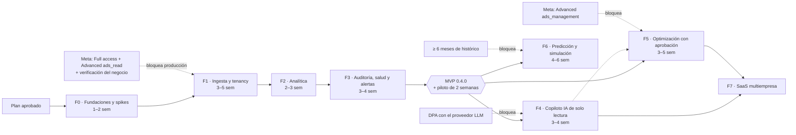

# Hoja de ruta — Ad Astra

> Versión 0.1 · 2026-10-23. Las duraciones son orientativas bajo SUP-04 (2 desarrolladores full-stack + 0,5 perfil de datos) y no incluyen los plazos de revisión de Meta. Cada fase se cierra con la puerta de [MASTER_PLAN.md §11](MASTER_PLAN.md#11-principios-de-ingeniería-y-reglas-de-ejecución).

## 1. Vista general

| Versión | Contenido |
|---|---|
| 0.1.0 | F0: repositorio, CI, spike de Meta |
| 0.2.0 | F1: ingesta multi-cliente |
| 0.3.0 | F2: analítica (primer incremento usable) |
| **0.4.0** | **F3: MVP** |
| 0.5.0 | F4: copiloto IA |
| 0.6.0 | F5: optimización |
| 0.7.0 | F6: predicción |
| 1.0.0 | Estabilización tras el piloto ampliado (y F7 si el negocio lo decide) |

## 2. Trazabilidad requisitos ↔ fases

| Requisito ([MASTER_PLAN §4.1](MASTER_PLAN.md#41-requisitos-confirmados-del-encargo)) | F0 | F1 | F2 | F3 | F4 | F5 | F6 | F7 |
|---|---|---|---|---|---|---|---|---|
| RQ-1.1 Autenticación oficial con Meta | ● | ● | | | | | | ● |
| RQ-1.2/1.3 Cuentas y multi-cliente | | ● | | | | | | ● |
| RQ-1.4 Entidades y métricas | ○ | ● | ● | | | | | |
| RQ-1.5/1.6 Sincronización y robustez | ○ | ● | | | | | | |
| RQ-1.7 Versiones y permisos | ○ | ● | | | | | | |
| RQ-1.8 Disponible / estimado / no disponible | | ● | ● | | | | | |
| RQ-1.9 Escrituras con permisos | | | | | | ● | | |
| RQ-2.x Analítica | | | ● | ○ | | | | |
| RQ-3.x Auditoría | | | | ● | | | | |
| RQ-4.x Salud | | | | ● | | | | |
| RQ-5.x IA | | | ○ | | ● | | | |
| RQ-6.x Predicción | | | | ○ | | | ● | |
| RQ-7.x Optimización | | | | ○ | ○ | ● | | |
| RQ-8.x Alertas e historial | | ○ | | ● | | ● | | |
| RQ-9.x Seguridad y arquitectura | ● | ● | ● | ● | ● | ● | ● | ● |
| RQ-10.x Calidad | ● | ● | ● | ● | ● | ● | ● | ● |

● fase principal · ○ base o aporte parcial

## 3. Prioridades (MoSCoW)

| Must (MVP) | Should (tras el MVP) | Could | Won't (por ahora) |
|---|---|---|---|
| Conexión Meta segura, ingesta incremental, tenancy + RLS, RBAC, dashboards coherentes con Ads Manager, estados de dato, auditoría con evidencia, salud explicable, alertas por email, registro de auditoría, backups | Copiloto IA de solo lectura, reportes ejecutivos, optimización con aprobación (estados y presupuestos), webhooks, calidad de eventos avanzada (EMQ) | Pronósticos, simulación Monte Carlo, Markov, curva de madurez de conversiones, Slack y Teams, portal de clientes, SSO | Creación de campañas, gestión creativa, otras plataformas, PII de leads, atribución propia |

## 4. Fases

Plantilla de cada fase: (1) objetivo y alcance · (2) requisitos funcionales y no funcionales · (3) arquitectura y componentes afectados · (4) plan de implementación · (5) artefactos que se entregarán · (6) pruebas previstas y dónde se registran sus resultados · (7) riesgos y limitaciones · (8) criterios de aceptación verificables · (9) dependencias para la fase siguiente.

### 4.1 F0 — Fundaciones y spikes de viabilidad

> **Estado (2026-10-23): en curso.** Hecho: PQ-01, 02, 04 y 05 respondidas; repositorio git local; esqueleto (un solo paquete, ADR-001 revisado); TypeScript 7 estricto con ejecución nativa en Node 22; Biome; Vitest con 50 tests en verde; Postgres 17 local con roles; cliente mínimo de Meta (versión, `appsecret_proof`, paginación por cursor, taxonomía de errores, cabeceras de uso, redacción); snapshot de specs v26 y test de contrato; sanitizador de fixtures; script del spike; repositorio privado `MaycollJaramillo01/ad-astra` con la CI en verde. Pendiente: configuración en Meta, **ejecución del spike por el responsable**, hallazgos V-01 a V-14, solicitudes de App Review y verificación, línea base de tiempos y PQ-03 y PQ-04b. Drizzle se aplaza a F1, con la primera tabla real.

1. **Objetivo y alcance.** Eliminar las incertidumbres críticas antes de construir: acceso real a Meta (nivel, permisos, cuentas de socio), comportamiento de la API v26, esqueleto del repositorio, CI y entorno local reproducible. **No** incluye funcionalidades de producto.
2. **Requisitos.**
   - FR: script `pnpm spike:meta` que, con un token de usuario del sistema leído de una variable de entorno local, valida el token (`debug_token`), lista las cuentas accesibles con `user_tasks`, descarga 30 días de insights diarios de una cuenta en los 4 niveles (síncrono y asíncrono), captura las cabeceras de uso y escribe fixtures **sanitizadas**.
   - FR: repositorio con el código de servidor (la web y los tipos compartidos llegan en F1, ADR-001); `docker compose up` levanta Postgres; `pnpm test` en verde.
   - NFR: el token nunca aparece en la salida, los logs ni los fixtures; reproducible en una máquina limpia siguiendo el README.
3. **Arquitectura afectada.** `platform/logging` (redacción), roles de BD, `modules/meta` mínimo (GET y POST, paginación, `appsecret_proof`, errores, cabeceras de uso, campos), CI.
4. **Plan.**
   1. Responder PQ-01 a PQ-05.
   2. Configuración en Meta: app de tipo Business con el producto Marketing API; **Require App Secret** activado; usuario del sistema; asignación de cuentas propias y de al menos una de cliente (autorizada) como socio; token con `ads_read`; solicitudes de verificación del negocio y de App Review (Advanced `ads_read`) preparadas y enviadas cuando el formulario lo permita.
   3. `git init`, remoto, rama `main` protegida; esqueleto pnpm; TypeScript estricto; lint; Vitest; GitHub Actions (typecheck, lint, test, auditoría de dependencias, escaneo de secretos).
   4. Docker Compose con Postgres 17 y roles `app_owner` y `app_rw` (Drizzle se configura en F1 con la primera migración real).
   5. Cliente mínimo de Meta + logging con redacción + tests unitarios.
   6. Spike: resolver V-01 a V-14 ([API_INTEGRATIONS §1.20](API_INTEGRATIONS.md#120-puntos-a-verificar-en-el-spike-de-f0)) y documentar los hallazgos.
   7. Autenticación (ADR-019): verificada la librería (licencia, mantenimiento, avisos); la integración con Google Workspace, Fastify y RLS pasa al inicio de F1, donde se usa por primera vez.
   8. Medir la línea base de la agencia: tiempo actual de revisión semanal por cliente (para la métrica de éxito del MVP).
   9. Actualizar los ADR afectados y CHANGELOG 0.1.0.
5. **Artefactos.** Repositorio inicial, README de puesta en marcha, `.env.example`, `docker-compose.yml`, pipeline de CI, script de spike, fixtures sanitizadas de v26, snapshot de specs de los objetos usados, sección "Hallazgos del spike" en API_INTEGRATIONS, ADR actualizados.
6. **Pruebas.** Unitarias: `appsecret_proof` (vector conocido), redacción de URLs y de objetos de log, clasificación de errores. Contrato: campos pedidos ⊆ specs v26. Manual autorizada: ejecución del spike contra una cuenta real con permiso explícito, registrada en [TESTING.md §9](TESTING.md#9-pruebas-manuales-autorizadas).
7. **Riesgos.** RSK-01 (App Review), V-01 negativo (las cuentas de socio exigen Advanced desde el inicio), datos reales en fixtures (se sanitizan y revisan antes del commit), RSK-14 (librería de autenticación).
8. **Criterios de aceptación.**
   - CA-F0-01: en una máquina limpia, `pnpm install && docker compose up -d && pnpm test` termina en verde siguiendo solo el README.
   - CA-F0-02: el spike descarga ≥ 30 días de insights de ≥ 1 cuenta autorizada, y gasto, impresiones y clics por día coinciden con Ads Manager (misma zona horaria y atribución); las diferencias se documentan.
   - CA-F0-03: la búsqueda del token y del `appsecret_proof` en logs, salida y fixtures de la ejecución da 0 coincidencias (verificación automatizada con el test canario).
   - CA-F0-04: nivel de acceso, permisos y tareas documentados con evidencia (respuesta de `debug_token` redactada).
   - CA-F0-05: cada punto V-01 a V-14 tiene respuesta o una decisión explícita de aplazamiento.
   - CA-F0-06: solicitudes de verificación del negocio y de App Review enviadas (o con la fecha de envío planificada y su motivo).
9. **Dependencias para F1.** Token válido con cuentas accesibles; respuesta a V-01 (modelo de acceso confirmado); cuentas de Vercel Pro y Neon (Launch o superior) creadas por el responsable; región de datos decidida (PQ-04b); cliente OAuth "Internal" en el Google Cloud del Workspace (ADR-019).

### 4.2 F1 — Núcleo de datos: tenancy, conexiones Meta e ingesta

1. **Objetivo y alcance.** Sincronizar de forma fiable, incremental y programada las cuentas autorizadas de varios clientes hacia Postgres, con aislamiento multi-tenant y gestión segura de credenciales. Incluye una UI administrativa mínima. No incluye dashboards de análisis.
2. **Requisitos.**
   - FR: login del personal con Google Workspace (alta por invitación; 2FA impuesto por el Workspace); tenant de la agencia; gestión de usuarios y roles; CRUD de clientes, asignaciones y consentimientos; alta de la conexión Meta (token de solo escritura, validación y cifrado); descubrimiento de cuentas; asignación de cuentas a clientes; activación de la sincronización por cuenta; jobs `entities`, `insights_incremental`, `insights_restatement`, `insights_backfill`, `activities` y `token_validation`; gobernador de cuotas; página de estado del sistema; registro de auditoría; detección de cambios de configuración (`entity_changes`).
   - NFR: idempotencia; fallo cerrado de RLS; uso de cuota < 75 %; datos de hoy con ≤ 90 min de retraso; ningún token fuera del backend; errores clasificados y visibles.
3. **Arquitectura afectada.** `tenancy`, `meta` (cliente completo: lotes, asíncrono, cabeceras, gobernador), `catalog`, `insights` (almacenamiento), `platform/jobs` (tabla `jobs` + `tick`, ADR-022), `platform/crypto`, `audit_log`; tablas de DATABASE_SCHEMA §3.1–3.5 y §3.8; despliegue en Vercel + Neon.
4. **Plan.**
   0. Despliegue mínimo en Vercel Pro + Neon (staging): API de prueba, cron del `tick` y conexión con *pooling*, para validar ADR-022 antes de construir encima.
   1. Migraciones base (Drizzle), roles, RLS y tests de aislamiento (lo primero, antes que cualquier tabla con datos).
   2. Autenticación, RBAC centralizado y tests de autorización por endpoint.
   3. Cifrado de tokens y conexiones Meta (alta, validación, rotación e invalidación).
   4. Cliente de Meta completo y gobernador (con tests de reloj simulado).
   5. Trabajos de sincronización drenados por el `tick` (tabla de sistema `jobs`, recurrentes por cuenta); upserts idempotentes; reexpresión de 28 días; particiones mensuales.
   6. UI administrativa: conexiones, cuentas, clientes, consentimientos y estado de sincronización.
   7. Staging con 2–3 cuentas reales autorizadas durante 7 días.
   8. Cierre: revisión de código, deuda, checklist de seguridad F1, CHANGELOG 0.2.0.
5. **Artefactos.** Migraciones, módulos `tenancy`, `meta`, `catalog` e `insights` (almacenamiento), jobs, OpenAPI v0.2, UI administrativa y runbooks: alta de un cliente, rotación de token y respuesta ante el error 190.
6. **Pruebas.** Unitarias (gobernador, taxonomía, paginación, sondeo asíncrono con temporizadores falsos, cifrado: ida y vuelta, AAD alterado, versión de clave), integración con Postgres real (RLS cruzado en todas las tablas, upsert idempotente, reexpresión que actualiza valores, particiones), contrato con fixtures v26, e2e (login → conectar → descubrir → asignar → ver el estado), test canario.
7. **Riesgos.** RSK-01, RSK-02, RSK-04 y RSK-12; cuentas grandes con "too much data"; entidades archivadas o borradas que siguen teniendo insights; cambios fuera de ciclo.
8. **Criterios de aceptación.**
   - CA-F1-01: ejecutar dos veces el mismo sync no produce cambios netos (test de integración).
   - CA-F1-02: el test de aislamiento recorre todas las tablas con `tenant_id` (salvo la lista explícita de tablas de sistema); un usuario del tenant A no lee, actualiza ni borra filas de B, y una tabla nueva sin RLS hace fallar la CI.
   - CA-F1-03: el token no aparece en ninguna respuesta de la API, log, error ni tabla de diagnóstico (test canario y test de contrato de las respuestas).
   - CA-F1-04: ante el error 190, la conexión pasa a `invalid`, se abre una alerta crítica y sus jobs se detienen sin reintentos infinitos.
   - CA-F1-05: ante los códigos de throttling (4, 17, 613, 80000…), el job se reprograma según las cabeceras sin fallar el run ni duplicar datos (test con respuestas simuladas).
   - CA-F1-06: en staging, el incremental horario y la reexpresión nocturna funcionan 7 días seguidos sin intervención, con uso de cuota < 75 %.
   - CA-F1-07: totales diarios por cuenta de gasto, impresiones y clics iguales a Ads Manager en 3 cuentas × 3 rangos; las diferencias de resultados se explican (atribución o madurez).
   - CA-F1-08: cada `sync_run` registra la versión de API, la ventana, las llamadas, las filas y el error redactado; cada conexión, sus scopes y su última validación.
9. **Dependencias para F2.** Hechos fiables en `insights_daily`; catálogo de entidades con `kpi_profile` derivado; Full access aprobado (o fecha prevista) para pasar a producción.

### 4.3 F2 — Analítica centralizada

1. **Objetivo y alcance.** Dashboards fiables de cartera, cliente, cuenta, campaña, conjunto y anuncio, con métricas coherentes con Meta y conscientes del objetivo. Es el primer incremento usable.
2. **Requisitos.**
   - FR: catálogo de métricas publicado en la UI (definición, fórmula, unidad, aditividad); perfiles KPI con detección automática y sobrescritura; objetivos KPI por cliente; vista de cartera (inversión, resultados, CPR frente a objetivo, concentración HHI); vista de cuenta (KPIs, tendencias, comparación de periodos: anterior y año anterior); tablas jerárquicas con filtros; series diarias con anotaciones (cambios de `entity_changes` y `meta_activities`, cambios metodológicos de Meta del 2026-01-12 y de marzo de 2026); comparación entre cuentas, campañas y periodos; descomposición del cambio de CPA; desgloses en vivo con caché; estados de dato en toda la UI; frescura visible; exportación CSV; multi-moneda según ADR-020.
   - NFR: p95 < 1,5 s en cartera (50 cuentas × 13 meses) y < 500 ms en tablas; accesibilidad básica; interfaz usable en tablet.
3. **Arquitectura afectada.** `packages/shared/metrics`, `insights` (servicio de consultas), `catalog`, web (dashboards), endpoints `/v1/insights/*`, `/v1/entities/*` y `/v1/kpi-*`.
4. **Plan.** Catálogo y tests de métricas → servicio de consulta (ratios de sumas, comparación, agrupación) → perfiles y objetivos KPI → vistas de cartera y cuenta → tablas y series → desgloses en vivo → exportación → pruebas de rendimiento y conciliación → cierre.
5. **Artefactos.** Catálogo de métricas (código y página en la UI), endpoints de consulta, dashboards, dataset sintético de rendimiento, informe de conciliación con Ads Manager.
6. **Pruebas.** Golden tests por métrica; test de propiedad (el ratio de sumas difiere del promedio de ratios en casos construidos); nulos frente a ceros; el alcance multi-día nunca es una suma; conciliación manual autorizada; e2e de dashboards; carga con el dataset sintético.
7. **Riesgos.** RSK-03 (paridad con Ads Manager), métricas no aditivas, multi-moneda, expectativas de "tiempo real" (los datos se refrescan cada 15 min en Meta y cada hora en Ad Astra).
8. **Criterios de aceptación.**
   - CA-F2-01: cada métrica visible está en el catálogo con definición y test.
   - CA-F2-02: en 3 cuentas reales × 3 rangos, gasto, impresiones, clics y resultados coinciden con Ads Manager con la misma configuración; las diferencias se documentan con su causa.
   - CA-F2-03: un valor no disponible se muestra como "No disponible" con su motivo y nunca como 0 (e2e).
   - CA-F2-04: el alcance de un rango arbitrario nunca se calcula sumando días (test).
   - CA-F2-05: el p95 se cumple con el dataset de referencia.
   - CA-F2-06: con varias monedas, la cartera muestra totales por moneda o convertidos y etiquetados, nunca mezclados.
9. **Dependencias para F3.** Catálogo y servicio de consultas estables; perfiles y objetivos KPI cargados para los clientes del piloto.

### 4.4 F3 — Auditoría, índices de salud y alertas (cierra el MVP)

1. **Objetivo y alcance.** Evaluar automáticamente cada cuenta, campaña, conjunto y anuncio con reglas configurables y un índice de salud explicable, y alertar tras cada sincronización. Calidad de eventos básica.
2. **Requisitos.**
   - FR: motor de reglas con registro, parámetros por tenant y cliente validados por esquema y versionado; catálogo v1 de 16 reglas ([ARCHITECTURE §6.5](ARCHITECTURE.md#65-motor-de-auditoría)); hallazgos con evidencia, impacto, confianza, prioridad y recomendación; ciclo de vida y decisiones con motivo; índice `health-v1` ([ARCHITECTURE §6.6](ARCHITECTURE.md#66-índice-de-salud-fórmula-health-v1)) con desglose visible, pesos configurables e histórico diario; alertas de los 7 tipos del requisito 8 con deduplicación, estados, políticas de notificación, resumen y email; marcas "útil / no útil"; calidad de eventos (estadísticas del píxel y, si V-14 lo permite, EMQ).
   - NFR: determinismo (mismas entradas → mismos hallazgos y puntuaciones, con el hash de entrada guardado); evaluación de 50 cuentas en < 5 min tras el sync; control de FDR.
3. **Arquitectura afectada.** Módulos `audit`, `health`, `alerts` y `notifications`; web (bandeja de hallazgos, vistas de salud, centro de alertas, configuración de reglas); tablas de DATABASE_SCHEMA §3.7.
4. **Plan.** Interfaz de reglas y harness de tests → reglas por categoría (primero las de entrega y gasto sin resultados, que son las de mayor valor) → salud v1 → alertas, deduplicación y notificaciones → UI → piloto de 2 semanas con ≥ 3 clientes → calibración de umbrales → cierre del MVP.
5. **Artefactos.** Catálogo de reglas (código y documentación por regla: lógica, parámetros, muestra mínima, impacto, ejemplos), fórmula de salud publicada en la UI, plantillas de email, informe del piloto.
6. **Pruebas.** Por regla: casos "dispara", "no dispara" y "datos insuficientes" con fixtures; golden tests de salud (recalculados desde los componentes guardados); test de determinismo; pruebas estadísticas con datos sintéticos de parámetros conocidos (tasa de falsos positivos ≤ el nivel nominal); backtest de alertas sobre el histórico; e2e de bandeja y alertas.
7. **Riesgos.** RSK-05 (fatiga de alertas), RSK-10 (inferencias inválidas), umbrales que no sirven para todos los verticales, malinterpretación de la puntuación.
8. **Criterios de aceptación.**
   - CA-F3-01: cada regla tiene documentación, parámetros con esquema, muestra mínima y tests de los 3 estados.
   - CA-F3-02: cada hallazgo muestra valores, periodo, referencia y su fuente, umbral, tamaño de muestra, versión de la regla, impacto con su método y confianza.
   - CA-F3-03: una entidad con datos insuficientes muestra "Datos insuficientes", nunca una puntuación baja (test), y la puntuación se reproduce desde los componentes guardados (test).
   - CA-F3-04: una misma condición produce una sola alerta abierta; se resuelve sola tras N evaluaciones sin la condición; cada transición queda en `finding_events`.
   - CA-F3-05: las alertas de conexión y sincronización llegan por email en ≤ 15 min desde la detección.
   - CA-F3-06 (objetivo de piloto, no bloqueante): ≥ 70 % de las alertas de severidad alta marcadas como "útiles".
   - **CA-MVP:** criterios de salida de [MASTER_PLAN §8](MASTER_PLAN.md#8-producto-mínimo-viable-mvp).
9. **Dependencias para F4/F5/F6.** Hallazgos, salud e historial como datos estructurados consultables; consentimientos con alcance `ai_processing` y de escritura donde corresponda.

### 4.5 F4 — Copiloto IA de solo lectura y reportes ejecutivos

1. **Objetivo y alcance.** Explicar variaciones, interpretar auditorías, priorizar oportunidades, responder preguntas y redactar reportes con cifras verificables, sin capacidad de escritura.
2. **Requisitos.**
   - FR: interfaz `LlmProvider` con la implementación de Anthropic; herramientas de solo lectura ([ARCHITECTURE §6.8](ARCHITECTURE.md#68-capa-de-ia-f4)); chat por cliente y cuenta con citas de evidencia; explicación de hallazgos; comparación de periodos y estrategias; reportes ejecutivos semanales y mensuales generados en lote; documentos con flujo de aprobación y búsqueda FTS; verificador de cifras; presupuestos y registro de uso; prompts versionados en el repositorio; set de evals.
   - NFR: 0 cifras no trazables mostradas sin marca; respuestas en streaming; costo mensual por tenant ≤ presupuesto; sin PII ni secretos en el contexto.
3. **Arquitectura afectada.** Módulo `ai`; tablas de DATABASE_SCHEMA §3.9 (F4); web (chat, reportes, documentos).
4. **Plan.** Revisión legal y DPA → interfaz y adaptador → herramientas y verificador → evals (≥ 50 preguntas con respuestas verificables preparadas con los gestores) → chat → reportes en lote → documentos y FTS → suite de inyección → cierre.
5. **Artefactos.** Prompts versionados, definiciones de herramientas, set de evals con su script, informe de costos, plantillas de reporte.
6. **Pruebas.** Unitarias de herramientas (alcance por tenant y RBAC); verificador (casos con cifras inventadas, redondeos y formatos); evals (exactitud de cifras 100 %, ausencia de lenguaje causal, cobertura de la pregunta); suite de inyección (nombres de anuncios y documentos con instrucciones); test de inventario de herramientas; tests de presupuesto.
7. **Riesgos.** RSK-06, RSK-07 y RSK-08; costos; dependencia del proveedor (mitigada por la interfaz).
8. **Criterios de aceptación.**
   - CA-F4-01: en el set de evals, el 100 % de las cifras mostradas como verificadas existen en los resultados de las herramientas.
   - CA-F4-02: el inventario de herramientas disponibles para el LLM no incluye ninguna que escriba o llame a Meta (test).
   - CA-F4-03: la suite de inyección no tiene ningún caso en que el contenido de anuncios o documentos altere las instrucciones, exfiltre datos de otro tenant o provoque acciones.
   - CA-F4-04: al superar el presupuesto mensual, las nuevas peticiones se bloquean con un mensaje claro y queda registrado.
   - CA-F4-05: los documentos no aprobados nunca aparecen en la recuperación (test).
   - CA-F4-06: los gestores del piloto valoran como útiles ≥ 70 % de las explicaciones de hallazgos (objetivo, no bloqueante).
9. **Dependencias para F5.** Esquema de propuesta de acción que la IA puede redactar (sin ejecutar).

### 4.6 F5 — Centro de optimización con aprobación humana

1. **Objetivo y alcance.** Proponer, previsualizar, aprobar, ejecutar, verificar y revertir cambios en Meta con control total. Tipos iniciales: estado (pausar o activar) y presupuesto (diario o total) de campañas, conjuntos y anuncios.
2. **Requisitos.**
   - FR: propuestas desde reglas, IA o usuarios; previsualización con estado en vivo, diff, impacto esperado con intervalo y advertencias; guardrails ([ARCHITECTURE §6.9](ARCHITECTURE.md#69-centro-de-optimización-f5)); aprobación por rol con doble aprobación por encima del umbral y reautenticación; ejecución idempotente; verificación; reversión; kill switch; seguimiento antes y después (con la advertencia de que no es causal); webhooks de `effective_status` y `with_issues_ad_objects`.
   - NFR: ninguna escritura sin aprobación registrada; sin duplicados ante fallos; trazabilidad completa.
3. **Arquitectura afectada.** Módulo `optimization`; métodos de escritura de `meta`; webhooks en la API; tablas de DATABASE_SCHEMA §3.9 (F5); web (cola de propuestas, diff, historial).
4. **Plan.** Advanced `ads_management` aprobado → cuenta sandbox (V-06) → máquina de estados y guardrails → ejecutor, verificación y reversión → UI → webhooks → pruebas en sandbox → piloto con acciones de bajo riesgo (pausas) → presupuestos → cierre.
5. **Artefactos.** Módulo `optimization`, runbook de incidentes de escritura, catálogo de tipos de acción con su reversibilidad.
6. **Pruebas.** Máquina de estados (todas las transiciones válidas e inválidas); guardrails; idempotencia (fallo a mitad de la ejecución → reintento sin duplicar); integración con Meta simulado; e2e del flujo de aprobación; **escrituras reales solo en la cuenta sandbox autorizada**.
7. **Riesgos.** RSK-09; reinicio de la fase de aprendizaje; límites de Meta; fallos parciales; permisos mal configurados.
8. **Criterios de aceptación.**
   - CA-F5-01: no existe camino del código que escriba en Meta sin una propuesta `approved` y un aprobador distinto del proponente cuando aplica la doble aprobación (test de arquitectura + tests).
   - CA-F5-02: cada ejecución guarda la instantánea anterior y posterior, el resultado de la verificación y la entrada en el registro de auditoría.
   - CA-F5-03: revertir en sandbox restaura el estado y el presupuesto previos.
   - CA-F5-04: el kill switch bloquea las ejecuciones pendientes en ≤ 1 ciclo del worker.
   - CA-F5-05: los errores 613/1487632 y 613/4841018 se gestionan con reprogramación y sin duplicados.
9. **Dependencias para F6/F7.** Historial de acciones y resultados para evaluar impacto y alimentar modelos.

### 4.7 F6 — Predicción, anomalías avanzadas y simulación

1. **Objetivo y alcance.** Estimaciones probabilísticas, pronósticos y escenarios presupuestarios con validación retrospectiva; detección de anomalías estadística que refine las reglas de F3.
2. **Requisitos.** FR: técnicas de [ARCHITECTURE §6.10](ARCHITECTURE.md#610-predicción-y-simulación-f6) con su condición de publicación; curva de madurez de conversiones por cuenta; evaluación antes y después de las acciones; fichas de modelo. NFR: ningún modelo visible sin superar su baseline; intervalos calibrados.
3. **Arquitectura afectada.** Módulo `forecasting` (TS); worker opcional de Python solo si lo decide el spike de ADR-018.
4. **Plan.** Harness de backtesting de origen móvil → baselines → ETS → anomalías robustas y CUSUM → curvas de respuesta y Monte Carlo → Markov (solo si se justifica) → UI de escenarios → cierre.
5. **Artefactos.** Fichas de modelo, informes de backtest, UI de escenarios.
6. **Pruebas.** Backtesting; recuperación de parámetros con datos sintéticos; calibración (cobertura empírica de los intervalos del 80 % entre el 70 y el 90 %); inyección sintética de anomalías (precisión y recall).
7. **Riesgos.** RSK-10 (no estacionariedad, confusión con el algoritmo de entrega de Meta, pocos datos); exceso de confianza de los usuarios.
8. **Criterios de aceptación.**
   - CA-F6-01: ningún pronóstico se muestra para una serie en la que no supera al baseline ingenuo estacional (MASE < 1) en el backtest.
   - CA-F6-02: cobertura empírica de los intervalos del 80 % dentro de [70 %, 90 %].
   - CA-F6-03: cada escenario muestra supuestos, intervalo, rango de extrapolación y la leyenda "estimación, no garantía".
   - CA-F6-04: los tests de recuperación de parámetros pasan con datos sintéticos.
9. **Dependencias para F7.** Ninguna bloqueante.

### 4.8 F7 — Evolución a SaaS multiempresa

1. **Objetivo y alcance.** Abrir la plataforma a otras empresas de forma segura y rentable. Alcance a definir con el negocio.
2. **Requisitos (candidatos).** Alta autoservicio con Facebook Login for Business; App Review del caso de uso público; facturación y planes con cuotas (sincronización, IA, cuentas); SSO; KMS con claves por tenant; reparto justo de la cuota de Meta entre tenants; portal de clientes; residencia de datos; página de estado; SLA; prueba de penetración externa; hashes encadenados en el registro de auditoría.
3. **Arquitectura afectada.** `tenancy`, `meta` (OAuth), facturación (módulo nuevo), seguridad.
4. **Plan.** Se define al cerrar F5 con datos de uso real.
5. **Artefactos.** A definir.
6. **Pruebas.** Penetración externa, carga con 500 cuentas y 10 tenants, aislamiento reforzado.
7. **Riesgos.** App Review del caso público, soporte, cumplimiento multijurisdicción.
8. **Criterios de aceptación.** A definir al planificar la fase.
9. **Dependencias.** Decisión de negocio.

## 5. Hitos y puertas

| Hito | Condición | Decide |
|---|---|---|
| H0 · Plan aprobado | Este documento y MASTER_PLAN aceptados; PQ-01 a PQ-05 respondidas | Responsable del producto |
| H1 · Viabilidad confirmada | CA-F0 cumplidos; V-01 resuelto; solicitudes a Meta enviadas | Responsable + equipo |
| H2 · Datos fiables | CA-F1 cumplidos | Equipo |
| H3 · Primer incremento usable | CA-F2 cumplidos | Responsable |
| H4 · MVP | CA-F3 y CA-MVP cumplidos tras el piloto | Responsable |
| H5+ | CA de cada fase | Responsable |

En cada puerta se puede **continuar, ajustar el alcance o detener**. Si una fase se desvía más de un 30 % de su estimación, se revisa el alcance antes de continuar (RSK-13).

## 6. Registro de deuda técnica

Se revisa al cierre de cada fase. Cada entrada indica el impacto y cuándo se paga.

| ID | Origen | Deuda | Impacto | Pagar en |
|---|---|---|---|---|
| TD-00 | Planificación | Duraciones estimadas sin conocer el equipo ni el volumen reales (SUP-03, SUP-04) | Planificación imprecisa | F0 (reestimar con los datos del spike) |
| TD-01 | Planificación | Las reglas y umbrales de F3 parten de criterios generales sin calibrar con datos de la agencia | Falsos positivos al inicio | F3 (piloto) |
| TD-02 | Planificación | El gobernador de cuotas no reparte la cuota entre tenants que comparten app | Contención en SaaS | F7 |
| TD-03 | Planificación | Las fórmulas de prioridad y salud v1 son heurísticas razonables, no óptimas | Orden de los hallazgos mejorable | F3–F6 (calibración con feedback) |
| TD-04 | Planificación | Detalles de API sin confirmar (V-01 a V-14) | Posibles cambios de esquema | F0 |
| TD-05 | Planificación | Algunos datos se repiten entre documentos (versiones de Meta, criterios del MVP) y pueden desincronizarse | Documentos contradictorios | F0: la fuente única es el documento de detalle (API_INTEGRATIONS, ROADMAP) y los demás enlazan; enlaces y anclas comprobados en la CI (`pnpm docs:check`). La sintaxis Mermaid sigue siendo una comprobación manual |
| TD-06 | F0 | El `tick` tiene un techo de 800 s por invocación: un backfill grande debe trocearse por meses y cuentas | Backfills lentos con muchas cuentas | F1 (troceo); reevaluar Vercel Workflows si no basta |
| TD-07 | F0 | ~~Workflow de CI escrito pero sin ejecutar hasta crear el remoto en GitHub~~ **Resuelto el 2026-10-23:** primera ejecución en verde (run 40007312436, commit `bbc6ba1`) | — | — |

## 7. Supuestos de capacidad

- Equipo SUP-04; ritmo de dos semanas por iteración; revisión de código obligatoria entre pares.
- MVP (F0–F3): unas 10–14 semanas de desarrollo + 2 de piloto, **más el tiempo de revisión de Meta, que puede quedar en la ruta crítica** si no se inicia en F0.
- Con un solo desarrollador, multiplicar las duraciones por 1,7–2 y considerar recortar F2 a la vista de cartera y de cuenta.
